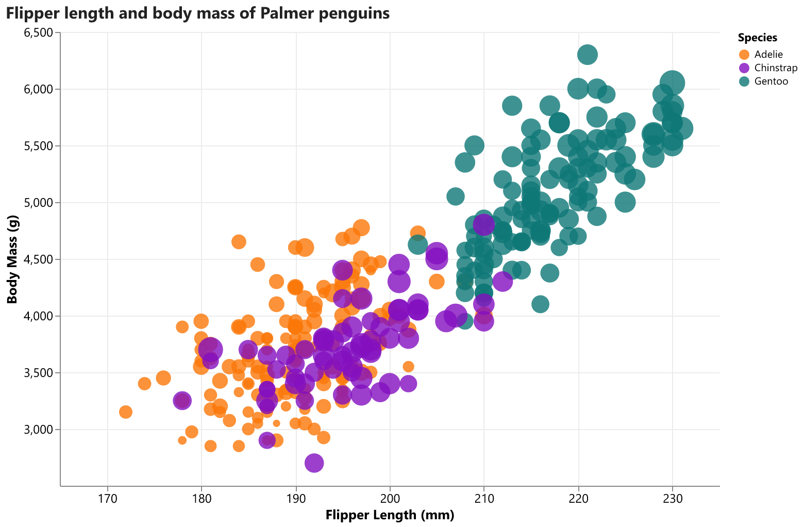
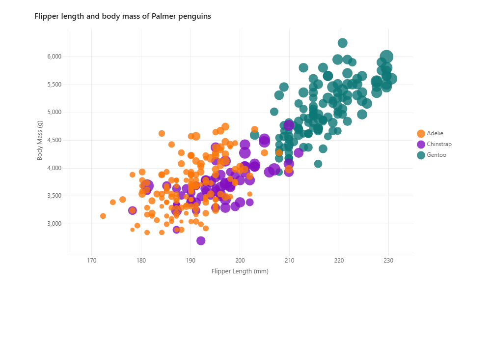
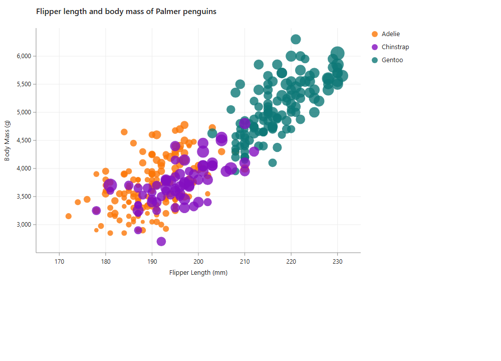
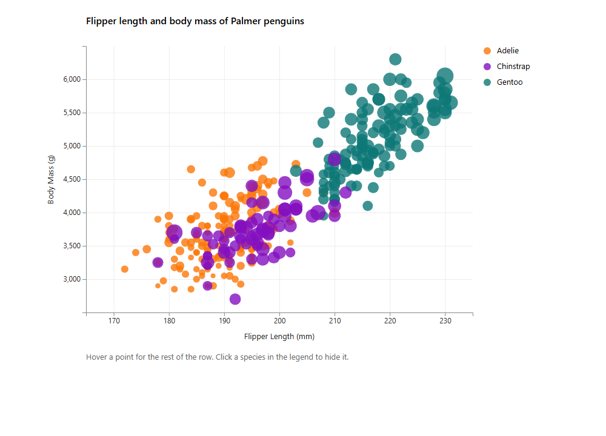
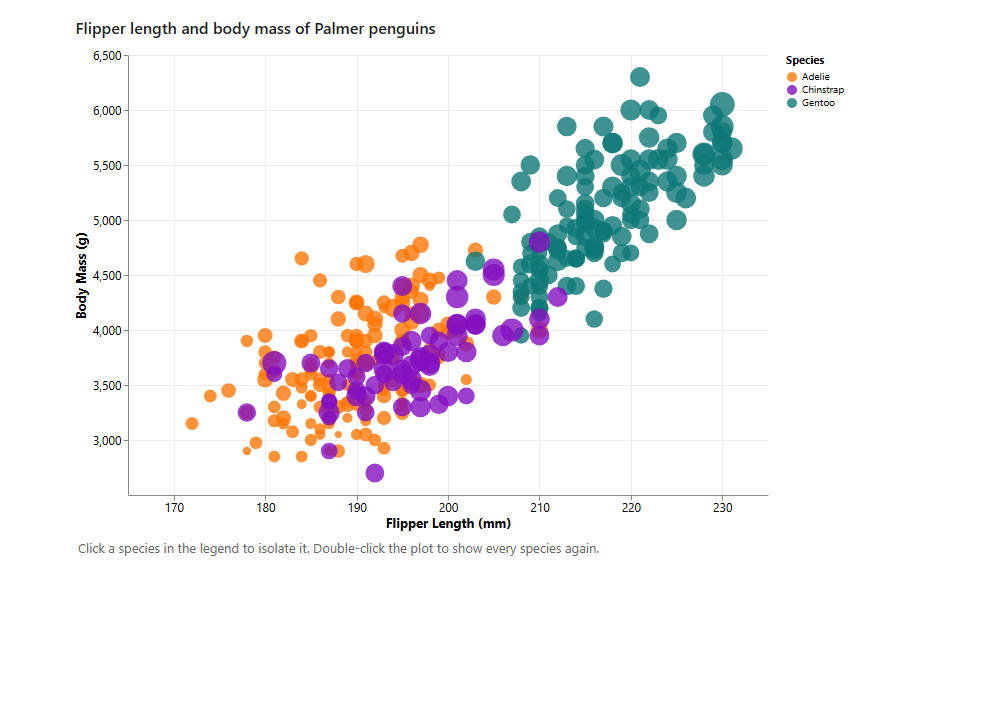

The three web pages load the CSV with `fetch` or `d3.csv`, so open them from a local server started in this folder:
NEED TO RUN THIS IN TERMINAL:               python -m http.server
Then visit the paths below. Opening the HTML files directly will not load the data.

# Palmer penguins, five ways
The same scatter plot, built once in each tool. Flipper length is on x and body mass is on y. Species sets the color. Bill length sets the circle size. Circles are drawn at opacity 0.8. Both axes start away from zero: flipper length runs from 165 to 235 mm, body mass from 2500 to 6500 g, with ticks every 10 mm and every 500 g.

`penglings.csv` has 344 rows. Two of them are `NA` for the measurements used here, so every chart plots the remaining 342. The species colors are taken from the reference chart rather than ggplot2's default hue scale: Adelie `#FB7708`, Chinstrap `#830FBF`, Gentoo `#0E7877`.

# Python + Altair
Altair was the smooth one. The chart is a list of encodings: position, color, size, opacity, and a tooltip. Dropping the `NA` rows is `to_numeric` plus `dropna`, and `scale.domain` keeps the axes off zero. Clicking a species in the legend isolates it; with nothing selected, every point stays at opacity 0.8.

The awkward part is output. Altair writes a Vega-Lite spec, not pixels, so `penguins.html` still needs the Vega runtime from a CDN, and the PNG export needs the separate `vl-convert-python` package. I would use Altair again inside a notebook, when I want a grammar-of-graphics chart and a tooltip without writing the scales by hand.

```
cd python-altair
pip install -r requirements.txt
python plot.py
```



# JavaScript + Chart.js
Chart.js draws this as a bubble chart on a canvas. Each species is its own dataset, which makes the color legend fall out of the library, and a tooltip callback adds island, sex, and bill length. Setting `min` and `max` on the scales is enough to keep the axes off zero.

Size was the hack. A bubble's radius is a pixel value named `r`, not a data scale, so bill length is mapped in code onto a radius from 4 to 14 pixels. I would use Chart.js for a small page that needs hover details and does not need a custom scale or SVG.

Library file: Chart.js 4.4.6, saved locally from jsDelivr. The chart code itself is in `main.js`. Open `http://localhost:8000/javascript-chartjs/`.



# Java
`PenguinPlot.java` uses only the JDK. It parses the CSV, skips non-numeric measurements, computes the same domains and the same 4-to-14-pixel radius, and writes `penguins.svg`. There is no chart library, so every tick, gridline, and label is a coordinate. That made the axis math obvious. It also means the hover tooltip is the browser's native SVG `<title>`, and the legend does not filter. Hovering a circle does add a dark stroke, which is as much interaction as plain SVG offers.

I would use this approach when a chart has to be one file with no dependencies. Java 17 or newer:

```
cd java
javac --release 17 PenguinPlot.java
java PenguinPlot
```

Open `java/penguins.svg`.



# d3
This is the version that spells the scales out. `d3.csv` loads `penglings.csv`, `"NA"` becomes `NaN` and those rows are dropped, then linear scales place the points. The SVG is built inside the `.then` callback. Building it earlier draws an empty chart, because the file has not arrived yet.

Hovering a point shows species, island, sex, and all three measurements. Clicking a species in the legend fades it to opacity 0.08; clicking it again brings it back. Clicking the last visible species restores all three, so the plot cannot be emptied by accident. I would use d3 when the interaction is custom enough that a template chart will fight back.

Library file: d3 7.9.0, saved locally. Open `http://localhost:8000/d3/`.



# Vega-Lite
Vega-Lite is the fifth tool. The chart is the JSON document in `vega-lite/spec.json`: quantitative x and y with explicit domains, nominal color, quantitative size, and a legend selection. A short loader parses the CSV and passes the cleaned rows in as `data.values`. Vega's own CSV parser is a poor fit here because the first header cell is blank and the missing measurements are the text `NA`.

Clicking a species in the legend isolates it. Double-clicking the plot clears the selection. Empty selections match every row, so the default view stays at opacity 0.8. I would use Vega-Lite when I want the chart to be a spec I can diff and reuse, rather than a drawing procedure. The runtime files (Vega 5, Vega-Lite 5, Vega-Embed 6) are saved locally from jsDelivr. Open `http://localhost:8000/vega-lite/`.



## Technical Achievements
Every chart drops the two rows whose flipper length, body mass, or bill length is `NA`, and plots the other 342.
Points carry more than the three encoded fields. d3, Chart.js, Altair, and Vega-Lite tooltips add island and sex. The Java chart puts the same sentence in each circle's SVG title.
d3's legend toggles a species on and off. Hiding Chinstrap leaves its 68 points at opacity 0.08 and the other 274 at 0.8.
Altair and Vega-Lite bind a point selection to the color legend, so a click isolates one species and a clear brings the rest back.
Chart.js uses a tooltip callback because a bubble mark has no place to hang island and sex except on the data object.

## Design Achievements
One palette, sampled from the reference chart, so Adelie stays orange, Chinstrap purple, and Gentoo teal in every tool. The panel itself is white. The reference uses ggplot2's grey theme, which was not required.
One pair of axis titles, the same domains, and the same tick spacing. The frames do not start at zero, and there is enough padding that the circles at 172 mm and 6300 g are not clipped.
Bill length uses one size range. d3, Chart.js, and Java map it to a radius of 4–14 px. Altair and Vega-Lite encode size as area, so their area range is about 50–616, which is a 4 px radius through a 14 px radius. The size legend is left off so the plot stays about the trend; the color legend stays, because the species clusters are the thing the chart has to name.
Opacity is 0.8 on every mark, which keeps the Adelie and Chinstrap overlap readable. Gridlines are a light gray, and the type is Segoe UI.