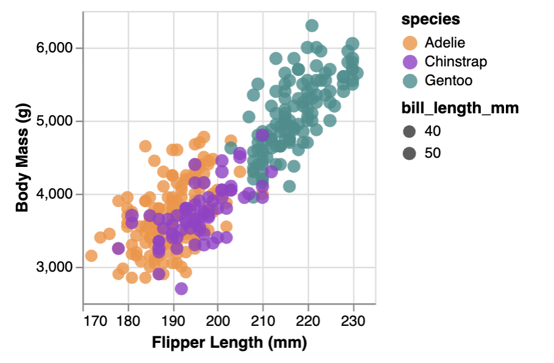

Assignment 2 - Data Visualization, 5 Ways  
===

# d3

This was on the more difficult side just because I'm not experienced with d3.js and Javascript as a whole, and I had to look up a lot of examples.
The main requirements of the scatterplot were met.

To visualize the penguins dataset, I had to extract each needed element from the .csv file with the d3.csv function, and create a conditional statement for rows that return null. I then had to specify elements such as margins, dimensions, the radius scale, the color scale. I also appended SVGs for the axes, data points, and labels.

Generally I found the process of working with d3.js tedious. While it seems to provide more freedom in how to display the scatterplot, I felt a lot of things had to be done manually. 

# R + ggplot2

With R and ggplot2, I used geom_point to create visualize the data with a scatterplot, and aes() to map visual properties to the points. I also created a vector with custom colors that correspond to each species.

Personally, I found R and ggplot2 the most convenient method so far.

# Vega-lite

Because I am using VScode as my IDE, I had to install the Vega Viewer extension to view my scatterplot. Vega-lite has a pretty different approach compared to the other methods I did so far, since I need to create my scatterplot using a .json file.

The "encoding" was mainly where I customized the scatterplot. I found it fairly simple and quick to do so.

The only notable adjustment I had to make was the offset between the numbers and symbols in the "bill_length_mm" section of the legend.