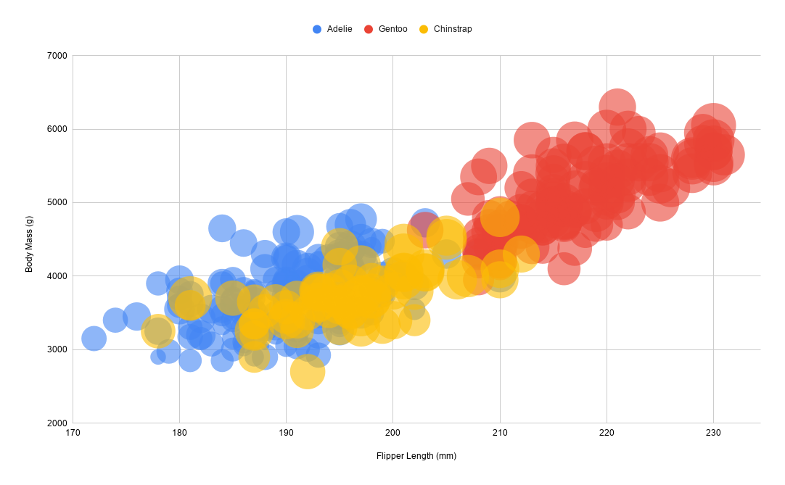
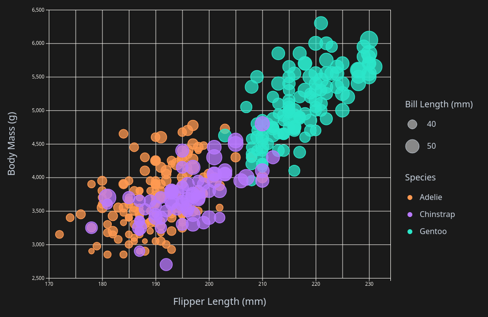
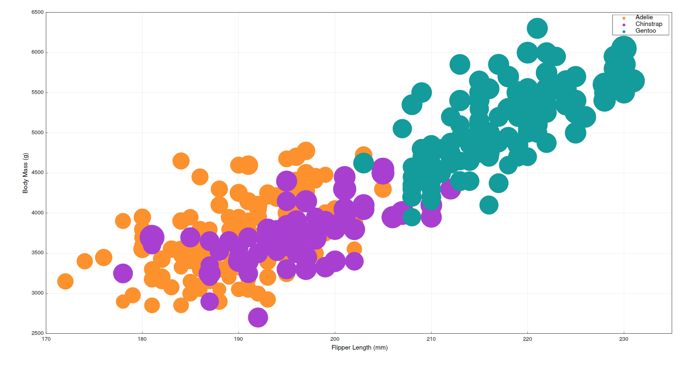

# Assignment 2 - Data Visualization, 5 Ways

## Google Sheets

Google Sheets was very quick and easy to set up, only requiring me to create a bubble chart and select the corresponding data columns I wanted to display. It had significant shortcomings, however, as Google Sheets does not provide a method of scaling the bubbles, making each data point bleed together. Additionally, I could not find a way to make a legend for the sizes of the bubbles, making it entirely unclear what data they represent. I would probably not use this tool in the future, at least for creating a bubble chart.

## Excel

Excel was a hassle to use, due to how buggy the web client is. Selecting a range of cells would not work for inputting data for whatever reason, so I was forced to manually type out the data ranges for each category, and it would often clear what I had typed if I ever tried to edit it. When I finished, I realized that the NA rows were confusing the plot and causing them to be plotted incorrectly and had to clean them out. I was able to change the bubble sizes to a more reasonable size but there was still no option to add a legend for the bubble sizes. I will not be using Excel for this purpose again.  

## D3.js

D3.js took a lot more time to get off the ground, but produced a much better result than Google Sheets and Excel. I based my code off the example seen [here](https://d3-graph-gallery.com/graph/bubble_template.html), making some changes to more closely fit the original image. I am much more experienced in code than spreadsheet manipulation, so this may be expected, but I found this process to be much easier than working with spreadsheets. The only real hiccups came from extending the example so I could lay the Y axis label on its side, which was done by putting the plot in its own group. D3.js has me much more willing to use it again in the future.

## Altair

Altair was very quick to set up. Unlike D3.js, Altair provides a function that when given the data as parameters will simply generate a plot. This simplicity is nice, but the result is not quite as similar to the original as I was able to do with D3.js. While I'm sure if I looked at the settings more I could create a plot that more closely matches the original, I decided that this was good enough. I would use Altair again in the future.

## Matplot++

For a C++ library, Matplot++ was suprisingly easy to get up and running. The most difficulty I had was parsing and cleaning the data, as I didn't use a library for that and had to read it value by value using a filestream. The resulting plot was not perfect. Matplot++ does allow for bubbles to be transparent, so this graph does not satisfy the requirements/ Additionally, Matplot++ is built off of gnuplot, meaning it is probably better to generate a plot using that instead, as the data already exists. I would probably not use a C++ library for this purpose.

## Technical Achievements
- Recreation: Recreated the example plot extremely closely in D3.js
- Interactivity: Created an interactive chart in Altair

## Design Achievements
- Dark mode: Designed an alternate palette for D3.js that is easier on the eyes