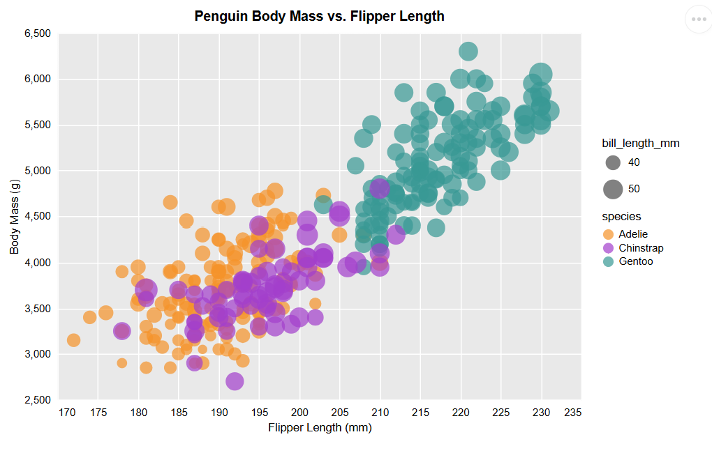
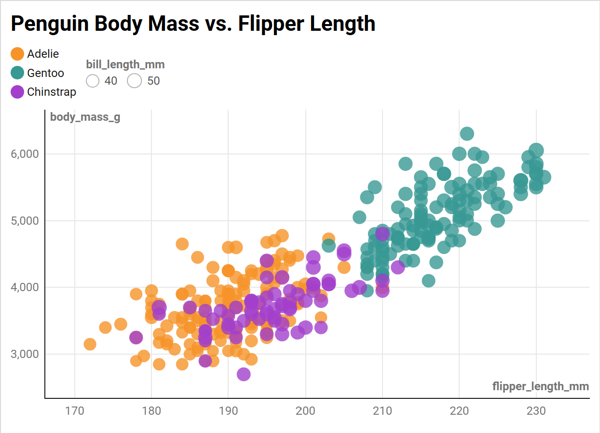
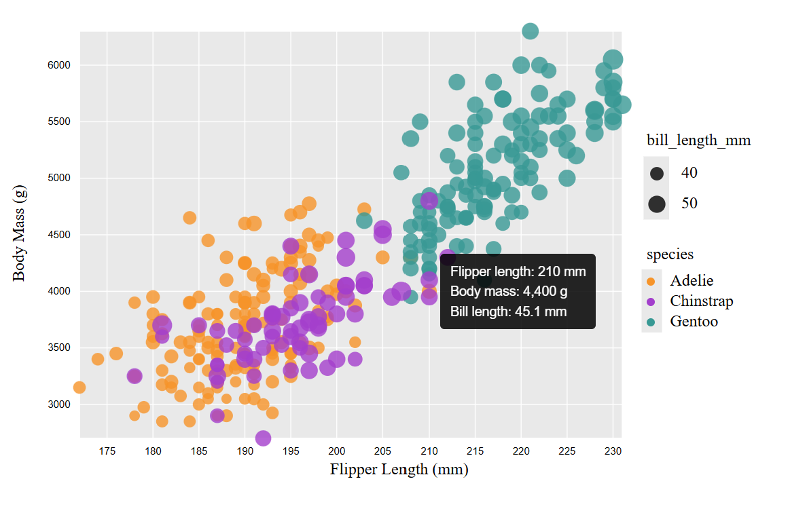

# d3 + JavaScript
d3 is a free JavaScript library used to create data visualizations in web browsers. To create the penguin visualization, I created a plot svg and added the necessary elements, such as axes titles/labels, legends, color mapping, size mapping, to it. 

While d3.js gives you a lot of control over individual elements of the graph, it requires many lines of code and location specifications.  

For this graph, the font differs from the reference graph.

  

 

# R + ggplot2
ggplot2 is a free R package used to create visualizations that allows you to build graphs step-by-step using data, aesthetic mappings (aes), and geoms (geometric objects). 

I found that this library was much easier to use than d3.js because the ggplot function allows you to add chart elements all at once, instead of building upon an svg. This software was also the same one used to create the reference plot given, which is why it was easy to match the required elements. Specifically, adding the gray background to the chart and legend was simpler than other software because it was a built-in theme that could be set, whereas in other software it had to be manually built by creating rectangles. 

I also used R packages (tidyr and dplyr) to clean the csv data and remove NA values. 

 

# Vega-Lite

Vega-Lite uses JSON specifications to create data visualizations. It is similar to R's ggplot2 because both are declarative and based on the grammar of graphics. Data fields are mapped to physical properties. The code is created in an .html file and rendered as a webpage. 

I thought that writing this code was much easier than d3.js and on a comparable level to ggplot2. I liked how each attribute of the graph, such as x-axis, y-axis, size, and color was a separate entity that could be altered. Even though I had to specific the x and y location of the bill length and species legend, it was easier to do so in Vega-lite than d3 because only an extra line needed to be added to the size and color fields.

Vega-lite also automatically disregards NA values, so the csv did not have to be cleaned. 

This graph differs because the x-axis shows increments of 5 instead of 10. The x and y axis titles are also smaller.

 

# Python + Vega-Altair
 Vega-Altair is a Python visualization library that is built on Vega-Lite. 
 
 Similar to Vega-Lite, each attribute of the graph is controlled by assigning it equal to data. I followed a similar workflow to Vega-Lite when creating this graph. The data had to be transformed into a DataFrame in order to create the graph, so I used pandas to do so.
 
 The graph is rendered as an .html file and displayed on a webpage. The program has to be run after every edit in order to update the .html file, which prolonged the process a bit.

 

# Datawrapper
Datawrapper is a browser-based data-visualizatio platform that turns data into graphics without coding. It supports multiple charts, maps, and tables. 

Using this website allowed me to create the following graph in less than five minutes. No code was required. The website prompts you to make a visualization through five steps. First, I uploaded the data as a csv. The next step allowed me to check and describe the data. The third step built the graph. You can select what column goes on the horizontal and vertical axes, customize the point color, change the opacity and map the size to bill length. However, there was less customization available. I couldn't change the background color of the chart or position the legend to the right. The circle sizes look quite similar and there is no option to change the scaling. The axes labels are at the edges of the chart and you cannot change boldness. 

## Technical Achievements
- **Interactive Element**: When you hover over points, the body mass, flipper length, and bill length is displayed (see below). I was able to do this in d3, Vega-Altair, and Vega-Lite, but Datawrapper did not have this feature and the library needed for this task in R was not downloading.

 

- **Mapped Data to Visual Properties**: Encoded flipper length and body mass as axes, species as color, and bill length as circle size
- **Configured Legends**: Altered legends so bill length displayed only 40 and 50mm circle sizes and arranged it above the species legend. 

### Design Achievements
- **Added Graph Title**: I added a title, 'Penguin Body Mass vs. Flipper Length' to the chart 
- **Used a Consistent Color Palette**: Used the same colors across all graphs for Adelie, Chinstrap and Gentoo penguins.
- **Plot Background Styling**: Changed the plot background color to light gray and added white gridlines.