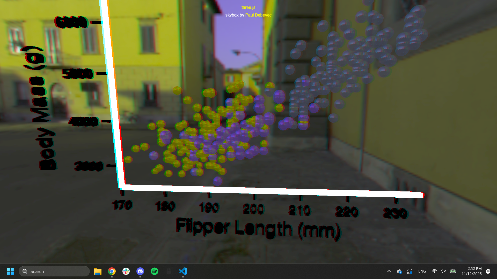
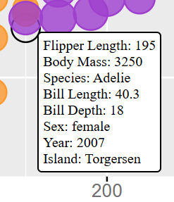

Assignment 2 - Data Visualization, 5 Ways  
===
# d3

d3 is a JavaScript library intended for data visualization. It is built to be low-level in order to provide flexibility in the types of graphs people can make on it. The name "D3" is an acronym for "data-driven documents". Source: https://d3js.org/what-is-d3

I think the easiest part of this was just modifying to get the right properties after adding all of the elements. Once the data points were on the screen, it was pretty easy to change their sizes & opacity. I'd say the most difficult part was just learning how to add axes + gridlines. Also, I forgot about that d3 needs to wait for data to load, so I got confused for a while about why there weren't data points on my screen. I didn't really add the legend through any sort of legend tool, just added shapes to make up the legend - same with the background color. I could see using this tool in the future, potentially for my MQP as I will be making a data visualization tool.

To run: navigate to the main directory and enter python -m http.server, then go to localhost:8000/d3/

# R + ggplot2

R is an open source language/environment intended for both statistical computing and graphics. It was built on the S language, and even some code in S is exactly the same in R. Source: https://www.r-project.org/about.html 
ggplot2 is an extension for R, intended purely for creating graphics. Source: https://ggplot2.tidyverse.org/

This tool was by far the easiest, although the syntax was quite confusing as I'd never used R before. However, once I made the plot, it was pretty much the same as the original example image since that was made in R + ggplot2. The main difficulty came from adding linear scaling to the plot by diameter instead of the default of scaling by area, as I had to figure out how to create custom scaling. It would've been easiest if I had kept the original scaling, but that would make it much harder to apply to other tools.

There's a good chance I'll use R in the future as it's common in computational biology, but I can't say I liked the format. It felt weird just building from a base plot and adding things to it. I didn't really have to use any hacks to get the right chart since the original chart was already made using R + ggplot2.

To run: install R, run from main directory

# Python + Jupyter + Matplotlib

Python is a very well-known open source programming language intended to be easy to learn and fast. Source: https://www.python.org/
Jupyter is an open-source project for Python that is intended for data science and other computing applications. Source: https://jupyter.org/about
Matplotlib is a Python library useful for multiple types of data visualizations. Source: https://matplotlib.org/

This one was probably easier than d3, mainly because it followed a very similar format and I could copy many of the variables used there, but it was certainly not as easy as using R. I've had the most experience doing data visualization using Matplotlib, so I thought this would be simple, but I had to use many different tools than I've been used to. It felt like each time I wanted to make a simple change I'd have to look up the syntax to do so with Matplotlib. However, I'm overall quite happy with how it turned out in the end, as it ended up closest to the original image.

I definitely would use this tool in the future, as it's pretty versatile and I have experience with using it. I'd say I had to use hacks to implement the legend, because although I was originally going to try using the built in Matplotlib legend, I wasn't sure if I would be able to replicate the same grey background squares with the correctly sized circles in the middle. So, I just manually added a bunch of shapes and text.

To run: install all required packages, run directly from the file through Jupyter.

# Python + Jupyter + Altair

Altair, also known as Vega-Altair, is a visualization library for Python, just as Matplotlib is. Source: https://altair-viz.github.io/

I was somewhat expecting Altair to be easier, primarily because it's also Python, but it was probably the most difficult tool overall. Altair is very simple if I just want a nice, easy chart, but to get it to meet the design achievements I was going for took a ton of effort. The worst part by far was trying to do the scaling properly, as looking for resources on this ended up suggesting a transformation on the data, but in Altair the legend is directly connected to the data so it would display inaccurately. I ended up figuring out how to use the scale to properly match the data to a quadratic area scaling, but I almost just gave up. I think another of the most annoying parts was when I realized there were no minor gridlines available in Altair, so I ended up just making two separate charts for x-axis and y-axis minor gridlines.  Padding the edges to create the correct image size was also annoying, but didn't take too long. I unfortunately was not able to preserve the nice gray background behind the circles in the legend, since Altair does not support drawing outside of the main chart. All things considered, I am pretty happy with what I was able to do in regards to the design achievements, as I was able to preserve nearly everything. 

I could see this tool being useful in the future if you just wanted to make a simple chart and not attempt to design it to perfectly match another chart. If you're trying to do the latter like I was, avoid Altair. 

To run: install all required packages, run directly from the file through Jupyter.

# Excel

Excel is Microsoft's spreadsheet tool for organizing data, creating plots, and performing analysis. Source: https://www.hp.com/us-en/tech-takes/software/explainer/what-is-microsoft-excel-used-for.html

I was in the mood for something significantly easier after Altair, so I chose Excel as my fifth tool. I'm not entirely sure why I thought it would be that easy, as although Excel is pretty easy to use for simple plots, it definitely wasn't made to copy specific styles. Luckily, it wasn't that hard either, just probably ranked close to d3 in difficulty making the plot. There's a handy bubble chart made for making different dots of different sizes, and I could just make a new series for each color, so those parts were pretty easy. I think some of the most difficult parts were just figuring out that I could do these things in Excel, as there isn't any sort of code and instead it just involved me searching through dropdown menus. I ended up doing a simple trick for the y-axis, as Excel doesn't allow for custom y-axis labels, so I just made a new series at the y-axis and put data labels to the left of it. Excel's axis limits do also mean that I couldn't place the major and minor y-axis where I wanted to, so instead every line is a major line, which does go against my design unfortunately. Excel also doesn't allow custom tick marks, so I put short lines at each tick manually. Finally, the legend is also something Excel doesn't really style all that well, so I just made the legend out of various Excel shapes. I would absolutely use Excel again as it is useful for editing CSVs and making simple charts while working directly with the data, but if I had a very specific visualizaiton in mind, I wouldn't use Excel. 

To run: open file in Excel.

# three.js + Papa Parse

three.js is a JavaScript 3D library intended for use across multiple browsers. Source: https://github.com/mrdoob/three.js/
Papa Parse is a CSV parser for JavaScript, which I used to load the penglings.csv file. Source: https://www.papaparse.com/#local-files

I somewhat thought this would be quite hard to do, as it's the one mentioned in the README as being not recommended. It was definitely something to get used to, but I think my experience in developing for 3D helped with making this much easier to do. Also, due to loading the CSV through a separate library that mostly translated it to a normal data structure, it was easier to modify than the other libraries which attempted to handle the csv data themselves to make the plot. I think for making simple charts, that method of data handing is better, but for my purposes in this assignment, it's far easier to deal with the CSV as a normal data structure, since I can customize each point just through code. The only difficult part of doing this in three.js was the imports, as I had to figure out what a CDN was and how to use it in my project.

I would use this library for making things interactive in 3D, but a scatterplot is probably the worst use of this. It's kinda fun to mess around with, but the data is simply not presented in an effective manner. I also built off of an example with a camera effect, so that's there now making the data blurrier. The only real "hack" I had to do was just making rectangles for the axes and ticks, although that is to be expected since it's not like three.js has a built-in scatterplot tool. 

To run: python -m http.server in the main a2-kjhitt-keagan-hitt folder, then go to http://localhost:8000/three.js/

## Technical Achievements
- **d3**: 
    - Added tooltips in d3, showing up when you hover over the data points to display information about each one.
Followed guide for tooltips: https://d3-graph-gallery.com/graph/interactivity_tooltip.html

- **R + ggplot2**:
    - Added custom linear scaling of the radius to avoid ggplot2's default area scaling.
    - Added the ability to save as svg through svglite package. Can add "ggsave("img/r.svg", width=1700, height=1050, units="px")" to do so - svg displayed here:

- **Python + Matplotlib**:
    - Imported Rectangles and Ellipses to create the legend.
    - Converted diameter in pixels to area in "points" to create a linear diameter scaling. 
- **Python + Altair**:
    - Utilized custom legend ranges & orientation w/ alt.Legend() to achieve the desired R + ggplot2 effect.
    - Figured out how to do a quadratic scale of circle size based on flipper length w/ alt.Scale(). 
    - Layered multiple charts to achieve the desired minor gridline effect.
    - Chart is interactable! Can move the chart and zoom in/out. 
- **Excel**: 
    - Used Visual Basic for Applications (programming language for Office applications) to resize the chart area + add the proper margins.
- **three.js + Papa parse**: 
    - Used a library designed for 3D applications to make a scatterplot, in addition to the required five libraries/tools. 
        - I did not apply my design achievements to three.js (other than color choice), as it was primarily intended as a technical showcase and more of an "extra" scatterplot than anything else.
    - You can look around in a 3D environment!
Built on example code: https://github.com/mrdoob/three.js/blob/master/examples/webgl_effects_anaglyph.html

### Design Achievements
- **Consistent color choice**: Consistently used the same colors (purple #9f3fce = Chinstrap, orange #fc992f = Adelie, cyan #219292 = Gentoo), as picked from the original image in the assignment:

- **Consistent element size, font choice**: Element size also measured directly from the original image - 50mm is a 41px diameter circle, 40mm is a 32px diameter circle, so the ratio is about 0.8px/mm. There seems to be some sort of non-linear scaling, because the point at (188, 3050) in the example is far smaller than it should be, but I chose to do linear scaling for each point by diameter. Font identified as Arial, 26px tall for axes & 21px tall for axis labels. I've attached images to show where I got my measurements from, but a summary of all measurements that I kept consistent:
    - Size Mapping: 0.8px diameter circle per 1mm bill length
        - 2px outline for each circle w/ 100% opacity compared to the 80% opacity fill
    - Font: Arial, 26px for legend & axis labels, 21px for smaller axis labels & legend labels
        - Axis label font color: #707070
    - Image size: 1700x1050
    - Chart size: 1200x900
        - Chart margins: 150px left, 350px right, 50px top, 100px bottom
    - Legend Placement 
        - bill_length_mm is at (1400, 250) and species is at (1400, 490)
        - each gray square behind the dots in the legend are 56px by 56px
        - the dots for species each have a 8px diameter
        
50mm circle:

Overall measurements:

Overall, this design achievement was by far the hardest part of this assignment, and I likely should have done something much easier. At least it worked!
- **Background Grid + Legends**: Not part of the assignment requirements, but I kept them for each library/tool. Background color is #ebebeb, grid lines are white (2px for major gridlines and 1px for minor).
- **More about tools in README**: This was on the Canvas rubric as an example design achievement, so I wrote a bit about each tool by visiting their websites and finding out what the purpose of each was.