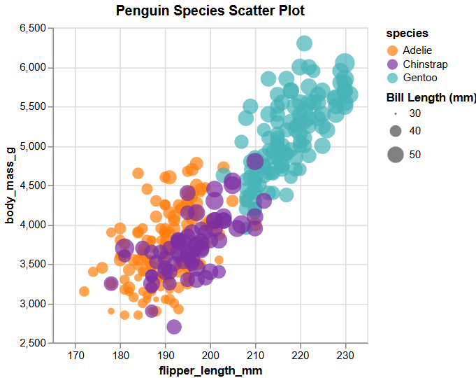

# Anna Towne

## D3
The graph in D3 was done entirely in javascript. It is a popular library that we had experince with last assignment. 

To visualize the dataset I used the svg that can be created with d3 and from there added axises, grad lines, the circles, and a legend by hand. I found that just straight d3 took the longest to use and was the most exact, I had a harder time with the axis labels on this one, they are there but very faint. This had the most customizaiton of all of them however you had to know the exact syntax and with trying not to use AI it wasn't always easy to find exactly what I was looking for. 

I used a documentation and example code from 3 different sites but all were mainly used for understanding syntax. I decided that for this graph I wanted to be able to see the difference in bill length better so the difference in size of the circles is mapped to a larger span to allow viewers to see a more drastic comparison.

## Altair
It is a Python library that is pretty easy to use. Documentation is fairly good, when you want to change things from the basic it gets a little more complex with knowing what funcitons can go in what but overall it made customization pretty easy. 

Also it is super easy to add a hover to get the exact stats of the penguin you are looking at. You can even add things that arn't apart of the visualizaiton like male/female. As long as it is in the dataset. This was one of my favorties to work with for the graphing libraries. 

## Flourish
Flourish was not a library so much as a really easy to use website that makes graphing super simple. You pick from a much of different graph options, upload your csv, decide which data columns are which part of the diagram, and then can further customize from there.

This was the quickest one to make, no code which was sad but I can see why it is so popular. While there were a TON of customization things, font alignment, size, colors, shapes. And tons of templates for many different graphs, because it is a site and not code that the user can manipulate down to the pixel, there are limitations. For example, I couldnt put the legend on the side of the graph, had to be on top. And I couldnt get a legend for the bill length. I also couldn't excentuate the differnce in bill sizes like in D3. 

## Plotly
I have used plotly before but it made the graphing process super easy, the documentation is clear and there is a ton of overhead making it a little more complicated to customize. However it makes it really easy to just get a graph with the basics of what you want. It is all in python, and when working with python pandas makes it super easy to clean the data.

Also, while custimization is a bit more complicated, their documentation is incredible and they have a search bar on the side for most things. And if you don't know the exact wording to look it up on the site, I found googling it with plotly documentation sends you to the right area to find the documentation you need. 

Lastly, while there is not a legend on the side for bill length, they are size differently based on size. Also, when you hover over the points it will tell you the exact size.

## ggplot2 (R)
This was done in R, honestly the hardest part of this grpah was downlaoding R and getting the kernal to connect to the jupyter notebook. Overall the data processing in R was super easy, and the graph creation with ggplot2 was simple. It was fairly simple and auto did a ton of features like background grid, truncating the axises, and the legend with both size and species was super quick. This was probably the easiest to do and get close to the original (which makes sense since it is in the same language and graphing library).

---
### Technical Achievements
- some of my graphs like altair and plotly have hovers to show the exact data values
- Got to play around with many different libraries and I worked with JS, Python, and R

#### Design Achievements
- made the difference in bill size more noticable to the viewer like in d3 and my ggplot2
- on my plotly I decided to color the penguins differently, I feel like the vibes match better, can't explain just is
- for the flourish graph I got to use a theme which changes background color, font theme, and overall mood of the graph
    - This application would be super easy for anyone to figure out, especially if you arn't used to code you can still make visualizaitons to show your findings

#### Resources Used
- D3 documentaiton
    - Used as base code for d3, overall basic syntax of graphing with d3 was learned from this / documentation
    - https://observablehq.com/@d3/scatterplot-with-shapes
    - https://d3js.org/what-is-d3
    - https://d3-graph-gallery.com/graph/custom_legend.html
- Plotly documentation
    - https://plotly.com/python/line-and-scatter/
- Altair documation
    - https://altair-viz.github.io/user_guide/api.html
- Flourish
    - no documentation just their site
    - https://app.flourish.studio/projects
- ggplot2
    - https://www.rdocumentation.org/packages/ggplot2/versions/0.9.0/topics/ggplot
