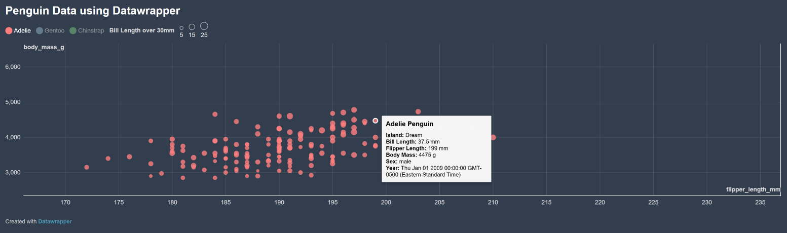

Assignment 2 - Data Visualization, 5 Ways  
===

Creating visualization of a dataset can be done trhough various means. As part of this WPI CS4804 Data Vis course, we had to represent the same dataset using 5 different methods. 

The dataset used is included in this repo as penglings.csv. 

The following was kept as close to the same as possible between all visualizations.
- Data positioning: it should be an upward-trending scatterplot as shown. Flipper Length should be on the x-axis and Body Mass on the y-axis.
- Reasonable scaling
- Axis ticks and labels: both axes are labeled and there are tick marks at a reasonable interval
- Color mapping to species.
- Size mapping to Bill Length.
- Opacity of circles set to 0.8 or similar for a semi-transparent effect.
- (**DESIGN ACHIEVMENT**): dark theme to all graphs, reasonable circle sizing, similar species color throughout.
- (**TECHNICAL ACHIEVEMENT**): Interactive tooltips on all graphs

Below is every visualization tool used, along with some basic info on them and my experience using them.

# Altair
I love Altair now <3

Altair is a declaritive visualization library for Python where you declare exactly what you want to be shown in the graph generated. Altair was quick and easy to use for me while being very fun. It is very well documented and offers a lot of creativity/liberties to the user. There is little setup needed, besides downloading the appropirate libraries, unlike some other visualization tools (DATAWRAPPER!!!!), size scaling is formatted automatcially to be based on the actual variation in size rather than total size (ie: scaling is updated to be visual/user friendly automatically). Similiarly, Altair autofilters incomplete data. Altair offers many ways to save and load your graph including saving it into an HTML file. Overall, it is really fun and easy to use!

For my design achievement of keeping reasonably similar sizing, color, and dark theme color across visualizations, Altair proved to be one of the easiest implementations with all functions having proper documentation.

As for my technical achievement of adding interactive tooltips across all visualizations, Altair was also one of the easiest implementations with the funciton alt.Tooltip() being incredibly powerful and easy to use. 

Starter code/inspiration used: 
https://altair-viz.github.io/getting_started/overview.html#overview

# R + ggplot2 + R Markdown

R is a language primarily focused on statistical computing and ggplot2 a very popular library for charting within R. Similiarly RMD (R Markdown) is a document format that compiles into an HTML or PDF while allowing R code to run directly inside it. Ggplot2's 'geom_point()' offers many functions for aesthics such as color, size, background and more. Similar to Altair, R and ggplot automatically filter out incomplete data and scale circle size according to variation between sizes rather than total size. Having prior experience with R + ggplot2 this came fairly easy to me and I did not have much issue with the main code/graph itself.

The design achievement of keeping the same color scheme, sizing, and theme across visualizations was easy to implement here. Ggplot has functions for colorschemes/themes so there was little issue here.

As for the tooltips I had to install a second package called plotly that allowed more tools for interactiveness in plots including tooltips. Ggplot intself cannot easily add tooltips on its own, so plotly comes in at the end giving the plot the  using the command ggplotly([ggplot name], tooltip = "[tooltip text]"). This was a little harder than other implementations as finding documentation was fairly hard and there are many lirbaries that offer a similar tooltip implementation, but after deciding on plotly, it turned out to be a fairly easy implementation.

# d3

D3 is a JavaScript library used to create interactive and customizeable data visualizations using HTML, CSS, SVG, and more. Unlike Altair and ggplot2, D3 does not automaitcally generate entire charts, instead the user has to manually define and place each element. While this does allow for more customization, freedom, and control over visualizations, it requires a lot mroe effort and a lot more code to implement. This was probably the hardest and longest to implement for me due to scattered documentation but it was not unreasonable. 

The design achievement was not too difficult as chaning the color scheme just involved using a css file for the background and documentation was found for the actual color scheme of the species itself.

Adding/figuring out tooltips was not fun, there is scarce information on how to implement this with the little sources that do exist all having vastly different and complicated implementations. After finally realizing that its implemenation was somewhat similar to typescript hover events and a LOT of trial and error I finally did get it to work.

Sources used for starter code/inspiration:
https://observablehq.com/@d3/line-with-tooltip/2
https://observablehq.com/@d3/scatterplot/2

# Datawrapper
The link below is the published website generated by Datawrapper of my created visualization.
https://datawrapper.dwcdn.net/qNoHV/1/

Datawrapper is a web-based data visualization that allows users to create and publish interactive charts, maps, and tables without needing to write code (similar to Tableau). However, it does offer an API and a Python package that allows users to program/code their custom visualizations. I chose to do the ladder, which turned out to be tricky to set up. I had to get a custom API key from the Datawrapper website. Just for saftey/practice I hid it in my .env file excluded from git and retrieved it using the python-dotenv package. Configuring the plot using python code was not that bad as the code was pretty straightforward and very customizable. Datawrapper does not generate/give an html upfront, rather it sends the generated visualization to your Datawrapper account where you can then publish itself yourself as its own website or embed it into other projects.

The set up was harder than the coding itself, and is very customizeable!

The design achievement was fairly straightforward for the color/theme as Datawrapper offers functions for these things. However, the sizing is where I ran into issues. Datawrapper scales size according to how har they are from 0 rather than how much each size scales between eachother. This means that not only are the sizes massive/overlap eachother, but you can barley notice the difference between them visually. To get around this I did have to manipulate the data a bit, I subtracted 30mm from all the bill lengths that way all the sizes scaled more reasonably to eachother. 

The technical achievement was fairly straightforward with very good documentation being offered and the code/functions being fairly understandable.

Starter code/documentation source used:
https://datawrapper.readthedocs.io/en/latest/user-guide/charts/scatter-plots.html

# Tableau

Tableau is a data visualization and analytics platform that allows users to create interactive graphs and dashboards. Unlike the other visualization tools used, Tableau does not require or offer programming to create visualizations. It is very accesible and easy to use however it does suffer from a lack of intricate customization. I used Tableau's public web editor for this assignment which is a little more restricted than the app version presenting some issues similar to datawrapper where I could not scale the sizes to a reasonable degree. 

The design achievemnt was a very similar story to datawrapper where the theme was very easy to change but for the reasonable size scaling, I was forced to manipulate the data (again subtracting 30mm from bill length), to make the sizes more reasonable. One thing to note is that I was not able to use custom colors/hex codes for color scheme so I was left to use their default colors. This means I did have to change my colorscheme here

The technical achievement/ooltips was extremely easy to add with it already being a built-in option that you can turn off/on and customize. 

## Technical Achievements
- **Tooltips**: More detail in each visualization description. I added interactive tooltips to each graph visualization I made upon the user hovering their mouse over a data point.
- **Outside packages**: More detail in each visualization description. Some implementations required other packages to properly implement and use. Mainly I used pathlib and panda in the python implementations to import the csv data, I used dotenv and os for the api key in datawrapper, and I used plotly for the tooltips in ggplot.

## Design Achievements
- **Similar Color Scheme**: I chose to have a simple and standard colorshceme throughout every visual, I used the colors below (or just red for Adelie, green for chinstrap, and blue for gentoo). Tableau for some reason did not let me use custom colors so I had to use orange red blue instead. I was too lazy/rushed to find documentation for how to change color for ggplot but thankfully it defaulted to the color scheme I went with.
        "Adelie": "#FF7F7F",
        "Chinstrap": "#90EE90",
        "Gentoo": "#ADD8E6"
- **Dark theme**: dark/gray background for all graphs to make it a little easier on the eyes and becuase I am a sucker for dark mode.
- **Reasonable/understandable size scaling**: I made sure the scaling was reasonable and visually different enough between all graphs, meaning I did have to manipulate some data to get around some technical limitiations.

### AI Use
- ChatGPT was only used for debugging my tooltip implementation in D3, everything else was done using the references and official documentation provided by each visual tool

