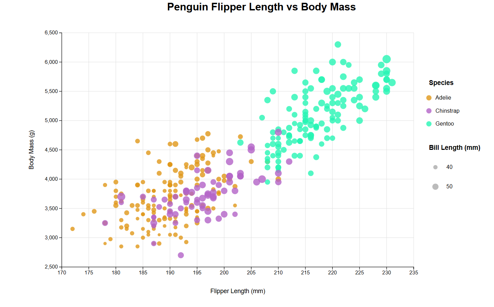
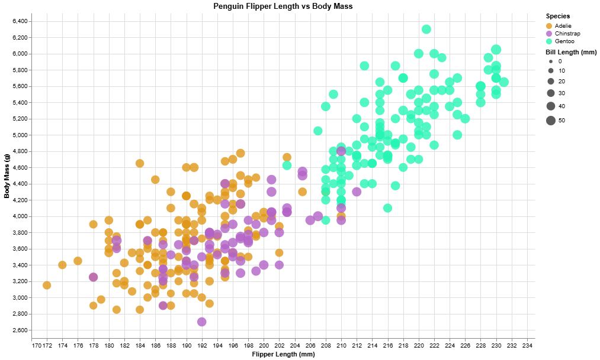
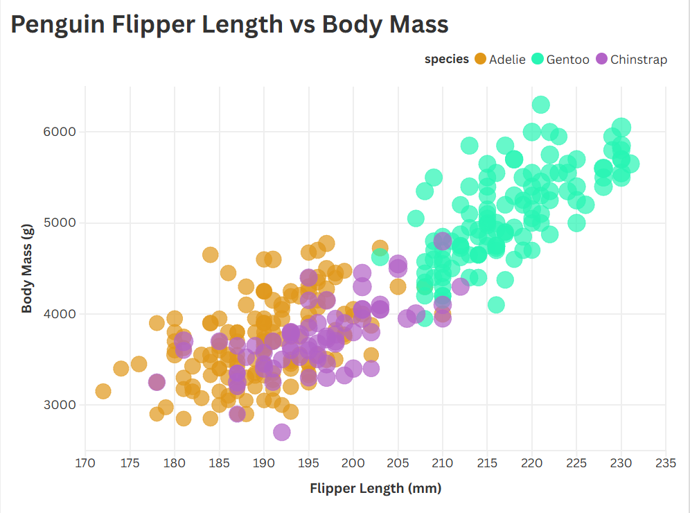

Assignment 2 - Data Visualization, 5 Ways  
===

Now that you have successfully made a "visualization" of shapes and lines using d3, your next assignment is to successfully make an *actual visualization*... 5 times. 

The goal of this project is to gain experience with as many data visualization libraries, languages, and tools as possible.

I have provided a small dataset about penguins, `penglings.csv`.
Each row contains a penguin observation and several variables about it, including bill length, flipper length, and more.

Your goal is to use 5 different tools to make the following chart:


These features should be preserved as much as possible in your replication:

- Data positioning: it should be an upward-trending scatterplot as shown.  Flipper Length should be on the x-axis and Body Mass on the y-axis.
- Scales: Note the scales do not start at 0.
- Axis ticks and labels: both axes are labeled and there are tick marks at a reasonable interval, e.g 10, 20, 30, etc.
- Color mapping to species.
- Size mapping to Bill Length.
- Opacity of circles set to 0.8 or similar for a semi-transparent effect.

Other features are not required. This includes:

- The background grid.
- The legends.

Note that some software packages will make it **impossible** to perfectly preserve the above requirements. 
Be sure to note where these deviate as you reflect on what a tool is good for.

Improvements are also welcome as part of Technical and Design achievements.

Libraries, Tools, Languages
---

You are required to use 5 different tools or libraries.
Of the 5 tools, you must use at least 3 libraries (libraries require code of some kind).
This could be `Python, R, Javascript`, or `Java, Javascript, Matlab` or any other combination.
Dedicated tools (i.e. Excel) do not count towards the language requirement.

Otherwise, you should seek tools and libraries to fill out your 5.

Below are a few ideas. Do not limit yourself to this list!
There are new tools coming out every year and we may not have an exhaustive list of the latest and greatest.

Some may be difficult choices, like Matlab or SPSS, which require large installations, licenses, and occasionally difficult UIs.

I have marked a few that are strongly suggested.

- R + ggplot2 `<- definitely worth trying`
- Excel
- d3 `<- since the rest of the class uses this, we're requiring it`
- Altair `<- hugely popular python library. highly recommended `
- three.js `<- well, it's a 3d library. not really recommended, but could be interesting and fun`
- p5js `<- good for playing around. not really a chart lib`
- Tableau
- PowerBI
- Vega-lite `<- very interesting formal visualization model; might be the future of the field`
- Flourish `<- popular in recent years`
- DataWrapper `<- popular in recent years`
- GNUplot `<- the former CS department head uses this all the time :)`
- SAS/SPSS/Matlab

You may write everything from scratch, or start with demo programs from books or the web. 
If you do start with code that you found, please identify the source of the code in your README and, most importantly, make non-trivial changes to the code to make it your own so you really learn what you're doing. 

Tips
---

- If you're using d3, key to this assignment is knowing how to load data.
You will likely use the [`d3.json` or `d3.csv` functions](https://d3js.org/d3-dsv) to load the data you found.

**Beware that these functions are *asynchronous*, meaning it's possible to "build" an empty visualization before the data actually loads. Figuring out how to do this properly can be a major hiccup if you haven't used async functions before. If this means you, start part of this project early so you don't end up in a rush!**

- `penglings.csv` has a few rows with `NA` values (two have no measurements at all). Filter them out before you plot (in d3, converting `"NA"` to a number gives `NaN`, which breaks scales and circle positions).

- *For web languages like d3* Don't forget to run a local webserver when you're debugging.
Same as A1: run `python3 -m http.server` in your repo folder and visit http://localhost:8000.
Being able to host a local webserver is an essential web development skill and very common in visualization design as well.

Readme Requirements
---

A good readme with screenshots and structured documentation is required for this project. 
It should be possible to scroll through your readme to get an overview of all the tools and visualizations you produced.

- Each visualization should start with a top-level heading (e.g. `# d3`)
- Each visualization should include a screenshot. Put these in an `img` folder and link through the readme (markdown command: ``.
- Write a paragraph for each visualization tool you use. What was easy? Difficult? Where could you see the tool being useful in the future? Did you have to use any hacks or data manipulation to get the right chart?

Other Requirements
---

0. Your code should be forked from the GitHub repo.
1. Place all code, Excel sheets, etcetera in a named folder. For example, `r-ggplot, matlab, mathematica, excel` and so on.
2. Your writeup (readme.md in the repo) should also contain the following:

- Description of the Technical achievements you attempted with this visualization.
  - Some ideas include interaction, such as mousing over to see more detail about the point selected.
- Description of the Design achievements you attempted with this visualization.
  - Some ideas include consistent color choice, font choice, element size (e.g. the size of the circles).

GitHub Details
---

- Fork the GitHub Repository. You now have a copy associated with your username.
- Make changes to fulfill the project requirements. 
- To submit, make a [Pull Request](https://docs.github.com/en/pull-requests/how-tos/create-pull-requests/creating-a-pull-request-from-a-fork) on the original repository, and put the link to your pull request in the A2 assignment on Canvas.
- Note: name your pull request using the following scheme: 
```
a2-your Gh username-your first name-your lastname
```

Grading
---

Grades on a 120 point scale. 
24 points will be based on your Technical and Design achievements, as explained in your readme. 

Make sure you include the files necessary to reproduce your plots.
You should structure these in folders if helpful.
We will choose some at random to run and test.

**NOTE: THE BELOW IS A SAMPLE ENTRY TO GET YOU STARTED ON YOUR README. YOU MAY DELETE THE ABOVE.**

# Name: John Porter

# R + ggplot2

For the R visualization, I used the ggplot 2 library to make a scatterplot based on the dataset provided to us. I used geom_point() to make circles and mapped species to color and bill length to size. Additionally, I customized the axis ranges, colors and transparency to match the visual we were shown. ggplot2 was relatively simple to use since the library provides functions that make it easy to map certain variables to visual properties for the scatterplot. However, some parts I found frustrating was the formatting and getting the legend to appear correctly. I think that R and ggplot2 is a reasonable choice to use in the fututre.


# d3

For the D3 visualization, I used javascript and the D3 library to create the scatterplot. I loaded the dataset using d3.csv as suggested in the assignment README and used D3 scales to position circles based on flipper length and body mass. Similarly, I used species for color and bill length for circle size. D3 was more challenging because of having to manually make SVG elements, scales, etc. instead of having built-in functions for these. Additionally, making sure the CSV data was loaded and converted properly made this the largest code file out of the five. Although, I can aknowledge the creative control that d3 gives the user makes it a useful tool to create things with more specific needs. 



# Altair

For the Altair visualization, I used python with Altair and Pandas libraries. I loaded the dataset using pandas and used Altair for the visualization components. Like previous visualizations, the different columns were assigned to their proper axes, colors, size, etc. Altair was one of the easier tools to work with due to the syntax making it easy to connect dataset columns to their proper visual components. Compared to d3, I didn't need to manually add each axes or other features. It was a little difficult to change the bubble sizes and formatting to look like the other charts, but I could definitely see myself using Altair in the future for the convenience and ease of use I had with it.



# Flourish

Link: https://public.flourish.studio/visualisation/30899242/




# Vega-lite


## Technical Achievements
- **Proved P=NP**: Using a combination of...
- **Solved AI Forever**: ...

### Design Achievements
- **Re-vamped Apple's Design Philosophy**: As demonstrated in my colorscheme...

# Sources:

Below is a list of resources I used to help get started on the different parts of the project:

- https://cran.r-project.org/web/packages/ggplot2/vignettes/ggplot2.html
- https://d3js.org/
- https://altair-viz.github.io/altair-viz-v4/getting_started/starting.html
- https://helpcenter.flourish.studio/hc/en-us/articles/8761582471439-Scatter-plot-an-overview
- https://vega.github.io/vega-lite/docs/data.html
