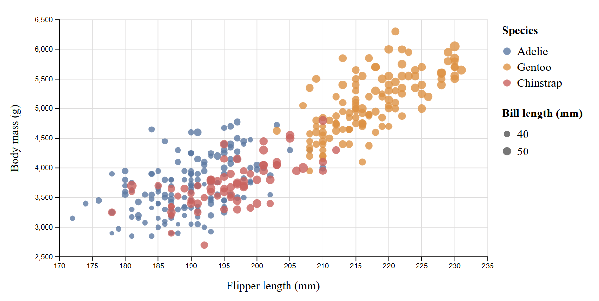
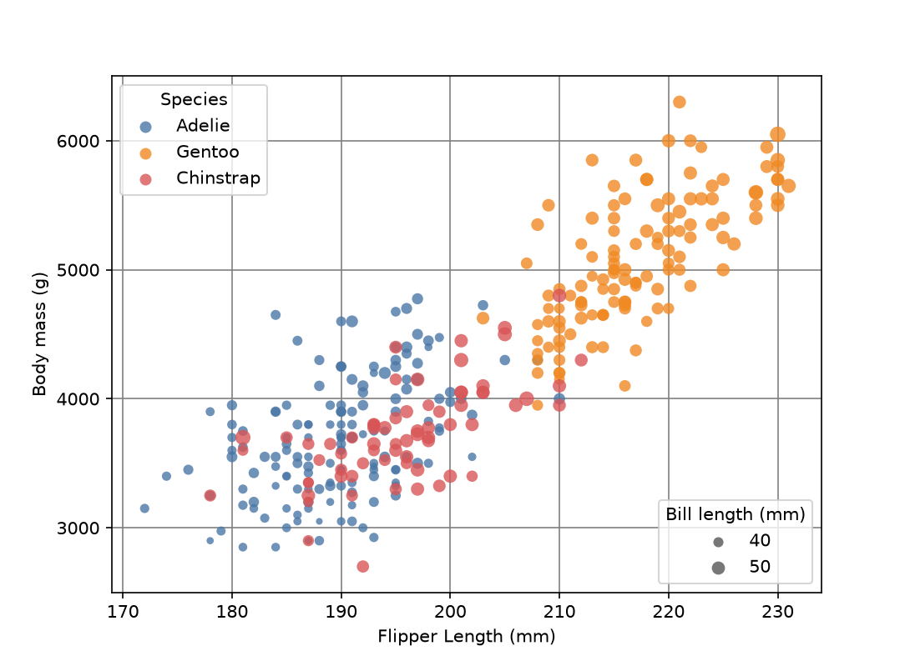
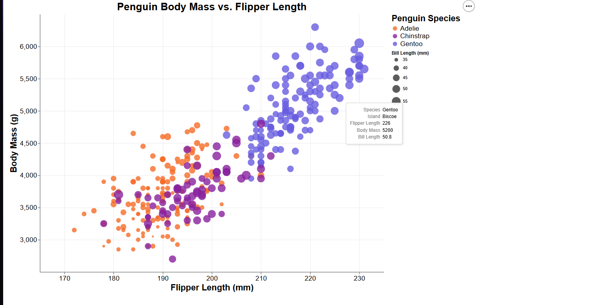
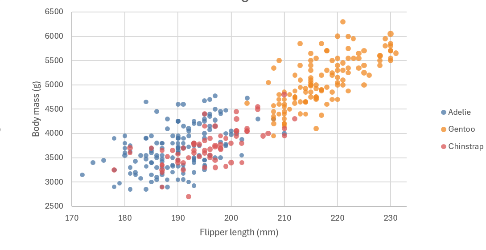
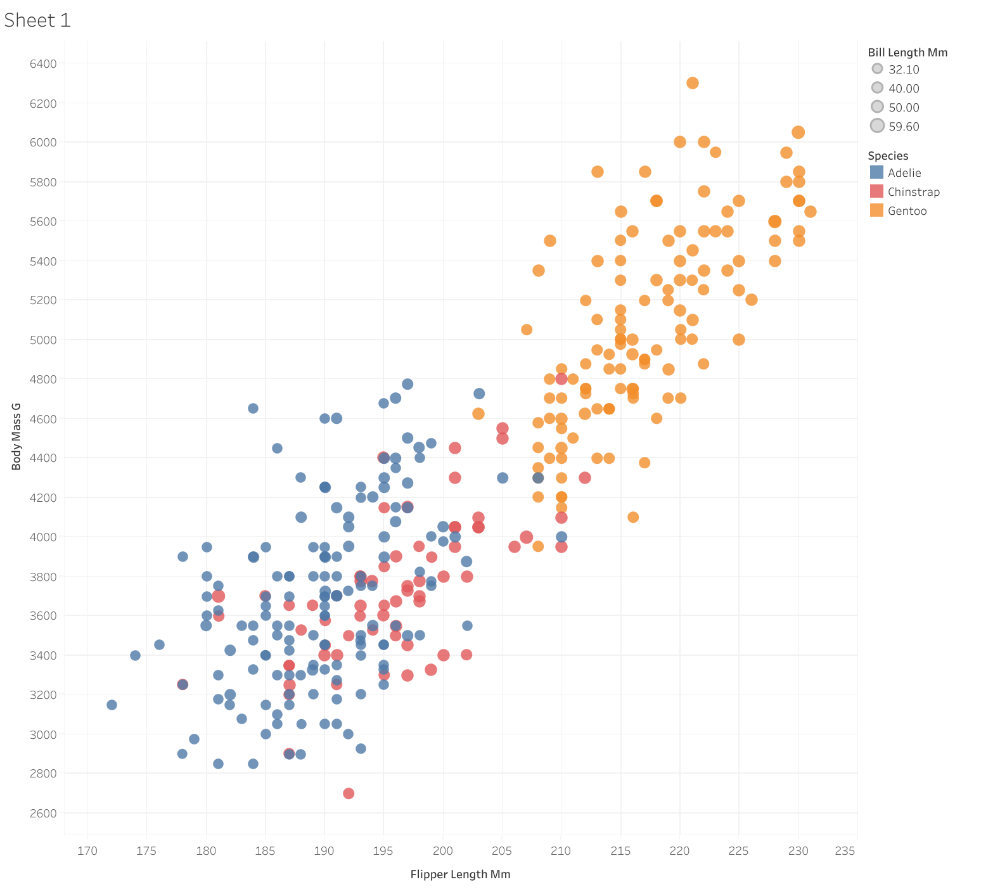

# Assignment 2 - Data Visualization, 5 Ways  

I created the same penguin scatterplot in D3, Matplotlib, Altair, Excel, and Tableau. Each chart has flipper length on the X axis and body mass on the Y axis. Each species is represented by its own color. Circle size is based on bill length. I skipped the rows that were missing measurements. The first columns is the location of each circle on the chart and then the bill length is how large each circle is.

I used the penguin data set and tried my best to make them look like the example scatterplot

# D3

For D3, I loaded in the CSV and got rid of the rows without measurements before creating the chart. The best part about D3 was the amount of control you have over placement, but this also took the longest to place the axes and legends. I also created a size legend to show the difference in size of circles of penguins with a 40 or 50 mm bill. I would definitely use it again if I really want or need precise control over everything.

To run it I ran a python -m http.server --bind 127.0.0.1 8000 and then opened the chart on the internet with http://localhost:8000/d3/

Loading CSV and converting measurements to numbers.
https://d3js.org/d3-fetch
https://d3js.org/d3-dsv#autoType

Addings circles, axes, and gridlines
https://d3js.org/d3-selection/joining
https://d3js.org/d3-axis

Position, color, and circle size
https://d3js.org/d3-scale/linear
https://d3js.org/d3-scale/ordinal
https://d3js.org/d3-scale-chromatic/categorical
https://d3js.org/d3-scale/pow

# Matplotlib

Matplotlib made it very easy to plot the measurements and add colors and size for each penguin. The part that took me the longest was figuring out how to put the two legends on the chart. I created a function that turns bill length into marker areas and used it for the points and the legend for size. I would use this again if I had to make some type of chart during writing python.

To run it, I installed matplotlib, and ran python matplotlib/scatterplot.py

Mapping CSV to a dictionary
https://docs.python.org/3/library/csv.html#csv.DictReader

Adding circles with color, sizes, and changing opacity
https://matplotlib.org/stable/api/_as_gen/matplotlib.pyplot.scatter.html

Gridlines and legends
https://matplotlib.org/stable/api/_as_gen/matplotlib.pyplot.grid.html
https://matplotlib.org/stable/users/explain/axes/legend_guide.html

# Altair

Altair was probably the simplest in my opinion as it was very easy to set the column names to what I needed. It was also really easy to add color and size because it seems like Altair already built the legends. I added pandas to load the CSV and get rid of the rows with missing measurements. And then altair to make the chart. I would use Altair again to make a interactive chart as it was very simple to initially set up.

For a new chart you would have to install altair and pandas and then run python Altair/scatterplot.py

CSV read and clean
https://pandas.pydata.org/docs/reference/api/pandas.read_csv.html
https://pandas.pydata.org/docs/reference/api/pandas.DataFrame.dropna.html

Scatterplot examples
https://altair-viz.github.io/user_guide/marks/point.html

Adding tooltip and html
https://altair-viz.github.io/user_guide/generated/channels/altair.Tooltip.html
https://altair-viz.github.io/user_guide/saving_charts.html

# Excel

I decided to create a 2D bubble chart, the hardest part what seperating the data. I used FILTER to keep rows with all of the measurements and a separate series to group each species. I also changed the bubbles scale because the circles overlapped and looked messy. Excel has a lot to just add without coding, and allowed me to control the legends and bubble size. I think the best use case for excel is obviously when the data is already represented in a spreadsheet.

This one was just opening it in Excel

Columns and filtering
https://support.microsoft.com/en-us/excel/functions/choose-function
https://support.microsoft.com/en-us/excel/functions/filter-function

Bubble chart, series, and bubble size
https://support.microsoft.com/en-us/excel/present-your-data-in-a-bubble-chart
https://support.microsoft.com/en-gb/office/change-the-data-series-in-a-chart
https://learn.microsoft.com/en-us/office/vba/api/excel.bubblescale

# Tableau

I used Tableau Cloud on the web, which was the easiest tool to plot charts. I simply dragged the measurements onto the Columns and Rows, put species on Color and bill length on Size. I just had to adjust the axes and fix certain things to show every penguin. Once everything was setup I was able to change the circle size and opacity. I would use Tableau again as it felt the most inituitive to work with.

To open it open it in Tableau Desktop

CSV and scatterplot
https://help.tableau.com/current/online/en-us/creator_connect.htm
https://help.tableau.com/current/pro/desktop/en-us/buildexamples_scatter.htm

Penguins, axes, colors
https://help.tableau.com/current/pro/desktop/en-us/calculations_aggregation.htm
https://help.tableau.com/current/pro/desktop/en-us/formatting_editaxes.htm
https://help.tableau.com/current/pro/desktop/en-us/viewparts_marks_markproperties.htm

Workbook
https://help.tableau.com/current/pro/desktop/en-us/export.htm

# Technical Achievements
- I added a hover tooltip to my Altair chart to look at the measurements. When you open the html you can hover over a circle to see the penguin's species, flipper length in millimeters, body mass in grams, and bill length in millimeters.
- In Excel I used FILTER to group the species to assign a color to each.
- In Tableau I had to turn off aggregation to show every penguin

# Design Achievements
- I used blue for Adelie, orange for Gentoo, and red for Chinstrap across all my charts so that you can see the difference in the charts and see the same species groups.
- I had to change all the axis ranges to spread out the data better.
- I changed scale and transparency per tool to fix the overlapping. I had to change the bubble scale to 8% in Excel and 25% transparency and tried to keep them consistent across the charts.
