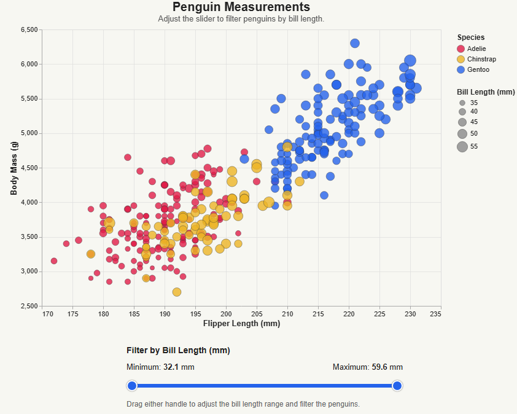
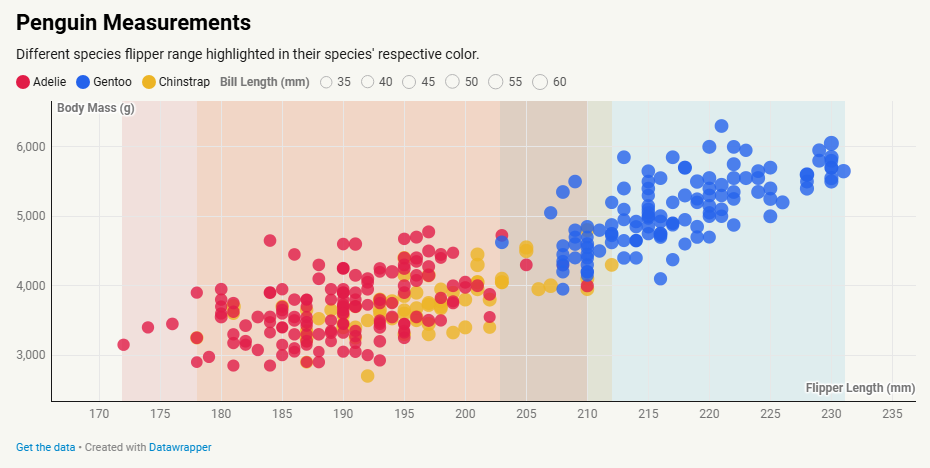
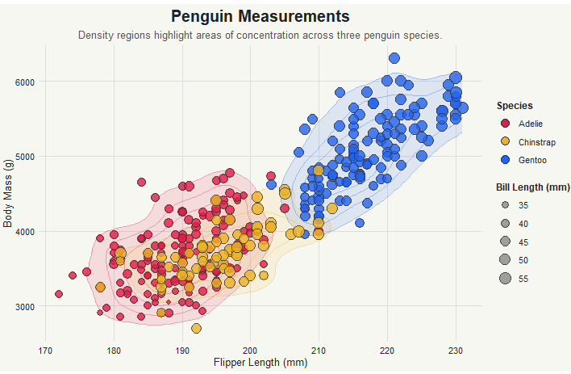

# JavaScript + D3.js:

You can view this for yourself via the `index.html` file in the `d3/` folder.

# Vega-lite: 

You can view this for yourself via the `index.html` file in the `vega-lite/` folder.

# Python + Altair: 

You can view this for yourself via the `index.html` file in the `altair/` folder.

# Datawrapper 

You can view this for yourself via the `datawrapper.html` file in the root directory.

# R + ggplot2: 

You can view this for yourself by running the `ggplot2_vis.R` file in the root directory.

## Technical Achievements:
- Added individual penguin measurement hover tooltips (D3.js)
- Added hover-based data point emphasis (D3.js)
- Implemented species-based filtering through a dropdown menu (D3.js)
- Created linked visualizations, so selecting a scatterplot region filters the corresponding histogram (Altair)
- Implemented a slider to filter penguins by bill length (Vega-Lite)
- Added interactive species selection (Datawrapper)
- Incorporated species-specific density region visualizations (ggplot2)
- Visualized each species’ flipper-length range with the highlight feature (Datawrapper)

## Design Achievements:
- Maintained a consistent color palette based on the modern scientific visualization color scheme
- Ensured consistent styling across all 5 tools, like data point sizing, opacity, and formatting (to the best of my ability)
- Used subtle data point outlines, gridlines, and neutral backgrounds to ensure the visualizations were easier to digest
- Used transparency and density regions to demonstrate data concentration (ggplot2)