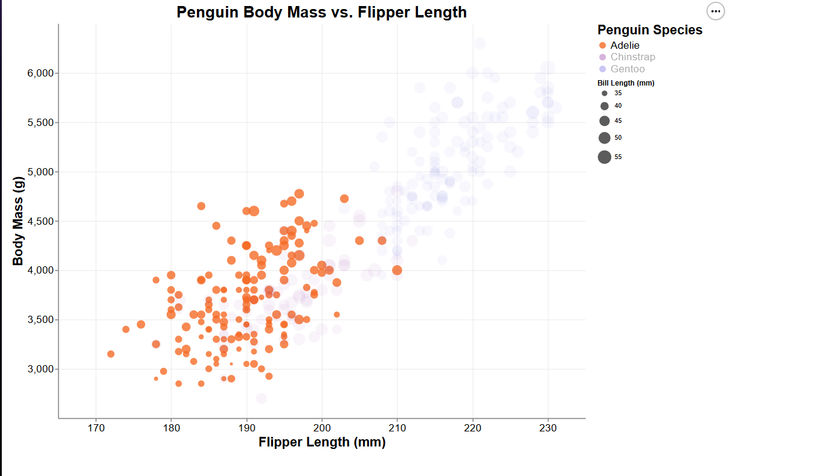
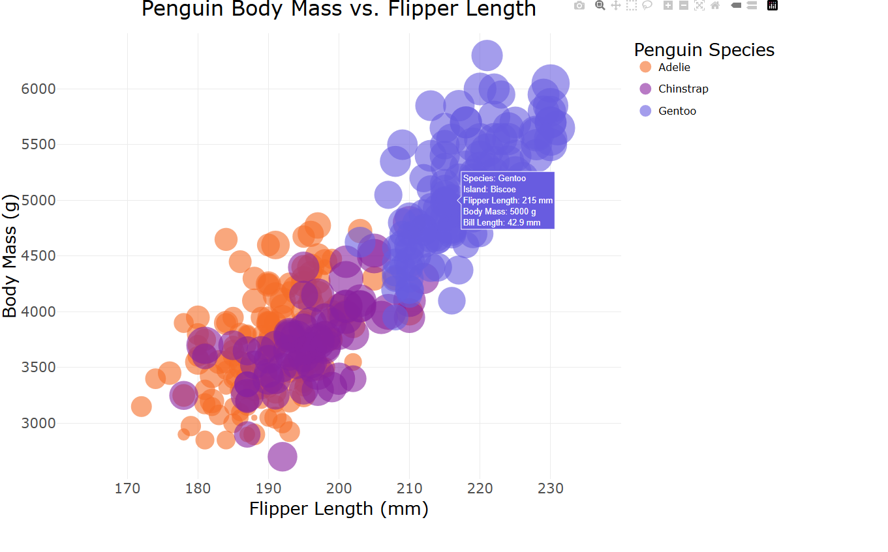
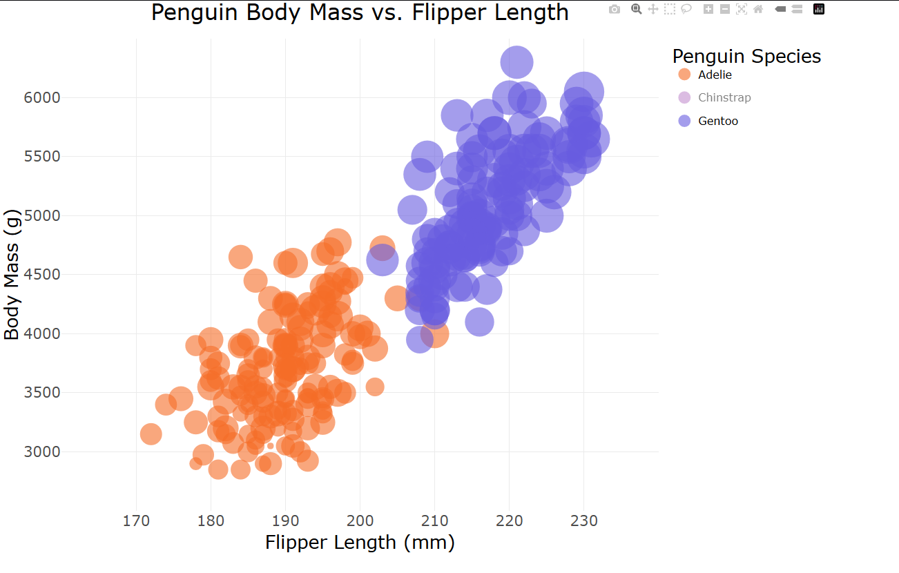
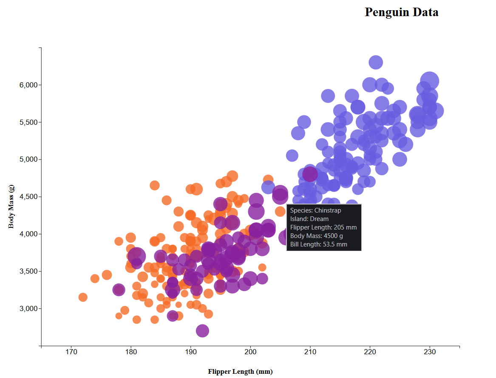
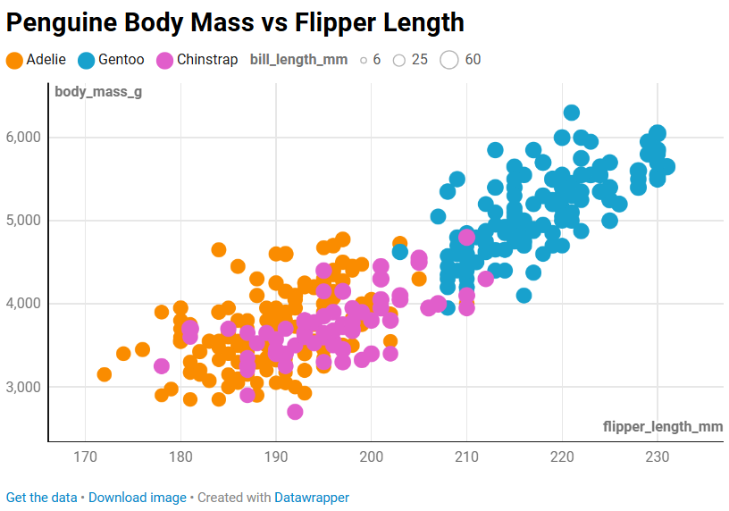
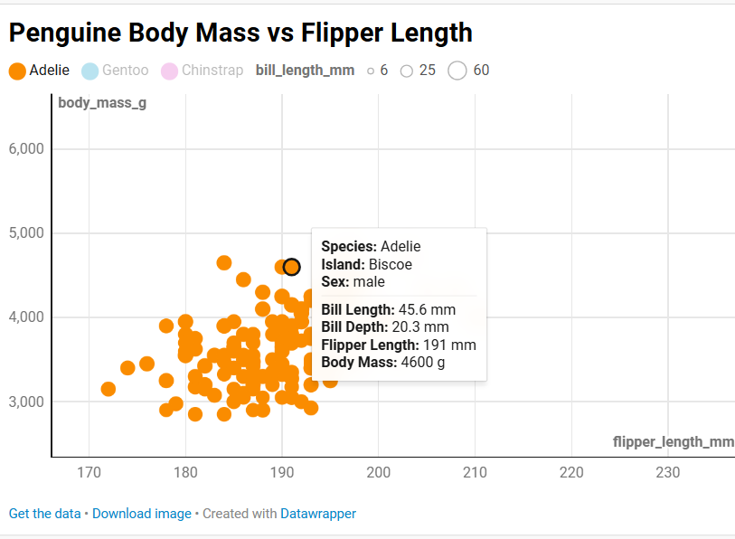
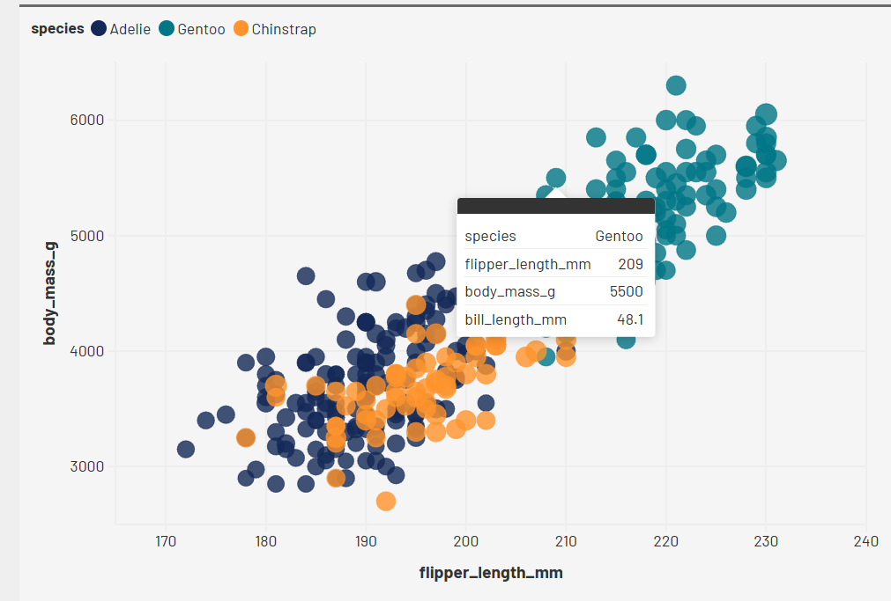

# Penguin Data Visualization – Five Different Approaches

## Overview

My five tools used were: **Altair (Python), R (ggplot2 and Plotly), D3.js, Datawrapper, and Flourish**.

## Repository Organization

All project files are organized as so:

- `altair/` – Python implementation using Altair.
- `ggplot/` – R implementation using ggplot2 and Plotly.
- `d3_implementation/` – JavaScript implementation using D3.js.
- `penglings.csv` – Source dataset used across the visualizations.

## Visualization 

### Color Scheme

Used these colors when I could

- **Adelie:** Orange (`#F56C27`)
- **Chinstrap:** Purple (`#88219E`)
- **Gentoo:** Blue/Purple (`#685CE0`)
### Axes and Scale
To replicate the scale and axes I used the following

- X-axis range: 160–240 mm, with 10 mm intervals.
- Y-axis range: 2,500–6,500 g, with 500 g intervals.

### 1. Altair (Python)

The Altair implementation uses Python and Pandas for data processing and Altair for visualization. Below we ans ee the full scatterplot with a tooltip over the highlighted data point.

Below as well is the Filter functionality available with Altiar interactive charts.

### 2. R (ggplot2 and Plotly)

The R implementation uses ggplot2 to construct the scatterplot and Plotly to add interactive functionality.

The full graph below has the size, color, and tooltip function.

Simiarly, it can also be filtered to remove certain data points, and by species. Also it can be zoomed in for finer selection of data points.

### 3. D3.js (JavaScript)

The D3.js implementation uses JavaScript to create the scatterplot directly through SVG elements.

Below is the d3 implementation which also has tooltip funcitonality, and the size differnces. 

### 4. Datawrapper

The Datawrapper implementation explores creating the same visualization throught the GUI.

The full data wrapper chart can be seen below.

Here is the fitlering and tool tip I was able to define manually.

### 5. Flourish

Flourish was the most limiting one, but I was still able ot recreate the basic strcuture of the graph, and include the tooltip, however I could not seem to add datapoints to tooltip that werent already present in the graph.

## Design Achievements

- **Appropriate element sizing:** Circle sizes represent bill length, allowing users to compare an additional variable without introducing another axis.
- **Consistent Axes gaps:** Consistent axis ranges and tick intervals, keeping the gap seen in the example.

## Technical Achievements
- **Interactive information:** Hover tooltips provide additional information without overcrowding the visualization with labels.
    - All the techniques used have Tooltips to see detailed information.

- **Species Filtering:** The Flourish, DataWrapper, Altair, and R(+ Plotly) have the ability to filter data points based on the selected species. Altair uses an interactive legend selection to adjust point opacity, while Plotly allows users to toggle species visibility through its interactive legend.
