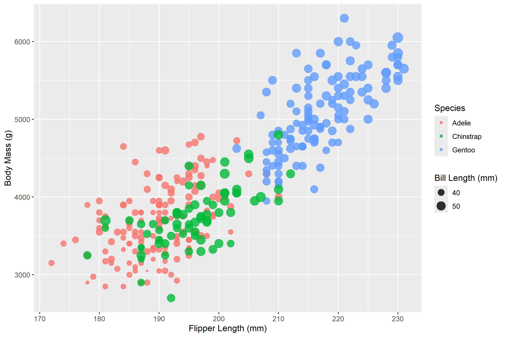
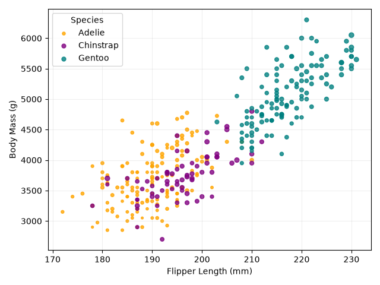
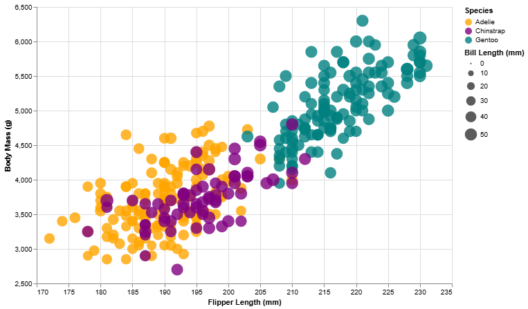
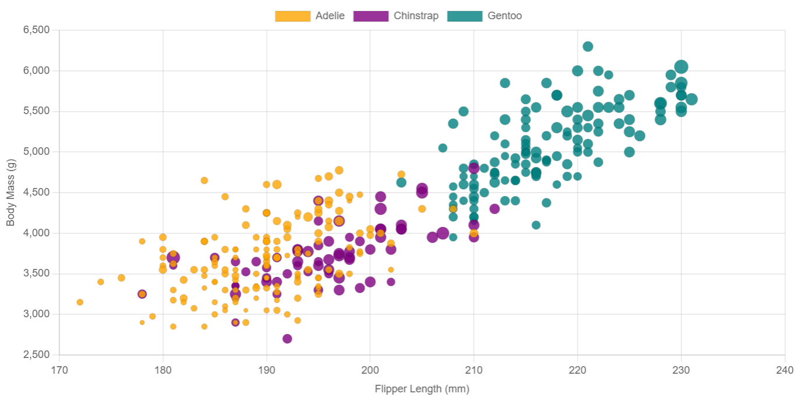
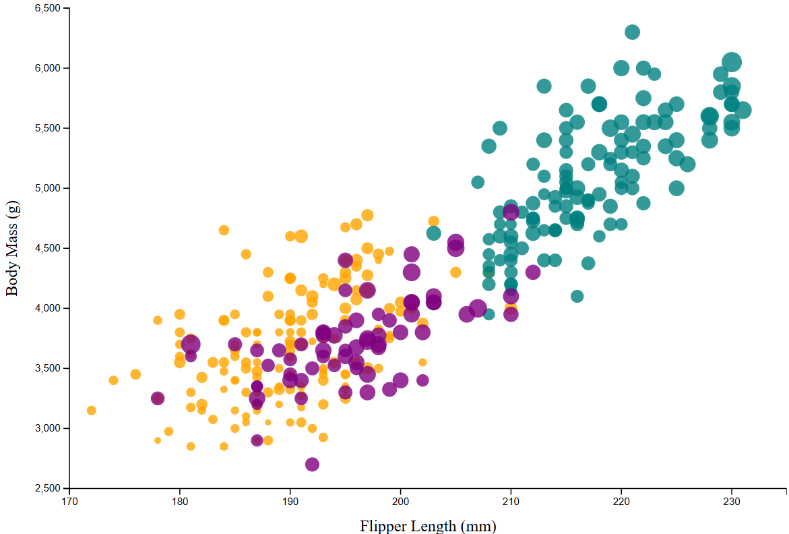

Assignment 2 - Data Visualization, 5 Ways  
===

Original Plot: 

**Tools used**: 
* R + ggplot2
* py + matplotlib
* py + altair
* js/html + chart.js
* d3

All scripts is in the "code" folder and all plot pngs are in the "img" folder.  

**Note:** all the file paths in the scripts point to my machine, so you may need to change the path line to wherever penglings.csv is for you. 

# R + ggplot2
I have experience using R and some with ggplot2, so recreating the chart was relatively easy for me. I used `filter()` from dplyr to remove the NA rows from the data first. I visualized the data using `aes()`, mapping the color and size inside, and `geom_point(alpha=0.8)` to control the opacity of the plot and keep it consistent with the original. I kept ggplot2's default size scaling because I found the data easier to read that way. The grid and the legends for species and bill length were automatically generated. For the colors, I tried to manually match them to the original chart, but it's not exact. ggplot2's plot variety is very useful. I can see myself using their volcano plots in particular for biological data.  

# matplotlib
I already use matplotlib regularly to make figures for projects and research (it's very commonly used in bioinformatics), so using it to recreate the chart was pretty simple. I used `dropna()` to filter out the NA rows from the data. For the plot, I looped over the species groups so each one was associated with a color and legend entry. I used `legend_elements()` to build the second legend for bill length. The axes are autoscaled. This tool is already very useful in general, but I can see it being used more for plots where you need full control over every element.   

# vega-altair
Using altair was very intuitive. I had less experience with it compared to matplotlib, but its syntax is very user-friendly and easy to pick up. The NA rows were filtered out. I set the axes manually this time, and set the colors and opacity as before. The legends were generated automatically. The only minor difficulty was displaying the chart, since it only showed directly if you're using Jupyter Notebook (I was in vscode). Otherwise, you have to save it as an interactive html file first in order to view it. I can see altair being useful when I want to do quick exploratory data analysis. 

# chart.js
Chart.js was difficult for me to use since I had no experience with it, and I'm not as comfortable with js and html. I used the "Step-by-step guide" in its docs to familiarize myself with it, and Claude to help with debugging. The NA rows were filtered out using Papa Parse. I used a bubble chart for this recreation instead for ease of use. One difficulty was that chart.js has no color sets other than the default, so I had to specify each color manually as an `rbga()` string (also how I set the opacity). I can see chart.js being most useful for putting figures on a website or dashboard.

# d3
Using d3 was the most challenging recreation for me (my first experience using it was a1), so I used the d3 Graph Gallery's "Basic Scatterplot" guide as a starting point, and Claude to help with debugging. I loaded the data using `d3.csv()` and `d3.autoType` and filtered out the NA rows. For this recreation, I mapped bill length to radius using `d3.scaleSqrt()`. Everything had to be built manually, including the axes, which took a lot more effort than the other tools. However, it also gives you more control and allows you to customize the plot completely. I can see d3 being most useful for custom, highly interactive online visualizations for websites or dashboards. 

## Technical Achievements
- **Legends**: Preserved 2 legends in each plot, except for chart.js and d3 
- **d3 Sizing**: Used a sqrt scale for the radius so the area of each circle grows with bill length 

### Design Achievements
- **Consistent color**: Color scheme preserved across all plots
- **Consistent labels**: Axis labels preserved across all plots
- **Legends + Grids**: Adjusted legend locations in matplotlib to not cover data

### Sources
- https://d3-graph-gallery.com/graph/scatter_basic.html
- https://altair-viz.github.io/user_guide/data.html
- https://www.chartjs.org/docs/latest/getting-started/
- https://ggplot2.tidyverse.org/reference/index.html
- Claude was used to help debug chart.js and d3 plots 
