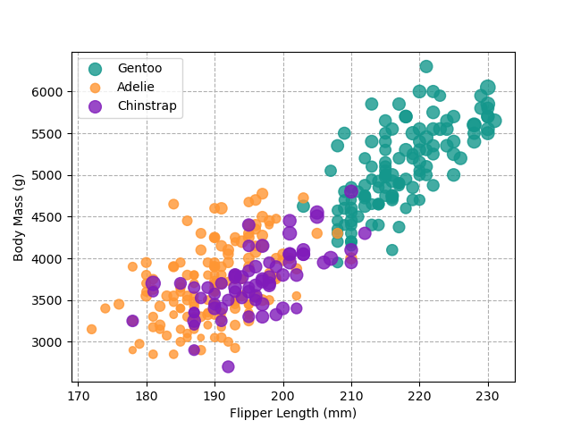
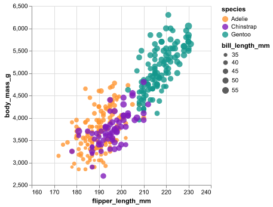
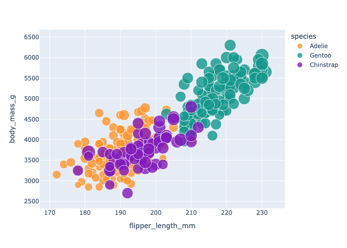
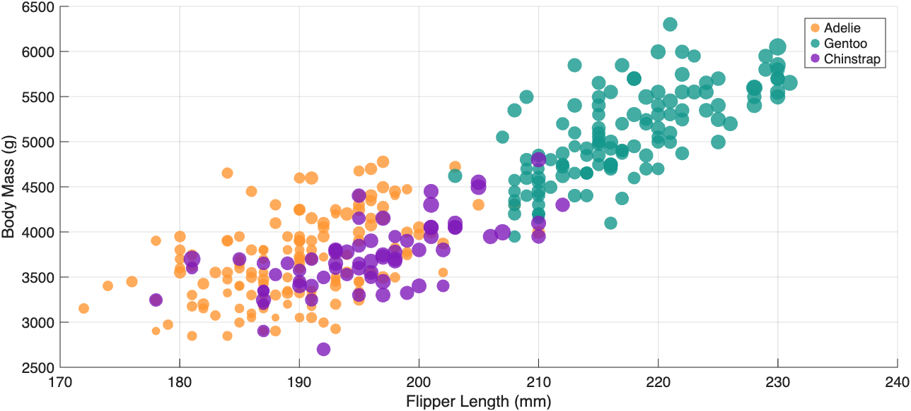
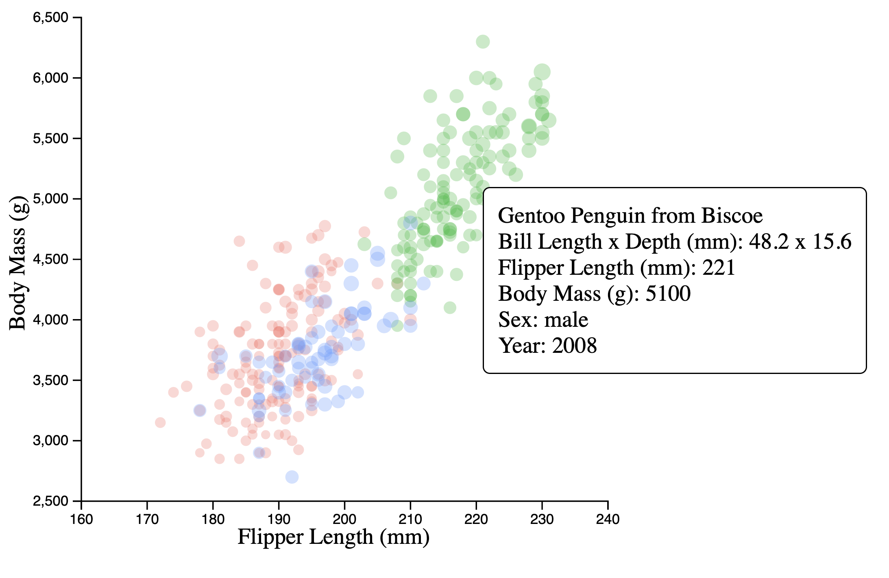

# Python + pyplot

Matplotlib.pyplot is a python library that can create many types of plots with customization.

To visualize the penguins dataset, I made use of pyplot's `scatter()` function, specifying the body mass as the y axis, flipper length as the x axis, and bill length as the size. Additionally, I customized the color, opacity, and labels, as well as showed gridlines and the legend.

Pyplot takes more programming than some other tools to create plots. However, it provides more control than others, since you have to format the data to be plotted anyways. I think it's great for when you already have to use python to format data.

# Python + altair

Altair is a python library that can create charts based on tables of data. It provides a simple way to link data columns to parts of the visualization.

To visualize the penguins dataset, I made use of altair's `Chart()` function, linking the flipper length column to the X axis, the body mass column to the Y axis, the color to the species column, and the size to bill length.

Altair makes it very simple to create a basic plot based on a table. However, since almost all the setup is included in the `Chart.encode()` function, it is harder to further customize. I think it's great for when you have all your data in a clean table and just want to visualize some of it.

# Python + plotly

Plotly is a python library that, similar to Altair, can create plots based on a table of data. It provides a simple way to link data columns to parts of the visualization.

To visualize the penguins dataset, I made use of plotly's `scatter()` function, with flipper length as x, body mass as y, species as color, and bill length as size.

Plotly makes it very simple to create a basic plot based on a table. I found it to be a more intuitive way to create a chart than altair, but it still has the simplicity of quickly creating charts based on data.

I think it's great for when you have all your data in a clean table and just want to visualize some of it, just like Altair. However, I think it has a more standard format of use than Altair, meaning it may be easier for people who may be used to other similar python libraries.

# Matlab

Matlab is often used in scientific and engineering fields and is an alternative to Python or R.

To visualize the penguins dataset, I made use of matlab's `scatter()` function, with flipper length as x, body mass as y, species as color, and bill length as size. I think Matlab is more complicated than other tools and languages/libraries if you are used to any other ones. However, I think it is able to make nice, clean visualizations.

I think Matlab is great for people already used to working in Matlab. It provides clean graphs with a lot of customizability, and I think it would be particularly good for clean figures for research papers.

# D3

D3 provides web-based visualizations. To visualize the penguins dataset, I created an svg scatterplot, with flipper length as x, body mass as y, species as color, and bill length as size. I think d3 is great for 

# Technical Achievements
I wanted to challenge myself to use programming for all 5 graphs. Additionally, I wanted to add some interactivity, which I did in my D3 plot.

In the D3 plot, you can hover over points to see more details. This makes it easier to see what the values compared to comparing the value to the axis tick marks, and it provides additional data that isn't shown, such as the island or year.

# Design Achievements
The bill length of the penguins ranges from 32 mm to 60 mm. However, just plotting this makes it hard to tell the difference between circle sizes. Often, a difference of 10 mm shows up as just a few pixels. To make it easier to see, I scaled the circle sizes so that 32 to 60 becomes 28 to 140, which is much easier to see.

Additionally, to better compare the different visualizations, I used the same color palette across all 5 visualizations.

