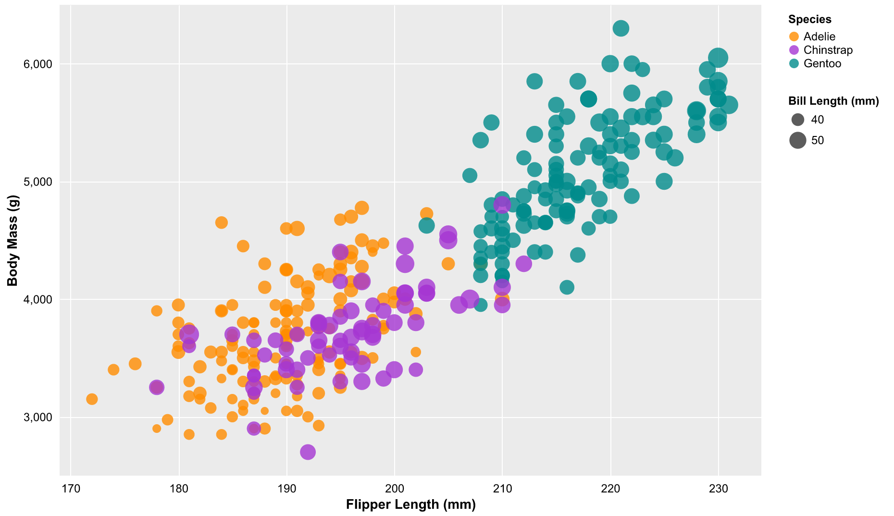
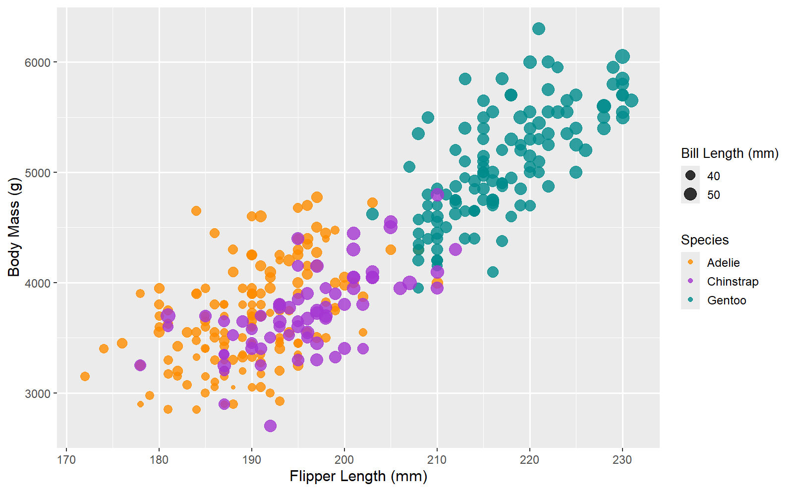

# Excel

Excel is a spreadsheet and data analysis tool that is part of Microsoft Office. 
It has a relatively low barrier to entry compared to other more code-heavy options which can be good for people with less coding experience. 
However, it can become clunky to manipulate data, especially since every array of data needs to be shown in data cells in the software.
Additionally, finding everything within the Excel UI can become a pain.
Sometimes even when I knew what I needed to do, it was hard to find the menu to actually do it.  
To make the chart, I used a bubble chart since it allows for changing bubble size based on a "z" value. 
To organize the data for the chart, I made a new sheet with the 3 data columns for each type of penguin using the Filter function to filter for the correct penguin type and to get rid of NA values. 

# Python
Python is a coding language that is easy to begin development in and contains many useful libraries. 
Many of these libraries are useful for processing and visualizing data. 
Because of that, creating a basic chart only takes a few lines of code when using these libraries, creating a low barrier to entry. 
I also know that if I wanted to expand the visualization further or use it within a website in the future, I would be able to due to Python and its libraries' great flexibility and wide range of features.  
For my chart, I used Pandas to convert the CSV to a dataframe. 
Then, I used Matplotlib's scatter function to create the graph, and used its built in show function to display the graph in a new window after running the program. Since the scatter function uses area for circle size which is difficult to see small differences in size for, I created a new equation to make the size differences for the circles easier to see.

# R
R is another coding language, although it is less flexible than Python being focused mainly on data and statistics. 
I used a regular R file in RStudio with the output going directly to the "plots" tab in RStudio.   
I used R's built-in read.csv function to convert the CSV to a dataframe, then I used ggplot's geom_point function to create the scatterplot. 
One thing I especially appreciate about this was that a legend was automatically created, including automatic size scaling for the dots and dot size being included in the legend. 

# D3.js
D3.js is a framework for creating SVG graphics in javascript. 
Unlike the other frameworks, it does not have a built-in scatterplot function and all graphical components must be manually placed. 
This significantly increases flexibility and creative freedom, but also makes it take much longer to create charts. 
To experience more of the upsides of using D3 without  the downsides, Agentic/AI coding could be very nice as it would be significantly faster to iterate than with manual coding while maintaining the increased freedom over the easier to use but more restrictive Python and R libraries.  
For my chart, I filtered out rows with NA values in the four target columns then used various SVG elements to draw the elements in the chart, manually setting the scales of the x axis, y axis, and dot sizes.

Expanded on approach outlined in https://d3-graph-gallery.com/graph/scatter_basic.html 

# PowerBI
Power BI is a data visualization tool. For users that don't want to deal with code, I found it to be a much more powerful and intuitive tool for visualization than Excel. Despite having more experience in Excel and none in PowerBI, I found it faster to both create the initial graph and to iterate on the design. Of course, flexibility is lost compared to the code-based options, a trade-off for the time and convenience of creating the graphics.  
For my chart, I had to transform the data columns to be decimal / whole number types since it orignally classified all the columns as text type. From there, it was simple to add a scatterplot and drag the data into the X-axis, Y-axis, Size, and Legend value fields of the graph. From there, I configured settings to make the graph more readable, such as changing the axis labels and changing the size multiplier on the markers.

## Technical Achievements
- **Excel**: Used Filter functions to manually created seperate columns of data for each penguin species with NA values filtered out so that those columns could be used as different groups within a Bubble Plot.
- **Python**: Used Pandas to convert the CSV into data for Matplotlib to visualize.
- **R**: Used built-in R functionality to convert the CSV into data for ggplot to visualize.
- **d3**: Asynchronous filtered out rows with NA values in target columns with d3.csv, used configurable constants for width and height of the entire graphic, and margins for the graph itself to allow for extra elements such as axis labels to be displayed outside of the chart.
- **PowerBI**: Converted columns stored as a text type to a decimal number / whole number type using the transform data tool before using the data in a scatterplot.

## Design Achievements
- **Excel**: Manually set X and Y range and scale so as to not start each axis at 0. Changed bubble size from area to radius to diameter to make size differences more visible.
- **Python**: Created custom dot size function to make the differences in dot size more visible, changed alpha value of dots to make them semitransparent.
- **R**: Changed alpha value of dots to make them semitransparent.
- **d3**: Manually set domain and range values for x-axis, y-axis, and dot size, and set dot transparency.
- **PowerBI**: Changed from dots to triangles as I find the flat edges easier to compare sizes than with circles. Changed label fonts / font sizes, changed chart title and axis labels from the default, configured the y-axis to show as 2000, 3000, etc instead of 2k, 3k, etc, and added a legend for species.

AI Use: Used AI similar to a search engine to help with setting up environments and finding/understanding the libraries and functions used to make the plots.