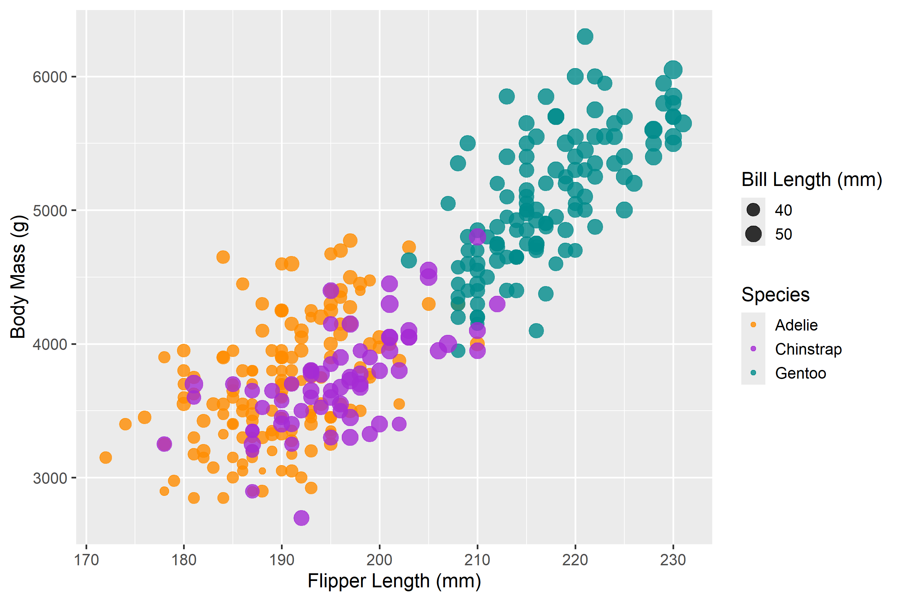
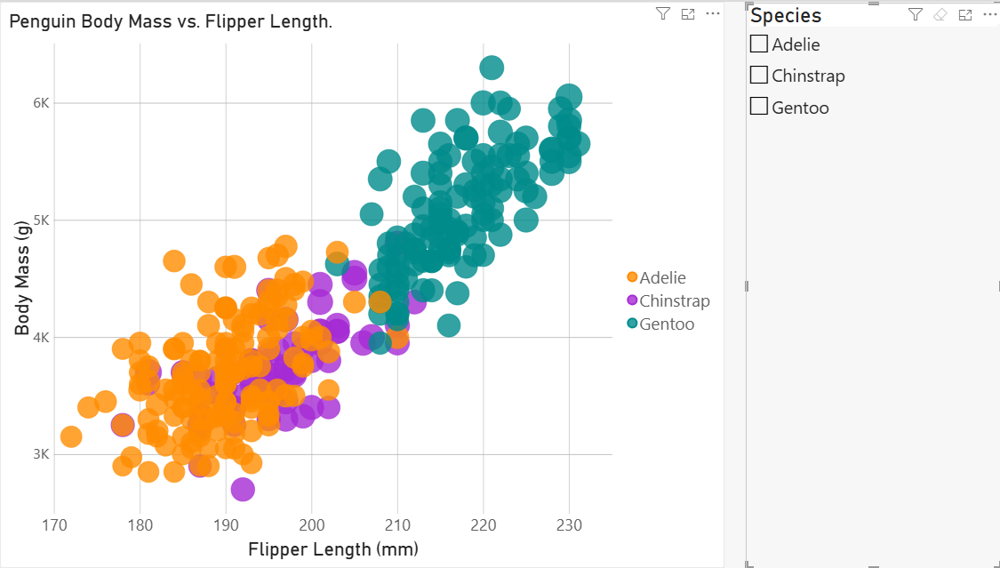

# Assignment 2 - Data Visualization, 5 Ways

# R + ggplot2

R is a language used for charting and statistical analysis
ggplot2 is a library for charting in R.

To visualize the penguins dataset, I made use of ggplot2's `geom_point()` layer, with aesthetics functions for the color and size.

ggplot2 provides a significant amount of build in functions that make building graphs really simple. ggplot also allows you to pass in a size field natively, so it made scaling by bill length super easy. I think starting with this was a good option for me, as I was already familiar with R and ggplot2 in particular. I already use it pretty frequently, and I definitely see myself continuing to use it, as it is very convenient to save images from as well, unlike some where I just had to screenshot. One other thing I noticed is how simple it was to add the background and legends.

# Excel

Excel was the second one I did, as I was also already familiar with it. I took the csv we were given and turned it into a table, so that i could filter and clean the data. From there, I used a bubble chart and implemented all of the required specifications. Overall, I think Excel is the easiest option to do for this assignment, due to a gui for creating the chart instead of code. Personally, unless I am manually entering data, or I also wanted to see the table itself, I would not use Excel for minor things.

# Altair

I chose Altair, as I had no experience with it before, despite having used Numpy and Pandas for other various things. I think overall Altair was very similar to R in that there were a lot of built in functions that made charting easier, and I appreciated how few lines it took to chart the data. I did have to research how to load the data, and how to create the graph, but the documentation was very helpful.

Sources:
https://altair-viz.github.io/user_guide/data.html
https://altair-viz.github.io/user_guide/marks/circle.html

# Vega-Lite

I had never heard of Vega-Lite before this assignement, so I was surpirsed to see how popular it was. I really like how it can be loaded easily through JavaScript, once you make the JSON spec. I did have to spend a lot of time trying to find how to write the spec, but once I found the right pages in the documentation, I was able to do it. This was also incredibly similar to Altair, which I appreciated.

Sources:
https://vega.github.io/vega-lite/docs/filter.html
https://vega.github.io/vega-lite/docs/circle.html
https://vega.github.io/vega-lite/docs/field.html

# D3

To me, this was the hardest to do, even with the D3 experience from last assignment. I found it tedious to have each attribute as a seperate section, as I was used to being able to have many of them combined. I understand the d3 is flexible enough to do all sorts of visualizations, but it definitely feels harder. For example, in cleaning the data, the sources that I found have you cleaning each column you plan on using individiually, as opposed to in R, where you can do it all in one line. I think it is convenient that it is all svg, as my experience last assignment helped, but I still don't think I would use this over altair or vega-lite outside of this class.

# PowerBi

Power BI was the sixth tool I used to recreate the graph. Like Excel, it has a graphical interface, but I had to spend some time figuring out how it handles the data. Initially, it wanted to sum the measurements together, so I added the unique penguin ID to make each penguin appear as its own point. Once that was working, I could assign species to color and bill length to bubble size, then adjust the axes and formatting. I also added a species slicer, which lets users filter the graph without changing the underlying data. I could see Power BI being useful for dashboards where users want to explore the data through filters and multiple charts.

## Achievements

### Technical Achievements

- Additional tools: I recreated the graph using six different tools, exceeding the requirement of five. These were R + ggplot2, Excel, Altair, Vega-Lite, D3.js, and Power BI.

- Interactivity: I added interactive features to the Altair visualizations, allowing users to hover and get more information.

- Responsive visualization: The D3 chart scales with the browser width while preserving the proportions of the graph, labels, and legends.

- Power BI filtering: I added a slicer in Power BI that allows users to filter the graph by species. This makes it easier to examine each species individually and reduces overlapping points.

### Design Achievements

- Cool color scheme: I used blue, purple, and teal in the D3 visualization to create a palette made entirely of cool colors, which I feel fits penguins better.

- Custom legends: I added species and bill-length legends to D3 and R using the same color and size scales as the plotted points.

## To Run the Web Pages

python -m http.server 8000

- **D3.js:** http://localhost:8000/D3-js/
- **Vega-Lite:** http://localhost:8000/Vega-Lite/
- **Altair:** http://localhost:8000/Altair/altair-penguins.html
