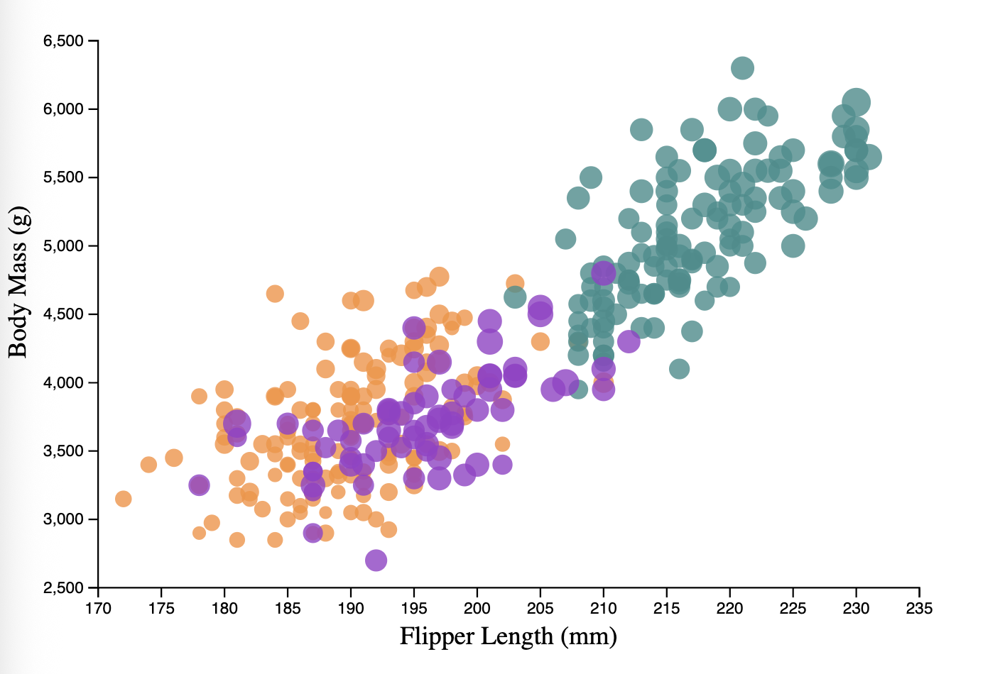
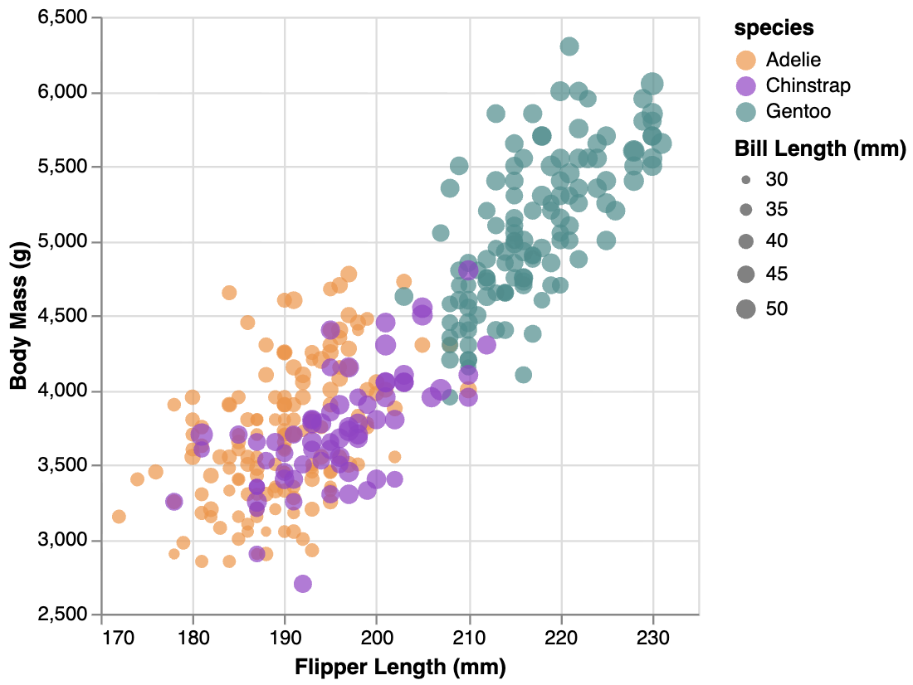
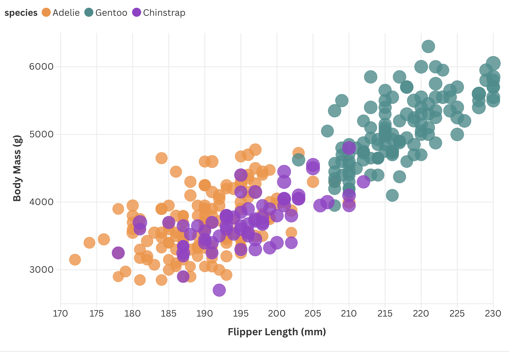
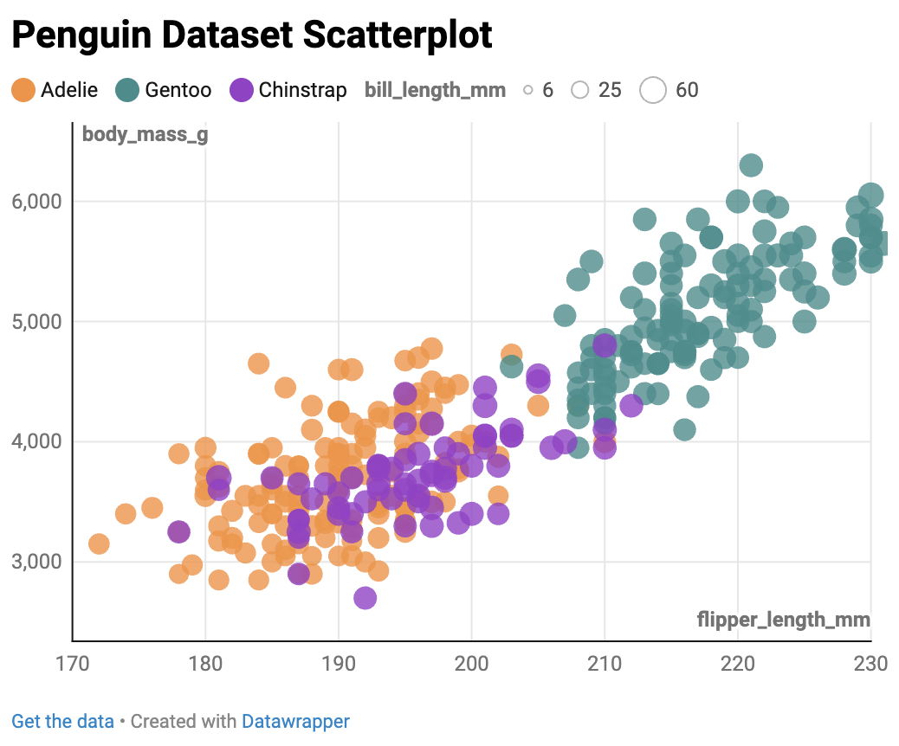

Assignment 2 - Data Visualization, 5 Ways  
===

Assignment 2 - Data Visualization, 5 Ways  
===

# d3.js



d3.js was on the more difficult side just because I'm not experienced with d3.js and Javascript as a whole, and I had to look up a lot of examples to understand the syntax (https://d3-graph-gallery.com/scatter.html).
The main requirements of the scatterplot were met.

To visualize the penguins dataset, I had to extract each needed element from the .csv file with the d3.csv function, and create a conditional statement for rows that return null. I then had to specify elements such as margins, dimensions, the radius scale, the color scale. I also appended SVGs for the axes, data points, and labels.

Generally I found the process of working with d3.js tedious. While it seems to provide more freedom in how to display the scatterplot, I felt a lot of things had to be done manually. 


# R + ggplot2


ggplot is a popular R package for creating data visualization. With R and ggplot2, I used geom_point to create visualize the data with a scatterplot, and aes() to map visual properties to the points. I also created a vector with custom colors that correspond to each species.

Personally, I found R and ggplot2 the most convenient method so far.

# Altair



Altair is a Python library used for statistical visualization.
Using Altair was mostly easy-- the only obstacles were some technical difficulties getting the proper extensions and getting Jupyter to work, but once those were fixed, everything went smoothly.

Through this library, I was able to easily add a tooltip that allows the user to hover over a point to view its data.
I can see this library being quite useful in the future. I feel this has a good balance between convenience and ability to create more complex visualizations.

I included the necessary dependencies used for this in ```requirements.txt``` under the ```altair``` folder.

# Flourish



Flourish is a web-based data visualization platform with a no-code workflow.

Using Flourish was quick and easy. I only see the tool being useful in the future for relatively uncomplicated datasets that do not require too much computation. I don't think I see this in areas where data visualization is taken more seriously.

All of the features of the original chart have been preserved except for the size mapping for the bill length. While the option to map the size of each circle to bill length was there, I was unable to scale down the sizes so that they aren't too big. The only option I found to deal with this was setting a minimum and maximum size for the circles, but that made the sizes of each circle nearly identical. 

# Datawrapper



Datawrapper, like Flourish, is a web-based data visualization platform that does not require code.

Datawrapper was very easy to use, and thankfully the website didn't force me to create an account to use it. I prefer Datawrapper over Flourish.

Like Flourish, all of the features of the original chart have been preserved except for the size mapping for the bill length, for the same reason. I used the ability to map the points to bill length, but the numerical values seem correspond to exactly the pixel size of the circles, causing them to be too large. I cannot change the proportions of the circles, and I was only able to modify their minimum and maximum sizes, which made them look identical.


## Technical Achievements

Using Altair, I added an interactive tooltip that displays flipper length, body mass, bill length, and species upon hovering over a data point.


## Design Achievements

I made the colors corresponding to each species consistent across all of the scatterplots, exactly matching those of the original scatterplot from the assignment instructions.
