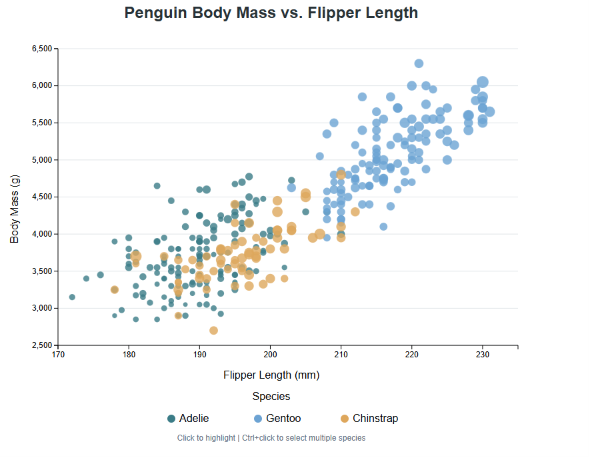
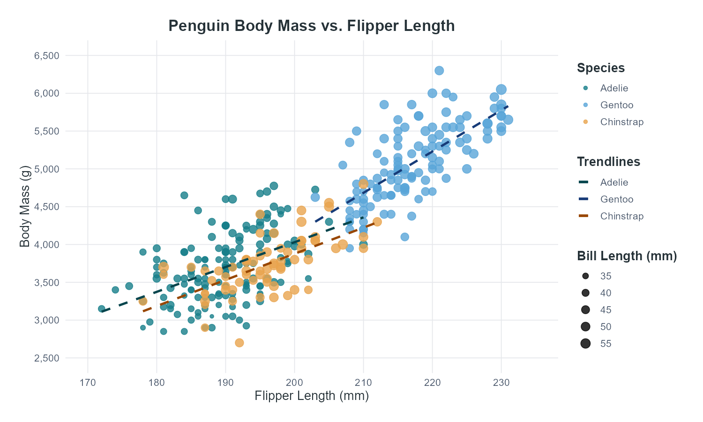
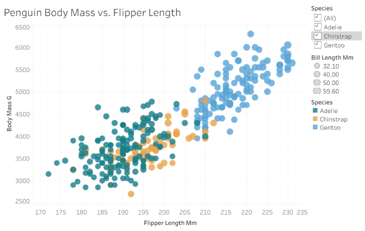

# Assignment 2 - Data Visualization, 5 Ways

## Project Description

For this assignment, we had to make the same penguin scatterplot across 5 different programs/libraries. I made them using python+altair, D3, ggplot2+R, Excel, and Tableau Public. Each chart shows flipper length against body mass, with color representing species and circle size representing bill length. I kept the colors consistent to compare how each tool handled the same data. Tableau ended up being my favorite, while Excel was the most frustrating.

# Python + Altair

I found Altair very intuitive. Its easy language made assigning variables to axes, colors, and circle sizes straightforward. I also added tooltips and filtered out missing measurements. My main complaint was having to use hex codes to choose specific colors, so I used an online color picker. I could definitely see myself using Altair again for future projects.

Code: [penguins_altair.py](python-altair/penguins_altair.py)
Interactive HTML: [penguins_altair.html](python-altair/penguins_altair.html)

# D3.js

D3 took more work than Altair because I had to set up the scales, axes, circles, and legend myself, along with loading and cleaning the CSV. However, it gave me the most control over individual elements. I added hover effects and a clickable legend that highlights one or multiple species using Ctrl + click, which helps with overlapping observations. This is only my second time using D3 for any work since I only learned about it through this class. Overall, I have been enjoying my time with it and would use it again in the future on a project or for more general analysis.

Code: [index.html](d3/index.html)

# R + ggplot2

I've used R a lot at WPI, so ggplot2 felt familiar and was one of the easiest coding libraries for me. It handled axes, legends, and visual mappings with relatively little code. I added separate linear regression lines for each species and adjusted the point sizes and gridlines. I also had to fix a transparent background when exporting the chart. I would definitely use ggplot2 again for statistical analysis in R.

Code: [penguins_ggplot.R](r-ggplot2/penguins_ggplot.R)

# Microsoft Excel

Excel was the least intuitive tool for me. Creating a basic chart was easy, but customizing it took much longer than expected. I had to make a separate worksheet and reorganize the data into three species-specific series just to give them different colors. The bubble chart eventually represented all four variables, but I would rather use a coding library or Tableau for this kind of analysis. Excel still seems useful for simpler charts and quick spreadsheet work.

Workbook: [penguins_excel.xlsx](excel/penguins_excel.xlsx)

# Tableau Public

Tableau was easily my favorite tool out of the five. Dragging and dropping variables made everything simple, and after a few Google tutorials, I understood what I needed to use the program. Unlike Excel, I didn't have to reorganize the data. I added a species filter, customized tooltips, and a dashboard without writing code. I could definitely see myself using Tableau again for interactive dashboards and future data science projects.

Workbook: [penguins_tableau.twbx](tableau/penguins_tableau.twbx)

## Technical Achievements

### Technical Achievement 1 - Data Preparation and Visual Mappings
I mapped flipper length, body mass, species, and bill length across all five tools. In Altair, D3, and ggplot2, I filtered out missing measurements. I also used nonzero axis ranges to match the reference chart.

### Technical Achievement 2 - D3 Interactions
I used D3 event handling to enlarge and outline circles on hover, show measurement tooltips, and make the legend clickable. Ctrl + click allows multiple species to be highlighted.

### Technical Achievement 3 - Regression Lines in ggplot2
I used geom_smooth(method = "lm") to add separate regression lines for each species, with darker dashed lines and a trendline legend.

### Technical Achievement 4 - Excel Bubble Chart
I created a BubbleData worksheet with three species-specific series so Excel could represent all four variables in a bubble chart.

### Technical Achievement 5 - Tableau Interactions
I created a Tableau dashboard with an interactive species filter and customized tooltips showing each penguin's species, island, sex, year, and measurements.

## Design Achievements

### Design Achievement 1 - Consistent Color Palette
I used the same ocean-inspired colors in all five charts: teal for Adelie, light blue for Gentoo, and gold for Chinstrap. This made the different versions easier to compare.

### Design Achievement 2 - Readability
I used labeled axes, nonzero axis ranges, semi-transparent circles, and adjusted point sizes. Subtle gridlines and clear legends also helped with overlapping observations.

### Design Achievement 3 - Tool-Specific Improvements
I used interactions in D3 and Tableau to help explore individual observations, and regression lines in ggplot2 to show trends. In Excel, I focused on getting the bubble sizes, colors, and legend to match the other charts. 

## Running the Visualizations

All commands should be run from the repository's main folder, which contains penglings.csv.

- Altair: Run py python-altair/penguins_altair.py (or use python3 instead of py). This requires pandas, altair, and vl-convert-python. The script generates the HTML visualization and PNG screenshot.

- D3: Run py -m http.server 8000 (or python3 -m http.server 8000), then open http://localhost:8000/d3/.

- ggplot2: Run Rscript r-ggplot2/penguins_ggplot.R with R, ggplot2, and scales installed. This generates img/ggplot2.png.

- Excel: Open excel/penguins_excel.xlsx in Microsoft Excel.

- Tableau: Open tableau/penguins_tableau.twbx in Tableau Public or Tableau Desktop.

## Sources and References

- Altair Documentation — Reference for Altair charts, encodings, and tooltips.

- D3 CSV Loading and D3 Selections — References for loading data and creating interactive SVG elements.

- ggplot2 Documentation — Reference for scatterplots, styling, and regression lines.

- Tableau Help — General documentation for Tableau visualizations and dashboards.

- Online tutorials and color picker: I used tutorials found through Google to learn Tableau and an online color picker to choose my chart colors.

- ChatGPT (OpenAI): ChatGPT helped with setting up general code, installing libraries, some data implementation like d3 sizes and altair implementation. I made the design choices and compared the tools based on my experience using them totally on my own.