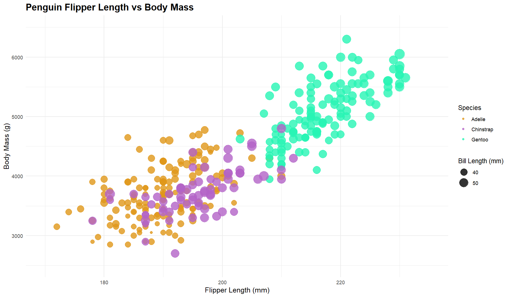
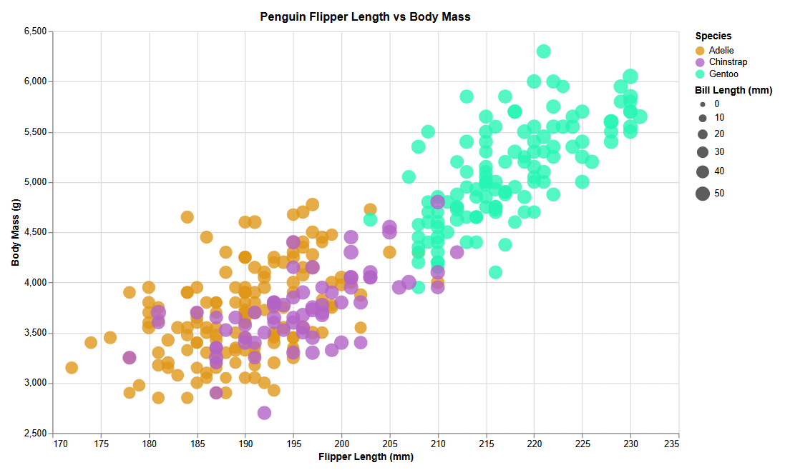

# Name: John Porter

# R + ggplot2

For the R visualization, I used the ggplot 2 library to make a scatterplot based on the dataset provided to us. I used geom_point() to make circles and mapped species to color and bill length to size. Additionally, I customized the axis ranges, colors and transparency to match the visual we were shown. ggplot2 was relatively simple to use since the library provides functions that make it easy to map certain variables to visual properties for the scatterplot. However, some parts I found frustrating was the formatting and getting the legend to appear correctly. I think that R and ggplot2 is a reasonable choice to use in the fututre.

# d3

For the D3 visualization, I used javascript and the D3 library to create the scatterplot. I loaded the dataset using d3.csv as suggested in the assignment README and used D3 scales to position circles based on flipper length and body mass. Similarly, I used species for color and bill length for circle size. D3 was more challenging because of having to manually make SVG elements, scales, etc. instead of having built-in functions for these. Additionally, making sure the CSV data was loaded and converted properly made this the largest code file out of the five. Although, I can aknowledge the creative control that d3 gives the user makes it a useful tool to create things with more specific needs. 

# Altair

For the Altair visualization, I used python with Altair and Pandas libraries. I loaded the dataset using pandas and used Altair for the visualization components. Like previous visualizations, the different columns were assigned to their proper axes, colors, size, etc. Altair was one of the easier tools to work with due to the syntax making it easy to connect dataset columns to their proper visual components. Compared to d3, I didn't need to manually add each axes or other features. It was a little difficult to change the bubble sizes and formatting to look like the other charts, but I could definitely see myself using Altair in the future for the convenience and ease of use I had with it.

# Flourish

Link: https://public.flourish.studio/visualisation/30899242/

For the Flourish visualization, I used its online visualization editor to make the scatterplot. This did not require writing code, so I uploaded the CSV dataset and assigned the columns to the charts x-axis, y axis, color, and size elements. This process was by far the easiest of all the tools I used because the whole chart could be made through the tools interface, without any code necessary. The only real challenges was learning where certain functions were, which was easy to figure out with their provided resources. This tool definitely could have more limitations than something like d3, but the ease of use makes up for this, and I could see myself using it again in the future. 

# Vega-lite

For the Vega-Lite visualization, I used the online Vega Editor to create the scatterpot using JSON.  I loaded the dataset directly from the CSV file hosted in my GitHub repo and said how each variable should be represented. Of course, like the previous tools, each column was used for their specified element in the visual. One of the easier parts of Vega-lite was JSON making it a straightforward process to assign variables to different parts of the visual. It was also nice that Vega-lite supports loading datasets from a CSV URL, which was very simple. I could also see Vega-lite being a nice and convenient option for future visualizations.

## Technical Achievements
- Created the scatterplot using five different visualization tools: R + ggplot2, D3, Altair, Flourish and Vega-Lite
- Used the penguin dataset to compare flipper length and body mass across three different penguin species
- Mapped multiple dataset variables to visual elements including X position, Y position, color, and circle size
- Used CSV data loading and data filtering to handle missing measurements and ensure visualizations displayed the right data
- Used interactive chart features like tooltips to provide additional information about individual data points
- Used different approaches to create visualizations, including programming libraries, a JSON-based visualization specification, and a online graphical editor

### Design Achievements
- Maintained a consistent color scheme across all five visualizations to distinguish Adelie, Chinstrap, and Gentoo species
- Used orange (#FF7F0E) for Adelie, purple (#A13ACB) for Chinstrap, and teal (#159B9B) for Gentoo
- Used circle size to represent bill length, which conveys an additional column without the need for another axis
- used opacity to make overlapping data points more visible
- Kept the axis ranges consistent across visuals so the graphs can be compared easily
- Included titles, labels, and legends to make the visuals easier to interpret

# Sources:

Below is a list of resources I used to help get started on the different parts of the project:

- https://cran.r-project.org/web/packages/ggplot2/vignettes/ggplot2.html
- https://d3js.org/
- https://altair-viz.github.io/altair-viz-v4/getting_started/starting.html
- https://helpcenter.flourish.studio/hc/en-us/articles/8761582471439-Scatter-plot-an-overview
- https://vega.github.io/vega-lite/docs/data.html
