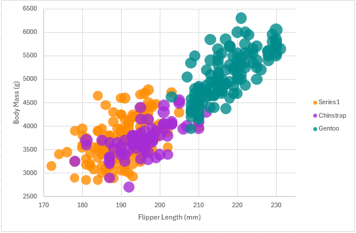
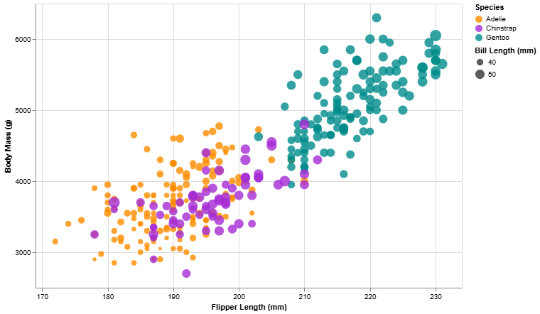
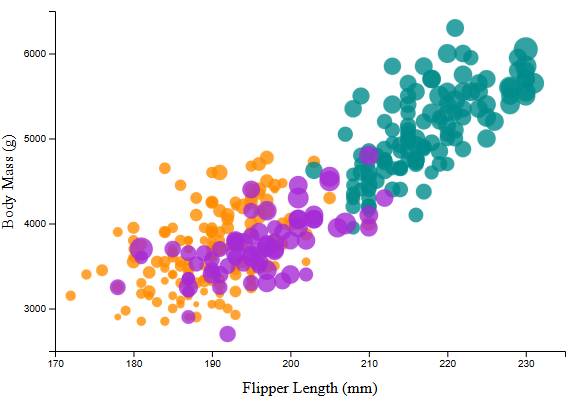

# Assignment 2 - Data Visualization, 5 Ways

# R + ggplot2

R is a language used for charting and statistical analysis
ggplot2 is a library for charting in R.

To visualize the penguins dataset, I made use of ggplot2's `geom_point()` layer, with aesthetics functions for the color and size.

ggplot2 provides a significant amount of build in functions that make building graphs really simple. ggplot also allows you to pass in a size field natively, so it made scaling by bill length super easy. I think starting with this was a good option for me, as I was already familiar with R and ggplot2 in particular. I already use it pretty frequently, and I definitely see myself continuing to use it, as it is very convenient to save images from as well, unlike some where I just had to screenshot. One other thing I noticed is how simple it was to add the background and legends.

# Excel

Excel was the second one I did, as I was also already familiar with it. I took the csv we were given and turned it into a table, so that i could filter and clean the data. From there, I used a bubble chart and implemented all of the required specifications. Overall, I think Excel is the easiest option to do for this assignment, due to a gui for creating the chart instead of code. Personally, unless I am manually entering data, or I also wanted to see the table itself, I would not use Excel for minor things.

# Altair

I chose Altair, as I had no experience with it before, despite having used Numpy and Pandas for other various things. I think overall Altair was very similar to R in that there were a lot of built in functions that made charting easier, and I appreciated how few lines it took to chart the data. I did have to research how to load the data, and how to create the graph, but the documentation was very helpful.

Sources:
https://altair-viz.github.io/user_guide/data.html
https://altair-viz.github.io/user_guide/marks/circle.html

# Vega-Lite

I had never heard of Vega-Lite before this assignement, so I was surpirsed to see how popular it was. I really like how it can be loaded easily through JavaScript, once you make the JSON spec. I did have to spend a lot of time trying to find how to write the spec, but once I found the right pages in the documentation, I was able to do it. This was also incredibly similar to Altair, which I appreciated.

Sources:
https://vega.github.io/vega-lite/docs/filter.html
https://vega.github.io/vega-lite/docs/circle.html
https://vega.github.io/vega-lite/docs/field.html

# D3

To me, this was the hardest to do, even with the D3 experience from last assignment. I found it tedious to have each attribute as a seperate section, as I was used to being able to have many of them combined. I understand the d3 is flexible enough to do all sorts of visualizations, but it definitely feels harder. For example, in cleaning the data, the sources that I found have you cleaning each column you plan on using individiually, as opposed to in R, where you can do it all in one line. I think it is convenient that it is all svg, as my experience last assignment helped, but I still don't think I would use this over altair or vega-lite outside of this class.

## Technical Achievements

- **Proved P=NP**: Using a combination of...
- **Solved AI Forever**: ...

### Design Achievements

- **Re-vamped Apple's Design Philosophy**: As demonstrated in my colorscheme...
