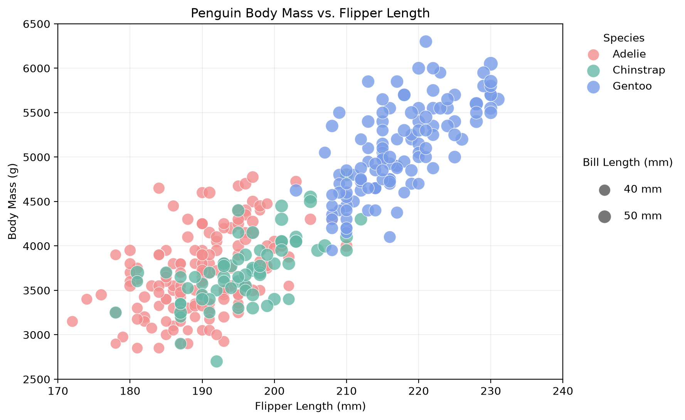
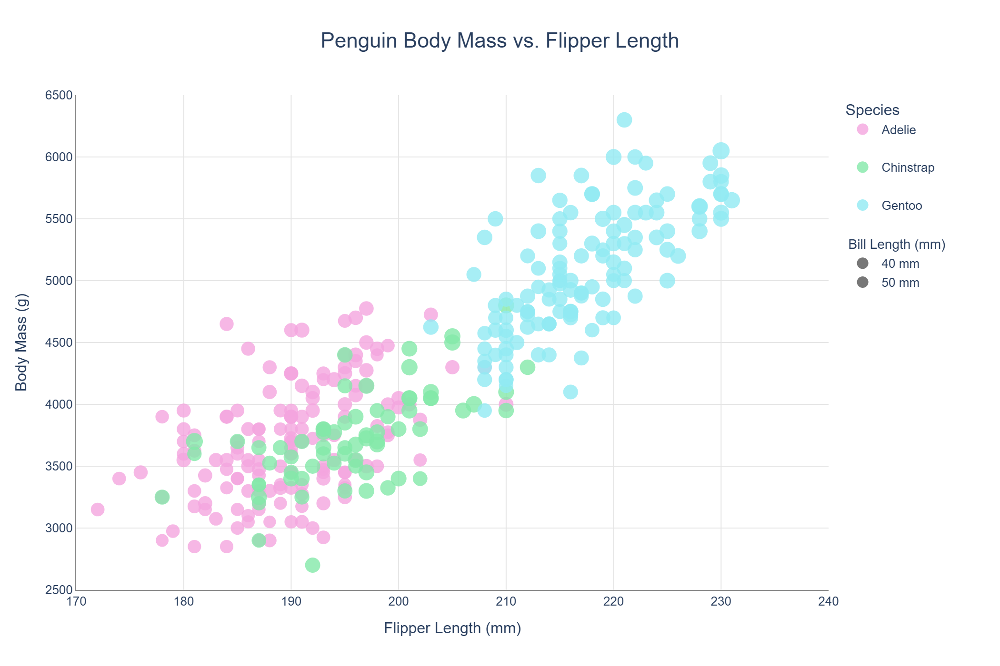
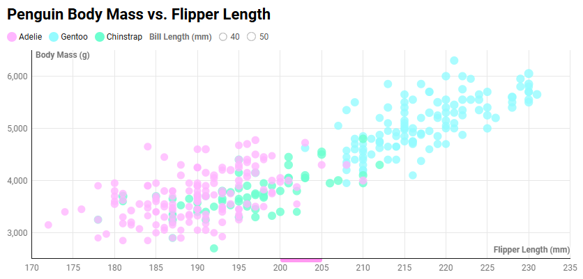

# Assignment 2 — Data Visualization, 5 Ways

## Overview

For this assignment, I recreated the same penguin scatterplot using six different visualization libraries and tools: D3.js, Matplotlib, Plotly, ggplot2, Datawrapper, and Flourish. The goal was to explore different approaches to data visualization and compare how much control each tool provides.

The dataset contains measurements of three penguin species: Adelie, Chinstrap, and Gentoo. Each scatterplot displays flipper length on the X-axis and body mass on the Y-axis. I also used different colors to distinguish the species and different circle sizes to represent bill length.

Throughout the assignment, I tried to maintain consistent axis ranges, colors, and transparency to make the visualizations easier to compare. I also explored the strengths and limitations of coding libraries compared to online visualization tools.

# D3.js

img/d3.png

D3.js is a JavaScript library used to create customizable visualizations for websites. Since I had already worked with D3.js in Assignment 1, I was familiar with some of its basic functions. However, creating a scatterplot using real data was more challenging than manually positioning shapes.

One difficulty was loading the CSV file asynchronously and converting the measurements into numbers. I also needed to filter out missing values so that they would not affect the scales or point positions. Unlike the other tools, D3.js required me to manually define the axes, scales, circle positions, and legends. However, this also gave me more freedom to customize the visualization.

# Matplotlib

Matplotlib is a Python library commonly used for data visualization and analysis. Compared to D3.js, I found Matplotlib easier to use because it provides built-in functions for creating scatterplots.

One challenge was determining the appropriate circle sizes. Initially, the differences between the circles were not very noticeable, so I experimented with different size calculations to make the variation clearer. I also added separate legends for species and bill length.

I think Matplotlib would be useful for research and data analysis because it can generate clear charts with relatively little code.

# Plotly

Plotly is a Python visualization library that supports interactive charts. I used Plotly Express to create the scatterplot and customized the colors, axis ranges, circle sizes, and opacity.

Compared to Matplotlib, Plotly was more convenient for creating interactive visualizations because hover tooltips, zooming, and panning are already built into the library. Users can hover over individual points to view penguin measurements without needing additional JavaScript code.

One challenge was getting the chart to display correctly and exporting it as a PNG. I also needed to adjust the circle-size calculations and create a separate bill-length legend to make the visualization more similar to the reference.

I think Plotly would be useful for interactive dashboards, data exploration, and websites where users need to examine individual data points.

# Datawrapper

Datawrapper is an online visualization tool that allows users to create charts without writing code. I uploaded the penguin dataset and used the interface to assign variables to the axes, colors, and circle sizes.

Compared to the programming libraries, Datawrapper was easier to get started with because I did not need to write code. However, finding certain customization settings was more difficult than expected.

One challenge was adjusting the circle sizes while keeping bill length mapped to size. I also spent time customizing the axis labels, species colors, and legends. I was able to add a size legend showing how bill length affects the circles.

I think Datawrapper would be useful for creating visualizations for reports, articles, and presentations, especially when a chart needs to be produced quickly.

# Flourish

Flourish is an online visualization tool that focuses on interactive and visually appealing charts. Similar to Datawrapper, it allows users to create visualizations through a graphical interface without writing code.

For my scatterplot, I mapped flipper length to the X-axis, body mass to the Y-axis, species to color, and bill length to circle size. I also customized the opacity, axis ranges, labels, and colors.

The biggest challenge was adjusting the bubble sizes. Initially, the circles were extremely large and overlapped significantly, making the chart difficult to read. I had to experiment with the minimum and maximum size settings until the scatterplot became clearer. I also explored the legend settings, although creating a separate bill-length size legend was less straightforward than in some of the other tools.

I think Flourish would be useful for interactive presentations and data storytelling because it provides many visual customization options without requiring programming knowledge.

---

## Technical Achievements

### 1. Creating Visualizations Using Six Different Tools

I recreated the same scatterplot using four programming libraries and two online visualization tools. This allowed me to compare different approaches to visualization development.

D3.js required manual control over most chart elements, while Matplotlib, Plotly, and ggplot2 provided built-in plotting functions. Datawrapper and Flourish allowed me to configure visualizations through graphical interfaces.

### 2. Data Cleaning and Processing

The penguin dataset contained missing values that could cause problems when generating scatterplots. I filtered out observations with missing measurements to ensure that the plotted points had valid values.

In Python and JavaScript, I also converted the measurement columns into numerical values before plotting them.

### 3. Mapping Four Variables in One Scatterplot

I represented four different variables using visual encodings:

- Flipper length: Horizontal position
- Body mass: Vertical position
- Species: Circle color
- Bill length: Circle size

This allowed me to communicate multiple characteristics of each penguin observation within a single chart.

### 4. Interactive Tooltips and Data Exploration

I implemented hover tooltips in D3.js and used Plotly's built-in interactive features.

In D3.js, hovering over a circle displays the penguin's species and measurements. Plotly also allows users to zoom and pan around the chart.

These features make it possible to explore individual observations in greater detail.

### 5. Custom Legends and Circle-Size Mapping

I worked on creating legends that explain both species colors and bill-length circle sizes.

In D3.js, I manually created the legends using SVG elements. In Matplotlib and Plotly, I added size legends using code. In Datawrapper, I used the built-in size legend settings.

This helped me understand how different tools handle legends and visual encodings.

### 6. Exporting and Reproducing Visualizations

I worked with multiple output formats, including PNG images and interactive HTML files.

For the programming libraries, I organized the source code into separate folders so that the visualizations could be reproduced. For the online tools, I exported screenshots of the completed charts.

---

## Design Achievements

### 1. Consistent Species Colors

One of my main design goals was using distinct colors to represent the three penguin species.

I experimented with different color palettes, including softer pastel colors, to make the scatterplots visually appealing while keeping the species easy to distinguish.

Using similar colors across different visualizations also made comparisons easier.

### 2. Improving Circle-Size Differences

Because bill length was represented through circle size, I wanted the differences to be noticeable without making the circles too large.

I experimented with different size scales in Matplotlib, Plotly, D3.js, and Flourish. This was especially important because many observations had similar measurements, causing circles to overlap.

### 3. Using Transparency to Reduce Overlap

I used approximately 80% opacity to make overlapping circles easier to distinguish.

Without transparency, points could completely cover one another, making it harder to understand the distribution of penguin observations.

### 4. Consistent Axis Labels and Ranges

I used descriptive axis labels with measurement units:

- Flipper Length (mm)
- Body Mass (g)

I also adjusted the axis ranges to focus on the dataset instead of starting at zero.

This helped make the upward relationship between flipper length and body mass more visible.

### 5. Clear Legends and Visual Hierarchy

I included species legends and worked on adding bill-length size legends to make the charts easier to interpret.

I also focused on using readable fonts, appropriate spacing, and simple chart backgrounds so that the data remained the main focus.

### 6. Reducing Visual Clutter

One challenge across multiple tools was balancing the amount of information displayed with readability.

I adjusted bubble sizes, opacity, and chart layouts to reduce unnecessary overlap. I also avoided adding too many decorative elements that might distract from the data.

---
## AI Use
I used AI to guide me in solving issues I may be having with my graph such as why the bubble size was weird and why things aren't showing up the way that I want them to be. I also used AI to organize my README.