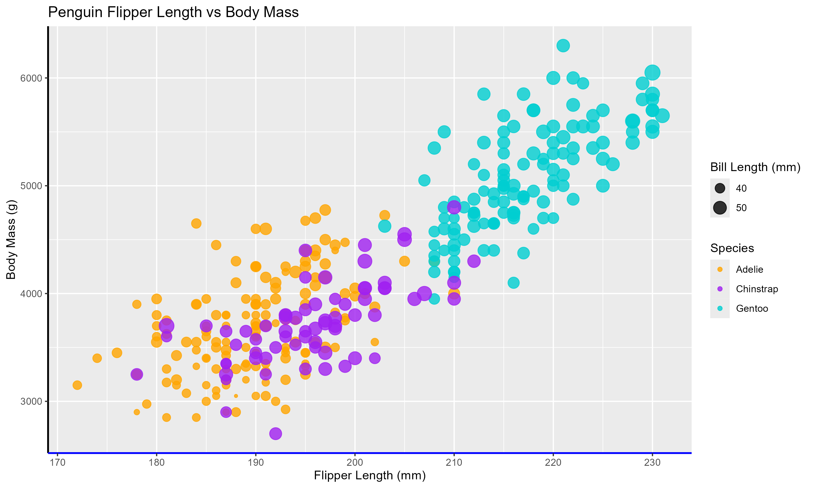

# R + ggplot2 + ggplotly
R is a statistical programming language typically used for different ideas related to different ideas within data science or just overall data analysis. Meanwhile ggplot2 is a popular R package that is utilized to create different visualizations of data. This is what I used to overall create what the chart would look like I used geom_point_interactive to plot out the different data points. There were other details involved as well such as scale for the specific color mapping, theme to add a few other design pieces to the graph, labs for labels etc. It took a little bit of time to understand how the different pieces worked but since it's just a few lines of code it wasn't too bad. I used ggplotly to enable more interactivity within the graph and printed it so that way it would actually display. A difficult part of creating this was just figuring out how to run R properly on VS Code. However what was most difficult was the fact that ggplotly fought me on being able to make a second legend and it just didn't happen. 
Static Graph that has both legends because plotly sucks:

Regular Graph:

Graph After Being Interacted With:

# D3
D3 is a javascript libarary that is able to build out data visualizations by building out different visual components to represent data. This was by far the most tedious visualizations to create out. The rest of the visualizations were using languages like Python felt like they were holding your hand since they have all these automatic functions built in to help you out. d3 since it is javascript and therefore not on the same level as python doesn't have those precautions in place insteading needing to manually build out the different axis and then all the different pieces such as the domain etc. Interactivity was the same way with needing to find the perfect way to get a respnsive graph without moving the whole chart. We had already worked with d3 before so I already knew how to build out shapes and have interactivity pieces but actually putting that into a coherent visualization instead of just a silly little picture was definitely an upgrade in knowledge.
Regular Graph:

Graph That is Interacted With:

# Altair
Altair is a python library that is used to create different data visualizations. Since its Python and python is so high level I found that the pieces were quite simple to learn and only took a few lines of code. I first used pandas to be able to read the csv data and used mark_circle within the Alt.Chart to actually plot out the different points. There there was just different pieces to do within the Chart such as the encoding and the properties to properly set up the pieces that were necessary so that way the data can be properly represented. Adding some of the other features such as the interactivity only required adding a .interactive to the chart. In order to actually run the code I used chart.save to put all the code into an html file so that way I could display the graph on a webpage in a simple format
Regular Graph:

Graph After Being Interacted With:

# Vegalite
Vegalite is a way to create visualizations utilizing a JSON Syntax. Altair and Vegalite are connected because Altair is built directly on top of Vegalite's specification. This means that Vegalite and Altair have a lot of similar features that they utilize (encoding for the different fields, etc). Even the way they display graphs is the same so its clear to see that they are related to one another in some way I was already familiar with JSON syntax due to working with JSON schemas and had already done the Altair visualization at this point so it wasn't the most difficult visualization to complete. The most annoying thing about it was because Vegalite is kind of its own thing I had to install an extension to preview the Vega Graph and run that in a very specific way in order to be able to actually display the graph.
Regular Graph:

Graph After Being Interacted With:

# MatplotLib
Matplotlib is another Python Library that is used to plot out different data visualizations. Again because python is so high level of a language it wasn't too difficult to set up with only a few lines of code as different pieces are already built into the language which is nice. Like Altair I had to use pandas to be able to properly get the csv data and then I was able to plot it out using a scatterplot and overall different plt commands. To add some more interactivity outside of the base activity being able to click and drag rather than the base toolbar it required using mplcursors and setting that up. I've used matplotlib in some of the other classes that I've taken at WPI such as Intro to AI, Machine Learning etc so I was already familiar with the tool and how to get graphs to show up.
Regular Graph:

Graph After Being Interacted With:

## Technical Achievements
- **Multiple Pieces of Interactivity**: For every single visualization I added multiple different pieces of interactivity including ...
    - Being able to move around the graph with pan usually by click and drag (I'm pretty sure R is the only exception where you have to click into the tool bar and select pan and then click and drag around because of the way the R library is set up)
    - Being able to zoom in on the graph usually by doing the 2 finger slide (R is the only one not fully like that cause same idea)
    - When you hover over a specific point it will give you information about that specific point in a little box

### Design Achievements
- **Color System**: I tried to keep the same overall color scheme that the original example has for the species with Orange for Adelie, Purple for Chinstrap and a blueish greenish for Gentoo
- **Better Understanding of Visualization** I added different features in that should hopefully make understand the data easier such as making sure that every single visualization has a lengend for species and bill length, grid within the different parts of the graph and even an overall title to represent what the graph is about
-**Miscellaneous** I also added a small little theme to the R graph and messed around with a few little details like making the bottom axis blue
