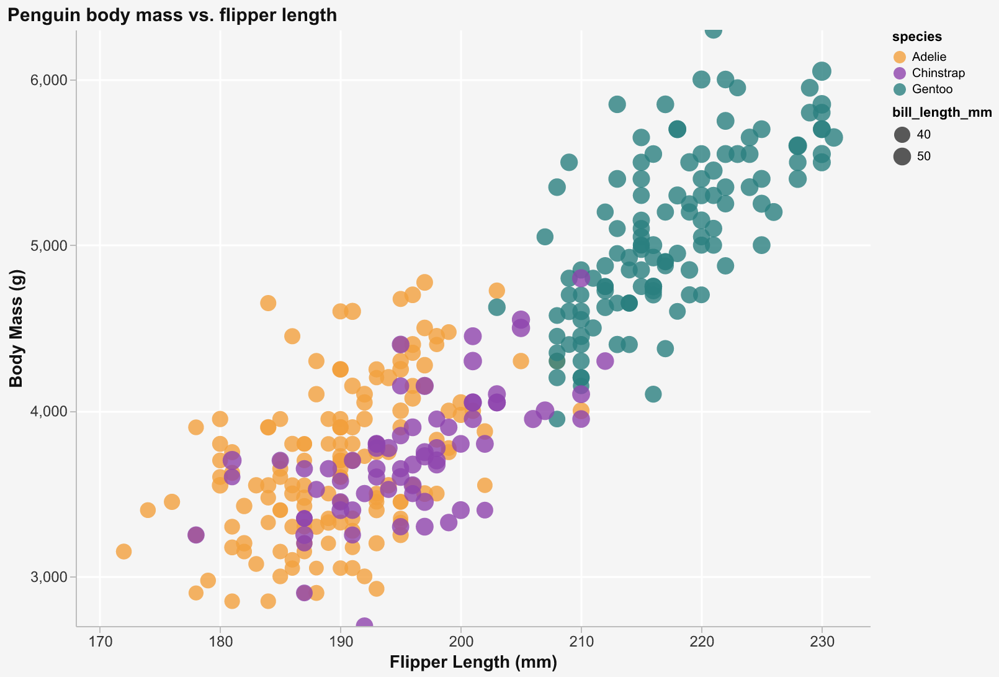
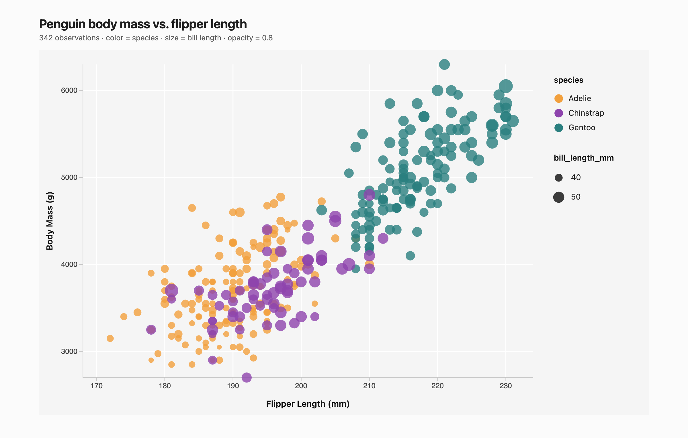
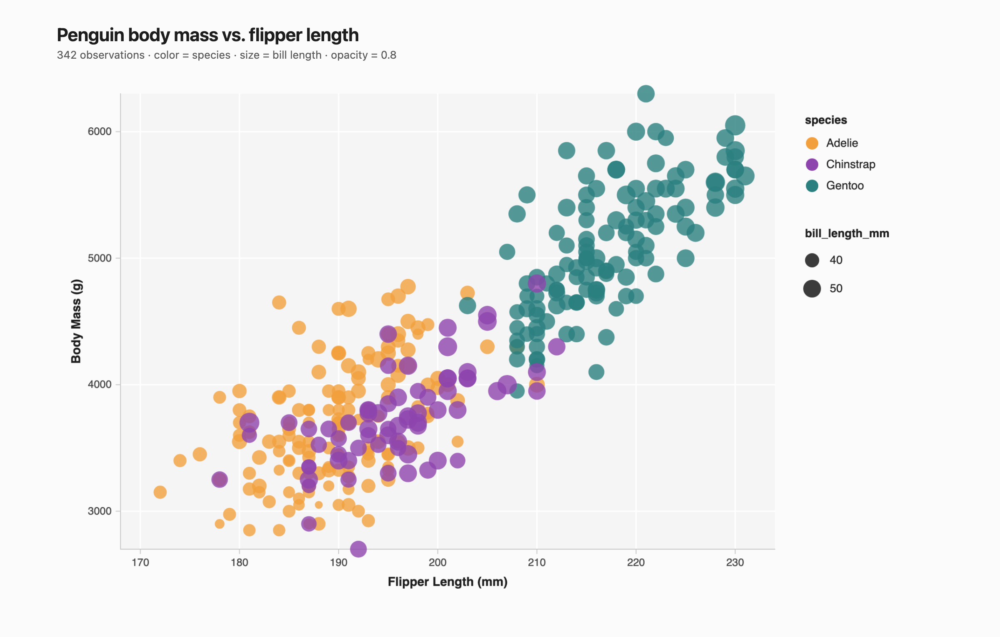
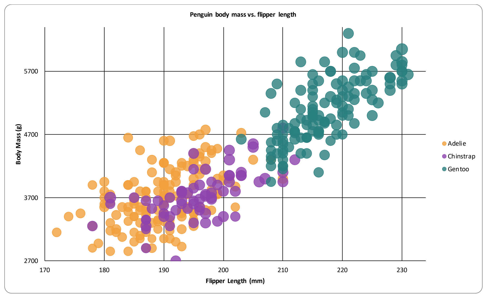
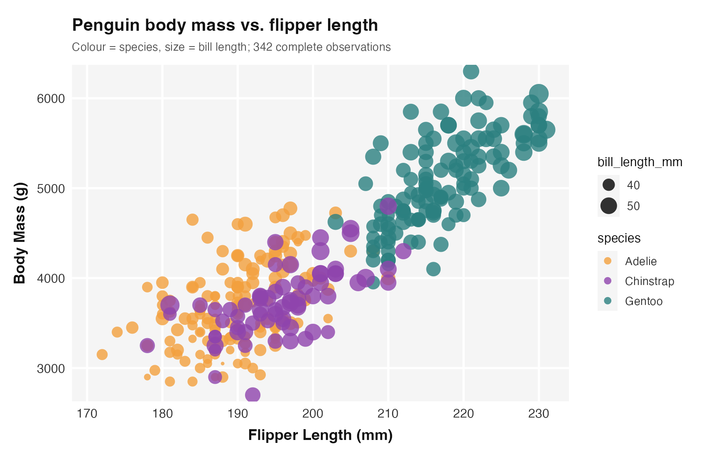

# Penguins, Five Ways

**Savio Ketnouvong**

## Live demos

GitHub Pages serves the whole project from the repository root. After the Pages
workflow runs, these links work without cloning or installing anything:

| Tool | Link |
|------|------|
| Python + Altair | https://saviocloud.github.io/a2-saviocloud-savio-ketnouvong/PythonAltair/penguins_altair.html |
| Java + D3 | https://saviocloud.github.io/a2-saviocloud-savio-ketnouvong/JavaD3/ |
| Java + p5.js | https://saviocloud.github.io/a2-saviocloud-savio-ketnouvong/JavaP5JS/ |
| Excel workbook | https://saviocloud.github.io/a2-saviocloud-savio-ketnouvong/Excel/penguins.xlsx |
| R + ggplot2 image | https://saviocloud.github.io/a2-saviocloud-savio-ketnouvong/RStudio/penguins_rstudio.png |

The root `index.html` is the landing page for those demos. The workflow in
`.github/workflows/pages.yml` regenerates the browser data and deploys the site
on every push to `main`; it can also be started manually from the Actions tab.
If you fork the repository, set **Settings → Pages → Build and deployment →
Source** to **GitHub Actions** once.

| # | Tool | Type | Deliverable |
|---|------|------|-------------|
| 1 | Python + Altair | code library | `PythonAltair/penguins_altair.py` |
| 2 | Java + D3 v7 | language + code library | `JavaD3/PenguinServer.java`, `JavaD3/main.js` |
| 3 | Java + p5.js | language + code library | `JavaP5JS/PrepareData.java`, `JavaP5JS/sketch.js` |
| 4 | Excel | dedicated tool | `Excel/penguins.xlsx`, built by `Excel/build_excel.py` |
| 5 | R + ggplot2 (RStudio) | language + code library | `RStudio/penguins_rstudio.R` |

## The data

`penglings.csv` contains 344 observations. Two rows have no measurements at all
(`NA` in every numeric column), so all five versions drop the rows that are missing
`bill_length_mm`, `flipper_length_mm`, or `body_mass_g`. That leaves **342
observations** plotted in every chart.

The code-based charts share the same constants so the five screenshots can be
compared (Excel adds a little headroom at the top of the y-axis, and
ggplot2 adds 2% expansion so the edge circles are not clipped):

```text
Adelie    #F2A03D
Chinstrap #8E44AD
Gentoo    #2A7F7F

x domain  168–234 mm, ticks every 10 mm
y domain  2700–6300 g, ticks every 1000 g
opacity   0.8
```

---

# Python + Altair



Altair was the quickest way I recreated the chart. I was able to easily adapt
the reference: `mark_circle(opacity=0.8)` into the code, which supplies the
marks, and the `x`, `y`, `color`, and `size` channels carry the encodings. The
`tooltip` channel adds observation details that the ggplot2 image cannot show.

What was easy was the declarative API, the built-in color, size legends, and the
automatic handling of missing values after the `pandas.dropna()` call. What was
difficult was the fine controls. Altair chooses “nice” axes that start at
zero, so I had to set non-zero domains with `alt.Scale(domain=...)`,
and I had to set the exact tick positions with `alt.Axis(values=...)`.
Exporting a PNG also needs `vl-convert-python`, which is listed in
`requirements.txt`.

The HTML output is interactive, which is where Altair excels. I can use quick
charts that look polished, with the only issue was forcing the domains and tick
values to match the reference instead of accepting the defaults.

# Java + D3



`PenguinServer.java` reads `../penglings.csv` with a small CSV parser that handles
quoted fields and doubled quotes, discards rows with `NA` measurements, and
serves the result as `/data.json`. The same process also serves the HTML, CSS,
JavaScript, and vendored D3 build, so there is no CORS problem and no fragile
`file://` data loading.

What was easy: total control over the visual result. `d3.scaleLinear()` with an
explicit domain makes the non-zero axes trivial, and `d3.scaleSqrt()` gives the
bill-length bubbles an area-proportional size. What was difficult: everything
D3 does not do for you — axes, gridlines, both legends, and the asynchronous
`d3.json()` load all have to be wired up by hand. The drawing code waits for the
promise to resolve before appending circles, which avoids the classic “empty
chart because the data has not arrived yet” bug.

I added hover tooltips (with a highlighted ring around the selected point) and
made each circle focusable with `tabindex`, so the details are available from the
keyboard as well as the mouse. The SVG also has an `aria-label`. This is the
version I would reach for when a chart needs bespoke interaction or layout that a
charting library will not express.

Files: `JavaD3/PenguinServer.java`, `JavaD3/main.js`, `JavaD3/index.html`,
`JavaD3/style.css`, `JavaD3/lib/d3.v7.min.js`.

# Java + p5.js



`PrepareData.java` does the same CSV cleaning as the D3 server and writes
`data.json`; the sketch fetches that file and calls `redraw()` when it arrives.

What was easy was the drawing. `circle()`, `line()`, and `text()` are what the
visual needs, and `pixelDensity(2)` keeps the canvas looking nice on the display.
What was difficult was the missing chart attributes. Linear scales, axis ticks,
legends, and hover hit-testing all had to be implemented manually, including the
nearest-point search in `mouseMoved()`. Also, the `noLoop()`/`redraw()` cycle used
to highlight a point had to be implemented also. A canvas is also a single bitmap,
so accessibility and text selection is worse when comparing it to the D3 chart.

Files: `JavaP5JS/PrepareData.java`, `JavaP5JS/sketch.js`, `JavaP5JS/index.html`,
`JavaP5JS/style.css`, `JavaP5JS/lib/p5.min.js`.

# Excel



Excel has  **bubble chart** maps x, y, and a size value to bubble area. The workbook
is generated with `openpyxl`: one sheet holds the clean table plus a contiguous
x/y/size block for each species, and a second sheet holds a native bubble chart
with one series per species so the three colors can be controlled independently.

What was easy was creating the chart. Once the columns are arranged, Excel's gave
the right trend. What was difficult was the automation and polish. `openpyxl`
does not expose per-series marker transparency, so `build_excel.py` unzips the
saved workbook and patches `xl/charts/chart1.xml` to add `<a:alpha val="80000"/>`
to the three species colors. The title and axis-title `overlay` flags also had to
be turned off; otherwise Excel draws the titles on top of the plot area.

There are two issues when comparing to the reference:

1. **Y tick labels are 2700 / 3700 / 4700 / 5700.** Excel anchors major units at
   the axis minimum, so a minimum of 2700 with a 1000 g interval cannot produce
   the reference's 3000 / 4000 / 5000 / 6000 labels. Starting at zero was not an
   option, and shifting the minimum would move the data away from the scale.
2. **No size legend.** An Excel bubble chart has a color legend, but it doesn't have
   a size legend. So the bill-length mapping is explained in the README instead of
   on the chart. 

The chart is exported to PDF from Excel and cropped for the screenshot; the workbook
keeps the data sheet visible for inspection.

Files: `Excel/build_excel.py`, `Excel/penguins.xlsx`.

# RStudio



In RStudio, I mapped the colour to `species` through `scale_colour_manual()`,
and marker size is mapped to `bill_length_mm` through `scale_size_continuous()`.
The size legend uses 40 mm/50 mm representative values like the other versions.

What was easy was that ggplot2 uses the same grammar of graphics used by the
reference image. So `aes(x = flipper_length_mm, y = body_mass_g, colour =
species, size = bill_length_mm)` describes the entire encoding in one place.
`theme_minimal()` and `element_*()` overrides reproduces the `#F5F5F5` panel,
white gridlines, and right-hand legends without hand-drawing any chart furniture.

What was difficult was matching the non-zero axis while showing complete circles.
With `limits = c(2700, 6300)` and no expansion, the largest and the smallest markers
are sliced by the panel edge, so the y scale uses `expansion(mult = 0.02)`.
The script also produces the same files whether it is run with `Rscript` from the
project root or sourced from the RStudio editor.

Files: `RStudio/penguins_rstudio.R` → `RStudio/penguins_rstudio.png`,
`img/rstudio.png`.
---

# Technical Achievements

- **One cleaning contract, every tool.** Python, Java, JavaScript, and R all keep
  the same 342 complete observations. The two fully-empty rows never reach a chart.
- **A Java data service for D3.** `PenguinServer.java` converts the raw CSV to
  `/data.json` and it also serves the static site, which removes both the
  `NA`-to-`NaN` problem and the `file://` CORS problem. It finds the repository
  from either the root or `JavaD3/`, and it refreshes the static `data.json`
  snapshot used by GitHub Pages.
- **A GitHub Pages build that needs no server.** The root `index.html` links all
  five deliverables, and `.github/workflows/pages.yml` deploys them. The browser
  charts read checked-in `data.json` snapshots, so the D3 and p5.js pages work on
  Pages where Java is not available.
- **One reproducible data snapshot.** `scripts/build_static_data.py` uses only the
  Python standard library to regenerate both `data.json` files, so the Pages data
  and the Java output cannot silently drift apart.
- **Correct size encoding.** D3 and p5.js both use `sqrt`, Excel uses a bubble
  chart whose size value represents area, ggplot2's `scale_size_continuous()`
  maps to area by default. This avoids mapping a numeric value linearly to radius.
- **Portable R script.** `penguins_rstudio.R` resolves its own location at
  runtime, so the same file works from the project root, from inside `RStudio/`,
  and when sourced in the RStudio editor. It regenerates both the local PNG and
  the README image with one command.
- **Interaction and accessibility.** The D3 chart has hover and keyboard-focus
  tooltips, `tabindex` on every point, an `aria-label` on the SVG, and
  `role="status"` on the tooltip. The p5.js chart adds nearest-point hit-testing
  and a redraw-on-hover loop. Altair adds pan/zoom and tooltips through
  `.interactive()`.
- **OOXML post-processing in Excel.** Because `openpyxl` cannot write marker
  values, the build script rewrites the chart XML inside the `.xlsx` zip to
  add 20% transparency to each species fill. This keeps the workbook native while
  still meeting the opacity requirement.
  
## Design Achievements

- **A single palette across all five tools.** The orange, purple, and teal were
  eyedropped, and reused in Altair, D3, p5.js, Excel, and RStudio, so switching
  tools does not change the chart.
- **Consistent geometry.** All use non-zero, fitted axes, 10 mm / 1000 g tick
  intervals, 80% opacity, and the same species ordering in the legends.
- **A quiet chart surface.** A light `#F5F5F5` panel with white gridlines, muted
  grey axes, and dark text keeps attention on the data. The ggplot2 theme
  reproduces the same treatment with `theme_minimal()`.
- **Readable overlap.** The combination of 0.8 opacity, area-based sizing, and
  the three-color palette makes the regions readable.
- **Legends that explain the encodings.** Species color and bill-length size are
  shown as separate, ordered legend groups; the size legend uses 40 mm and 50 mm
  as representative values rather than an unreadable continuous ramp.
