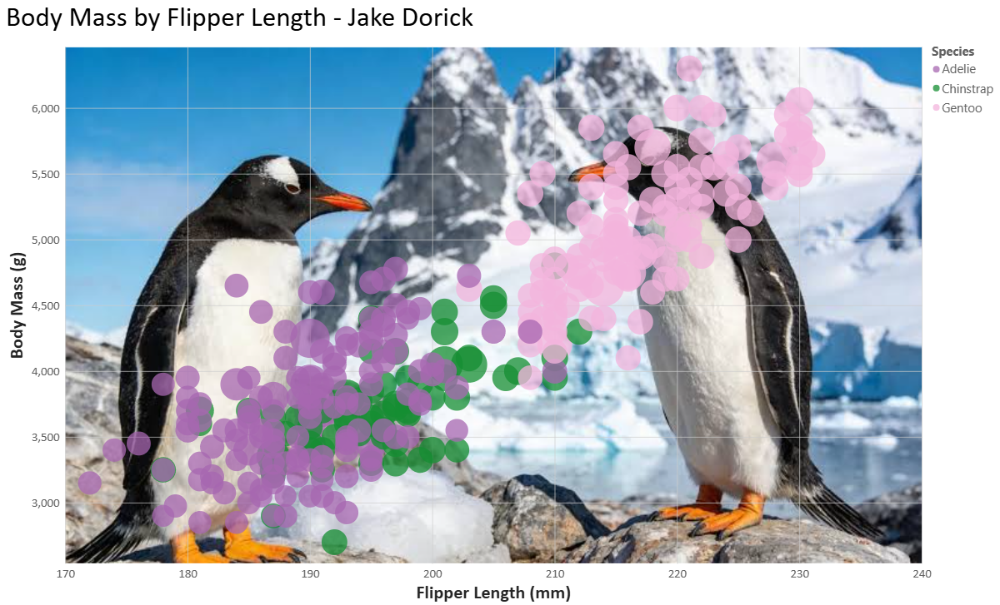
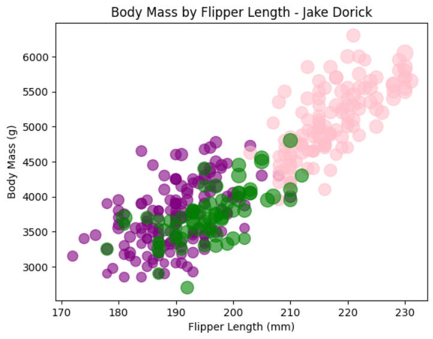
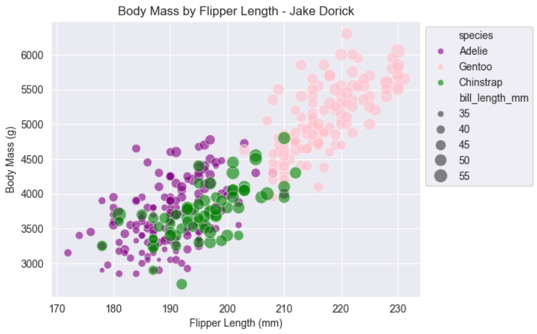
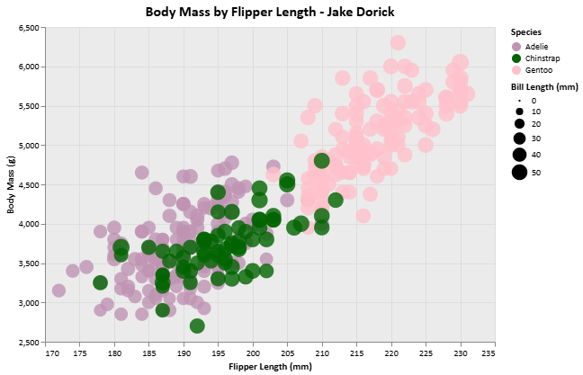
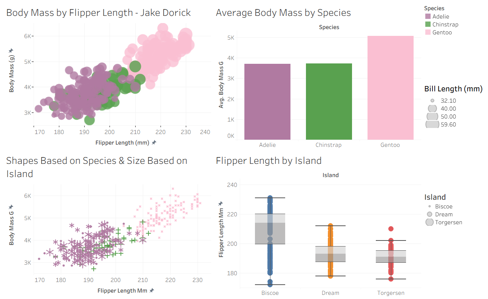
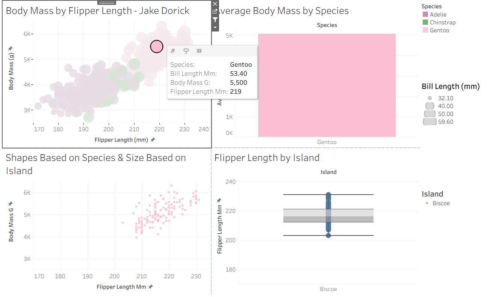

Assignment 2 - Data Visualization, 5 Ways  
===

## Author: Jake Dorick

# R + ggplot2 + R Markdown

The first visualization I attempted was using R since it would be the most easiest for me. I have used R in numerous classes here at WPI and I am currently a PLA for MA 2621 in which I teach R.
R is a language primarily focused on statistical computing.
ggplot2 is a popular library for charting in R.
R Markdown is a document format that compiles to HTML or PDF and allows you to include the output of R code directly in the document.

To visualize the penguins dataset, I made use of ggplot2's `geom_point()` layer, with aesthetics functions (particularly `scale_color_manual()`) for the color and size.

I attempted to recreate the original chart as accurately as possible to base the next visualizations off of this one.

# d3

d3 is a JavaScript library for building visualizations out of SVG elements in the browser. I did all of my code within an HTML file rather than splitting off into .html and .js files. 

I appended the panel, gridlines, ticks, labels, and one circle per penguin using d3 scales to convert data values into pixel positions. However, a few instances of positioning was done manually after difficulty with the `xScale()` and `yScale()` functions. 

d3 gives exact control over the visualization, but is incredibly arduous and is not something I would see myself using in the future for visualization tasks. I was missing one semicolon and it took me like 15 minutes to realize why nothing was loading in my localhost web server.

# Datawrapper

Datawrapper is a web tool for creating charts by uploading your data directly into your web browser. The website allows you to create the generic graph without having to log into an account; however, to publish your work, a free account is needed. I had used this software before, in high school, so making this chart was quite easy.

I could see myself using Datawrapper in the future for creating quick visualizations that do not require the use of a programming language. There is certainly less customizability in Datawrapper compared to other visualization softwares in this assignment, but if speed is desired, Datawrapper is incredibly efficient.

# Excel

Excel is the most well-known and influential spreadsheet program in the world. Nonetheless, recreating the visualization in Excel was one of the most annoying tasks of this assignment. 

Figuring out how to set species as color and bill length to size is not as approachable as other software. Excel does not show a bubble-size legend and also does not make the difference in sizes nearly as noticeable as other software. Copying the CSV into Excel also messed with some of the data. My first version of the visualization had some penguin species mixed up, so I ended up having to reset the sheet and sort the data by species so each series pointed at the correct rows. 

# PowerBI

PowerBI is a business intelligence tool for building interactive reports. This software is very similar to another software I used, Tableau. Luckily for me, I have used both of these softwares before, so the data visualization aspects came incredibly easy to me. 

However, before you are able to do data visualization in PowerBI, you must transform your data. PowerBI is notoriously bad at recognizing data types in columns of CSV files, so I had to manually go in to the dataset, change all 'NA's to `null`, and change the data types to be numeric decimals. 

After that though, the visualization aspects are incredibly simple. PowerBI even offers the ability to change the background image to an image on your computer, so I decided to make it an image of two penguins! 🐧

# Python: Matplotlib, Seaborn, Altair

I have undoubtably the most experience in Python. I have used Matplotlib and Seaborn to make visualizations before, so I used both of those libraries. Beyond that, I have never used Altair before, but after learning about it, I think it has become my favorite Python visualization library. 

### Matplotlib

Matplotlib is the base plotting library in Python. I used `plot.scatter()` to fulfil the basic requirements of the visualization. Nothing fancy happened in Matplotlib. The only data manipulation that had to occur was that I mapped size to `bill_length_mm ** 2 / 15` to make the difference more dramatic.

### Seaborn

Seaborn is built on Matplotlib. I used `sns.scatterplot()` to make the visualization, adjusting the `hue` and `size` features to match the requirements. The only difficulty I ran into was placing the legend to the top right portion of the chart, as Seaborn automatically places legends inside the chart. 

Seaborn is probably the most useful for professionals trying to make appealing graphics. Seaborn has a good mixture of ease-of-use and complexity for specific visualization needs. 

### Altair

Altair is a declarative statistical library, meaning that the user declares what data and relationships to visualize instead of drawing individual elements like Matplotlib. This makes the code look very clean and easy to understand after looking at the documentation. 

Most importantly, Altair allows for interactivity in its visualizations. From my visualization, you are able to zoom, highlight individual points, and see all relevant information (bill length, species, body mass, and flipper length) as part of a tooltip. 

# Tableau

Tableau is a drag-and-drop visualization tool very similar to PowerBI in UI, but arguably much easier to use. No data manipulation was necessary for Tableau unlike PowerBI. I have used Tableau since high school and has been a personal favorite for creating a wide variety of visualizations.

Smaller, fine formatting, can be difficult at times. For instance, to my knowledge, there is now way to add manual ticks to a graphic. I spent a long time trying to figure out how to add the little black lines by each tick marker, but eventually gave up. Peculiarly, if you click on an axis in Tableau, the black lines appear, but as soon as you deselect the axis, the lines disappear. 

### Main Visualization

### Dashboard

I also created a dashboard with interactive elements as a part of my design and technical achievements. More details regarding this are in the technical and design achievements section below.

### Interactivity

Details regarding the interactivity of my Tableau dashboard are in the technical achievements section. 

## Technical Achievements

First and foremost, I created more visualizations than the base assignment requires. In total, I used **seven** softwares (R, d3, Datawrapper, Excel, PowerBI, Python, and Tableau) and from those seven, I used three Python libraries (Matplotlib, Seaborn, and Altair), for a total of nine visualizations.

My familiarity with so many of these tools allowed me to easily create multiple graphics in various softwares and showcase my familiarity by creating consistency across graphs. 

Interactivity is present in two of my visualizations, which are able to be accessed in the files of this repository. First, Altair's functions allowed me to create a tooltip function and a highlighting function for the graphic. By adding a `pick` parameter to Altair, I was able to accomplish this. Secondly, and most notably, is within Tableau. Through my familiarity of Tableau, I was able to create three different types of graphs (the scatter plot required, a bar chart, and a boxplot). Beyond that, I created an interactive dashboard which allows the user to click on a certain point in the scatterplot, and have the other charts change. This was done through Tableau's *Dashboard Actions*.  

## Design Achievements

As briefly mentioned in the Technical Achievements, my familiarity with so many of these tools allowed me to create consistency across the graphics. Most notably are in the form of color choices, font choice (Calibri where applicable), the legends, and the background grids. 

The noticeable exception to this is PowerBI's penguin background grid; however, I felt it was more important to show off PowerBI's design capabilities rather than stay consistent.

In a majority of other instances, I kept color consistent, either by using words or inputting HEX codes for the species colors. That is, I chose purple for Adeline, dark green for Chinstrap, and pink for Gentoo. Datawrapper unfortunately only has basic color choices in its free version, so the color for Chinstrap is slightly off. 

Nonetheless, consistency with axis titles, the chart title, legend location (top right where legends were able to be added), point shape (always circular), and a grey background grid (I used #EBEBEB to match ggplot).

Lastly, color choices for species remain consistent in the dashboard, shape is used as a visual tool in the dashboard, and color choices change when referencing the `island` feature (bottom right boxplot in the Tableau dashboard). 
