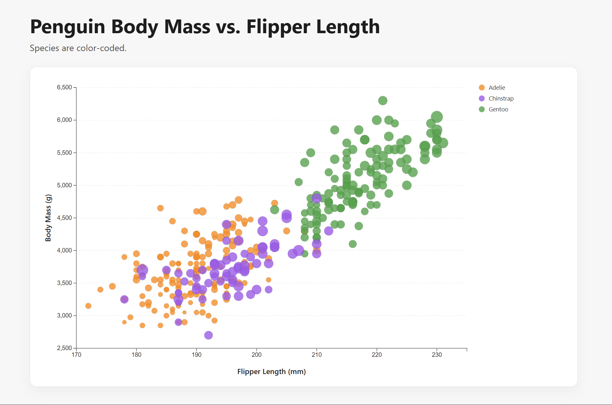
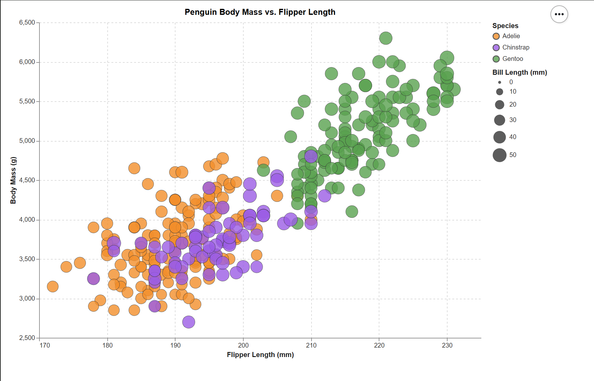
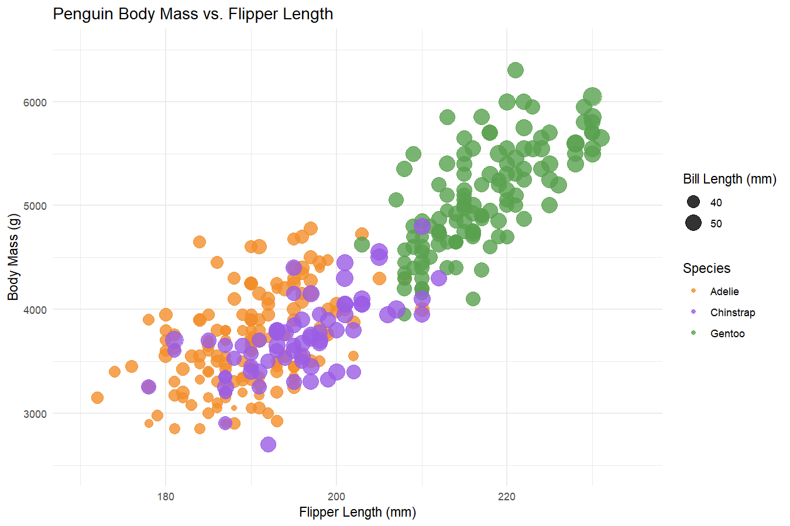
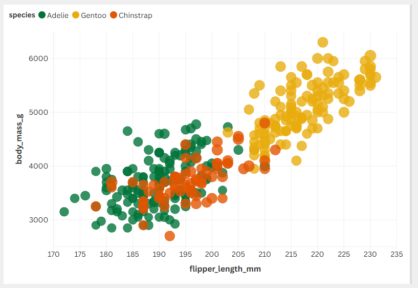
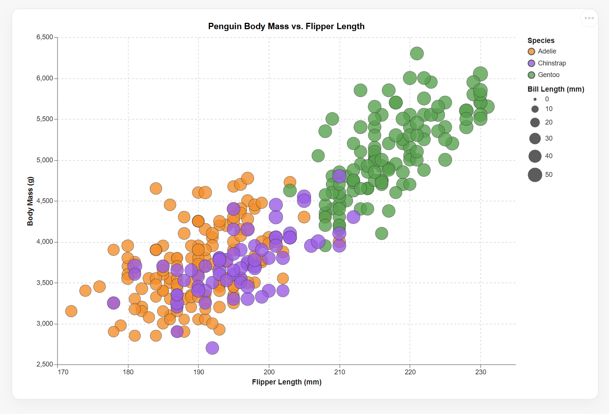

# d3

D3 gives me alot of control over how the chart is drawn in the browser, which made it possible to customize the axes, legend and tooltips. It was a bit difficult to figure out the loading of CSV async and filtering out rows with missing measurements. This took more setup than the higher-level chart tools below. It seems useful when I want customized interactions or a design that is difficult to express with a standard charting API.

# Altair

Altair let me describe the chart through its visual encodings instead of manually drawing each mark. I had to make the data URL relative to the HTML page and run a local web server so the browser could load the CSV. I felt like this one wasn't very difficult compared to d3, might be biased since I'm used to coding in Python.

# R + ggplot2

ggplot2's felt straightforward when building the scatterplot and when mapping species and bill length to the visual elements. I filtered out rows with missing chart measurements and used manual colors and non-zero axis limits to match the reference img. I didn't have to draw each point manually which is a plus.

# Flourish

Flourish is the highest-level platform for data vis among the 5 which made it stupidly easy to use. I simply had to upload the data and change the axes a little bit to get what I want. It seems perfect if you don't want to code and is looking for something quick and easy, but the tradeoff is that there aren't much customizations you can do. Not sure if there is a pro plan that sovles this.

# Vega-Lite

Vega-Lite itself was not hard to write, but figuring out how to display the spec in a browser took quite a bit of googling since I couldn't find out a way to upload CSV onto the web editor and display it on there.

## Technical Achievements

- Added hover details to the D3 and Altair charts.

## Design Achievements
