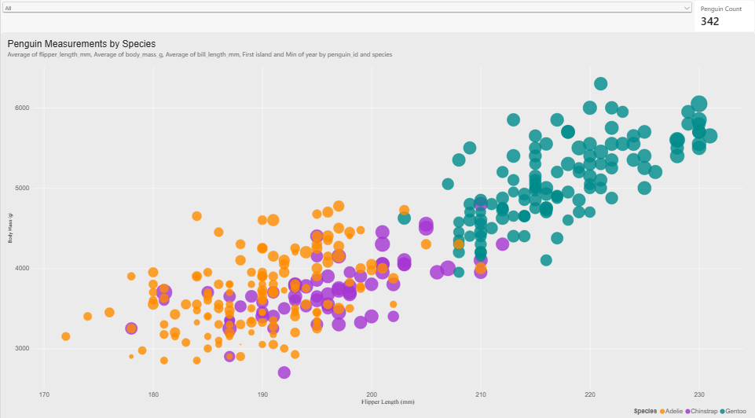

# d3.js

For this visualization, I used D3.js to recreate the original penguin scatterplot using JavaScript. The goal was to match the original graph by plotting flipper length on the x-axis, body mass on the y-axis, using different colors for each species, and changing the circle sizes based on bill length. D3 required me to manually create the axes, scales, gridlines, circles, and legends. One challenge was figuring out how to convert the data values into positions on the graph while keeping the correct axis ranges. I also had to make sure the CSV loaded correctly and remove the missing values. Once I understood how the scales worked, adding and customizing the circles was relatively straightforward. I also found that changing colors, fonts, and other design elements was easy because I had direct control over them in the code. I think D3 is most useful for creating highly customized and interactive visualizations where you want complete control over how everything looks and behaves.

Technical Achievements

I added two interactive features to improve the visualization. The first was a tooltip that displays additional information when hovering over a penguin, including its species, measurements, island, and year. I also added buttons that allow users to filter the chart by species. This makes it easier to compare individual groups without having all three species displayed at the same time. The number of visible penguins also updates when a filter is selected.

Design Achievements

I tried to recreate the original chart's appearance by using a light gray background, white gridlines, and similar axis ranges. I also chose a consistent color for each species and used the same colors in the legend. I adjusted the circle sizes based on bill length and kept the opacity at 0.8 so overlapping points would still be visible. I used Arial and made the labels large enough to read. I also added a darker outline when hovering over a circle to make the selected point easier to identify.

# R + ggplot2

For this visualization, I used R and the ggplot2 library to recreate the original penguin scatterplot. Since the example was originally created using ggplot2, I wanted to match its appearance as closely as possible, including the colors, circle sizes, axis ranges, and gray background with white gridlines. Compared to D3, ggplot2 made the process much easier because it automatically handled the axes, legends, and positioning of the points. Mapping the different data variables to the graph was also relatively simple using the aes() function. One challenge was adjusting the formatting options to get the graph looking as close to the example as possible. I also had some difficulty getting the interactive Plotly version to display correctly in RStudio's Viewer, which required troubleshooting. I think ggplot2 is most useful for quickly creating detailed and accurate visualizations for statistical analysis, especially when working with datasets that need to be explored or compared.

Technical Achievements

I added an interactive version of the chart using the Plotly library. This allows users to hover over individual penguins and view their exact measurements, species, island, and year. I also added the ability to hide or show different species through the legend and zoom in on areas of the graph. In addition, I created a second version with regression trend lines for each species. This helps show the overall relationship between flipper length and body mass within each group.

[Open the interactive R visualization](r-ggplot2/penguins-interactive.html)

Design Achievements

I tried to make the chart closely resemble the original by using a gray background, white gridlines, similar axis ranges, and semi-transparent circles. I kept the same species colors as my D3 visualization so they would be easier to compare. I also adjusted the font sizes, axis labels, legends, and circle sizes to improve readability. For the version with trend lines, I used thin lines that match the species colors to add information without making the graph too cluttered.

Additional Note

One limitation I noticed was that the interactive Plotly version did not look exactly the same as the static ggplot2 chart. Some aspects of the circle sizing and legend formatting changed when converting it. However, I was able to keep the original static visualization for comparison while using the interactive version to explore the data.

# python + altair

For this visualization, I used Python with the Altair library to recreate the original scatterplot. I used pandas to load the penguin dataset and remove incomplete observations, then used Altair to represent flipper length, body mass, species, and bill length through the position, color, and size of the circles. I also adjusted the opacity, axis ranges, and background to match the original figure. Creating the basic graph was fairly easy because Altair allows you to map the data columns directly to visual properties without manually drawing each element. Adding tooltips was also simple compared to D3 because Altair has built-in support for interactions. One challenge was understanding how the encoding and formatting options worked, particularly when trying to match the circle sizes and legends to the original. I think Altair is most useful for quickly creating clean, interactive visualizations in Python, especially when you're already using pandas to process and analyze data.

Technical Achievements

I added several interactive features to improve the visualization. First, I included tooltips that display the exact measurements and other information about each penguin when hovering over a circle. I also made the species legend clickable so users can highlight one species while fading the others. This makes it easier to compare the different groups without removing the other data points completely. Finally, I enabled zooming and panning, which allows users to examine sections of the graph more closely when points overlap.

[Open the interactive Altair visualization](python-altair/penguins-interactive.html)

Design Achievements

I tried to make the chart look as close to the original as possible by adjusting the background, gridlines, axes, and circle sizes. I used the same orange, purple, and teal species colors as my D3 and R visualizations so the charts would be consistent. I also used Arial and adjusted the axis labels and legend text to make them easier to read. The circles use 80% opacity, similar to the original, and their sizes are based on bill length. One difference is that Altair scales circle sizes differently than D3 and ggplot2, so I had to adjust the size range to get a similar appearance.

# tableau

For this visualization, I used Tableau Public to recreate the penguin scatterplot without writing code. I imported the dataset and assigned flipper length and body mass to the axes, species to color, and bill length to circle size. I then adjusted the axis ranges, colors, transparency, gridlines, and legends to make the graph resemble the original. Creating the basic scatterplot was easy because Tableau uses a drag-and-drop interface, and I didn't have to write any code to map the data. Adding tooltips and filters was also relatively simple using the built-in options. One challenge was that Tableau initially aggregated the data, which caused multiple penguins to be grouped together instead of appearing as individual points. I had to disable aggregation and make sure the missing measurements were handled correctly. Some of the formatting settings were also difficult to locate. I think Tableau is most useful for quickly exploring datasets and creating interactive dashboards that can be understood and used by people without programming experience.

Technical Achievements

I added several interactive features to improve the visualization. First, I customized the tooltips to display additional information about each penguin, including its measurements, species, island, and year. I also added a species highlighter that lets users focus on one species while keeping the other observations visible in the background. Finally, I added a dropdown filter that allows users to display individual species instead of the entire dataset. These features make the chart easier to explore and help users examine specific groups of penguins.

Design Achievements

I tried to make the chart as similar to the original as possible by adjusting the axis ranges, gridlines, background color, and circle sizes. I used the same orange, purple, and teal species colors as my other visualizations to keep them consistent. I also set the circle opacity to 80% and adjusted the font sizes to make the labels and legends easier to read. One difference was that Tableau handled circle scaling and legend formatting differently from ggplot2, so I adjusted those settings manually to get as close to the original as possible.

# power-bi

For this visualization, I used Microsoft Power BI Desktop to recreate the original penguin scatterplot. Like Tableau, Power BI allowed me to create the graph through a graphical interface rather than writing code. I imported and cleaned the dataset, then mapped flipper length, body mass, species, and bill length to the appropriate visual properties. Creating the basic chart and adding interactive elements like tooltips and slicers was relatively easy because Power BI includes these features in its interface. One of the biggest challenges was that Power BI automatically aggregated the data, so I had to create a unique ID for each penguin to display the individual observations correctly. I also found it difficult to match certain formatting details because Power BI automatically controls features such as axis tick intervals and bubble scaling. I think Power BI is most useful for building interactive dashboards and reports where users need to filter data, track measurements, and explore information without having to write much code.

Technical Achievements

I added several interactive features to improve the visualization. First, I customized the tooltips to show additional information about each penguin, including its measurements, species, island, and year. I also added a slicer that allows users to filter the chart by species. To make the filter more informative, I created a DAX measure that counts the penguins currently being displayed and added it to a card. This count updates automatically when a different species is selected. These features make the chart more useful for exploring the data.

Design Achievements

I tried to make the visualization look as similar to the original as possible by matching the axis ranges, colors, circle sizes, transparency, and labels. I used the same orange, purple, and teal species colors as my other visualizations to keep everything consistent. I also adjusted the fonts, legend, and background to improve readability. I placed the species filter and penguin counter above the chart so users could easily interact with them without covering the data.
