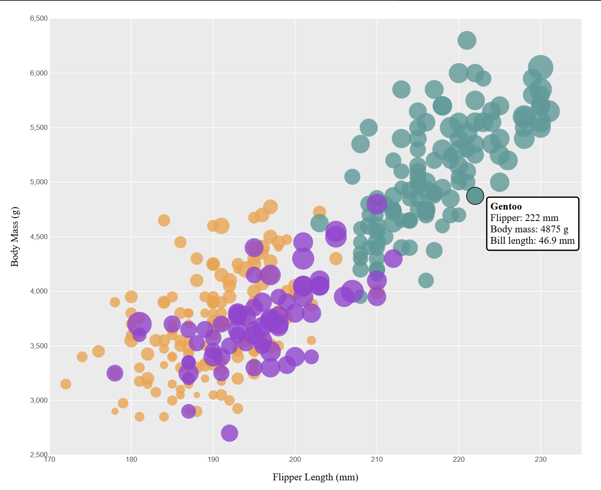
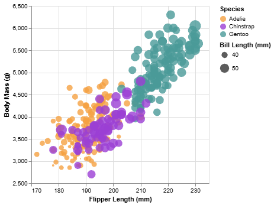
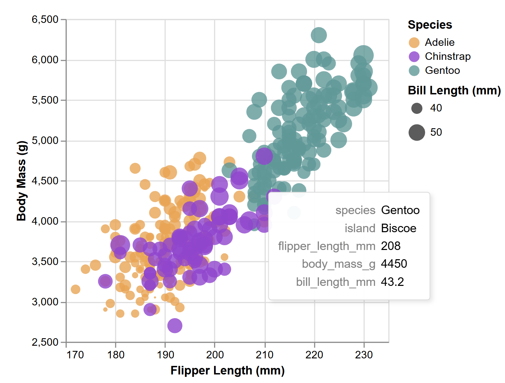
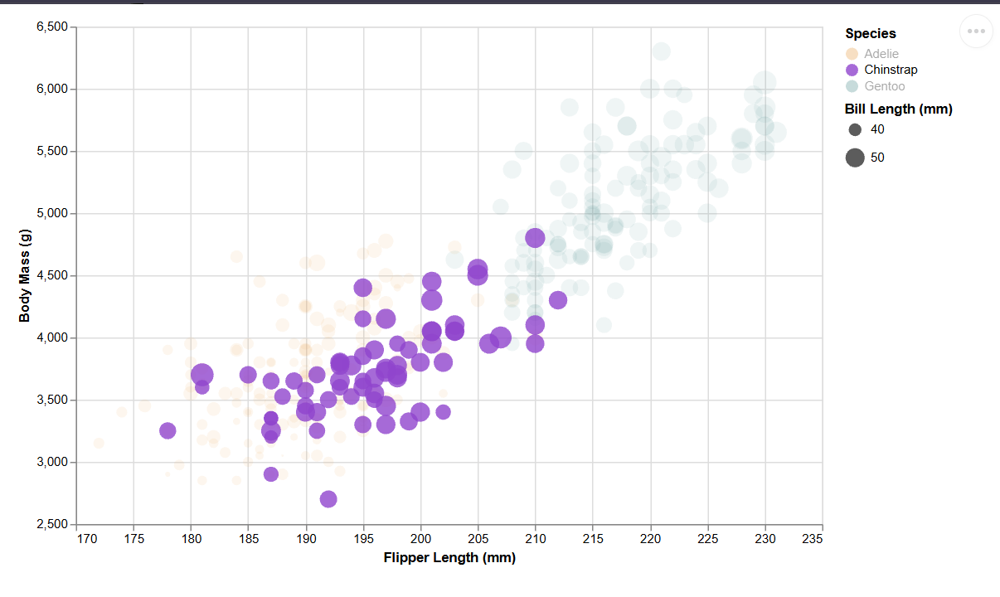
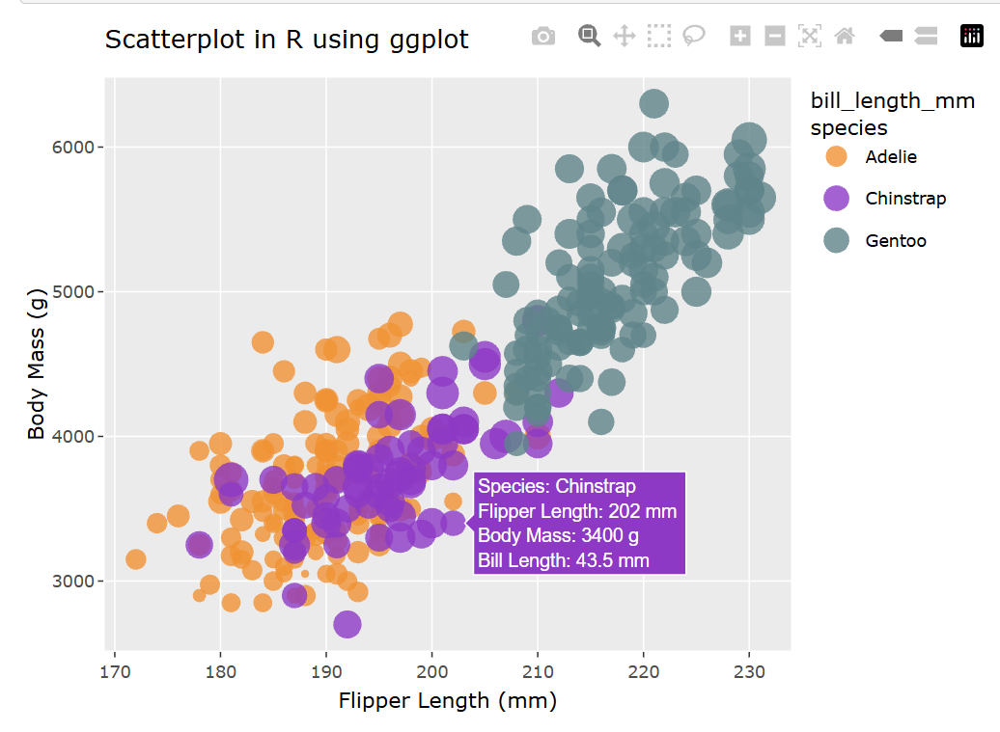
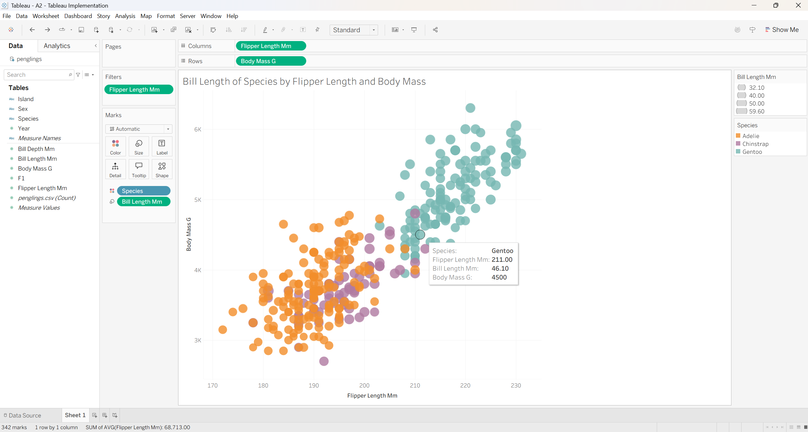
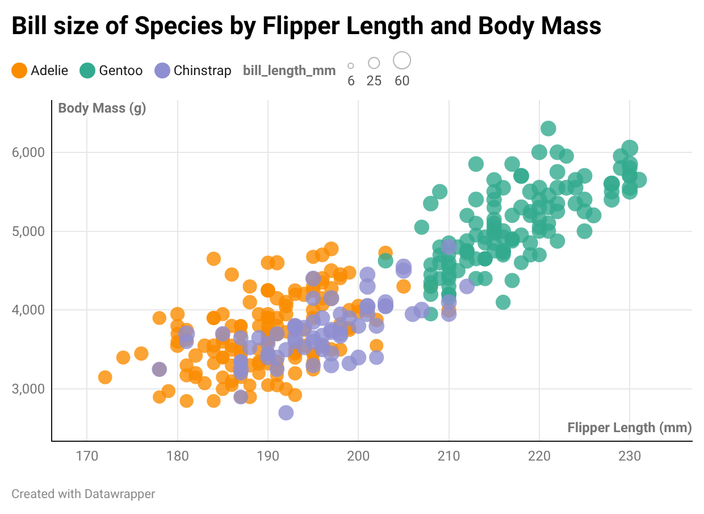

Assignment 2 - Data Visualization, 5 Ways  
===
# d3.js
<sub> Note: Must be run from the a2-DataVis-5ways folder. Going into D3 will break it for some reason. </sub>

D3.js is a JavaScript library used to create interactive visualizations in web browsers using HTML and SVG. I found d3 particularly difficult to use. There was a lot of documentation to go through for seemingly the smallest details. Although frustrating to use, I do think it provided one of the nicer visualizations and I understand that this library provides many functions and methods that give users a much wider selection of features and control over how a visualization looks.

Sources I used to create the visualization:
- https://d3-graph-gallery.com/graph/custom_theme.html
- https://d3-graph-gallery.com/graph/interactivity_tooltip.html#template
- Claude

I used the above demos to give me a base starting code before altering it to match the graph we are trying to plot. I changed the sizing of the graph and the dots (based on biil length). It took a lot of trial and error. I used the second link as a base in creating tool tips. Claude was helpful in explaining each line of code to me so I could understand what each part does. I learned I had to create a tooltip box first. It is hidden until an event happens such as mousing over each data point. I then had to attach each of the handlers (mouseover, mouse moving, mouse leaving) to each individual dot in order for the toolbox to pop up. 



# Altair
<sub> Note: must be run from the Python_Altair folder </sub>

Altair is a library in python used to create interactive data visualizations. I had the most fun with this library and I found the logic very similar to R and ggplot. I used the below source to get started with the base graph. Pandas was used to import the csv and clean the data. Through some searching of documentation I learned that ```.interactive()``` is an easy way to make the graph be able to zoom in and out. ```add_params()``` allowed for filters to be added per species. When you click on a species, only those of that species will be highlighted. They also had a built in tooltip parameter that let tooltips be added per data point. I feel that Altair is a useful tool for quick visualizations with far less code, but still being able to have detailed insights on data.

Source: https://altair-viz.github.io/gallery/multifeature_scatter_plot.html

### Base visualization


### Tooltip Hover


### Filter (ex. Chinstrap)


# R + ggplot2 + plotly + R Markdown

R is a language primarily focused on statistical computing. ggplot2 is a popular library for charting in R. R Markdown is a document format that compiles to HTML or PDF and allows you to include the output of R code directly in the document. To visualize the penguins dataset, I made use of ggplot2's `geom_point()` layer, with aesthetics functions for the color and size. I also used the plotly library to add some interactive elements. When hovering over each point, a tooltip appears showing each data point/penguin's species, flipper length, body mass, and bill length.

I used my own code from MA2612 Labs to help me get started as a refresher on ggplot. ggplot was easy enough to navigate and adding tooltips was only two additional lines of code using the plotly library. This tool would be helpful for quick visualizations where you might want to perform other statistical computations alongside the data. 



# Tableau

Tableau is a business intelligence and data visualization platform that lets users analyze data and create interactive dashboards and reports. It offers a drag-and-drop interface that makes it particularly accessible to those who may not have a lot of coding experience. I just took MIS4084 - Business Intelligence and so this was one of the easiest visualizations to create. I was able to drag and drop my x and y axis directly. I was able to drag Species into the color filter and bill length to the size bar. Tooltips were inherently built in along with filters. The only thing that needed some messing around were the axis ticks and intervals, specifically to making sure they didn't start at 0. Unlike the exmaple visualization, I could not narrow down the beak length legend to only show 40 and 50. Had I attempted this, it would only show the data points where the bill length were 40 or 50. 



# DataWrapper
Datawrapper is a web-based tool that allows users to create charts, maps, and tables directly online. It was extremely simple with drop down menus and tips. However, I found that this method did not provide as much control as I would've liked that other tools gave. For instance, I couldn't find any way to add tool tips, the legends were always in awkward places, and I did not see any options to move the axis titles. They were always stuck within the graph which made the graph itself feel cluttered. The beak length circle filter also didn't seem to show much of a difference. This tool would be good for people who want to make quick and simple visualizations without programming experience, however the lack of control over design made it frustrating to use. 



## Technical Achievements
- Added tooltips to R, d3, Altair, Tableau
  - R: plotly library
  - d3: Using outside sources, creating a tooltip box and defining what happens when mouseover, mousemove, mouseleave to show the hidden tooltip
  - Altair: tooltip parameter; ```.interactive()``` 
- Added a filter feature for species for altair using ```add_params()```
 
## Design Achievements
- Kept the color theme consistent throughout all my graphs. Made sure all the colors were contrasting enough in order to differentiate between the different species. Opacity being set to 0.8 makes sure that even with overlapping dots, you can still see the individual points.
- Had to add the background and grid lines to d3 implementation so it wasn't just dots floating on a white background
