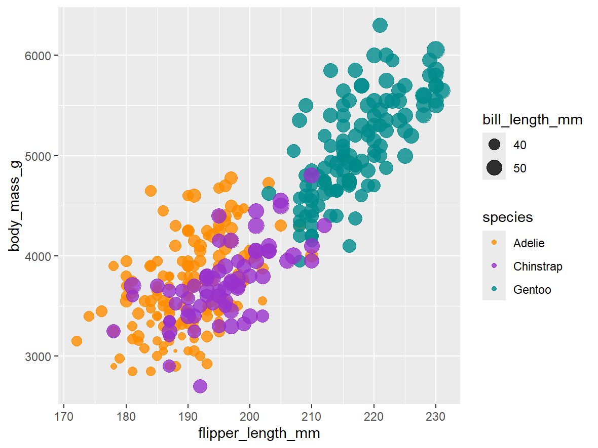
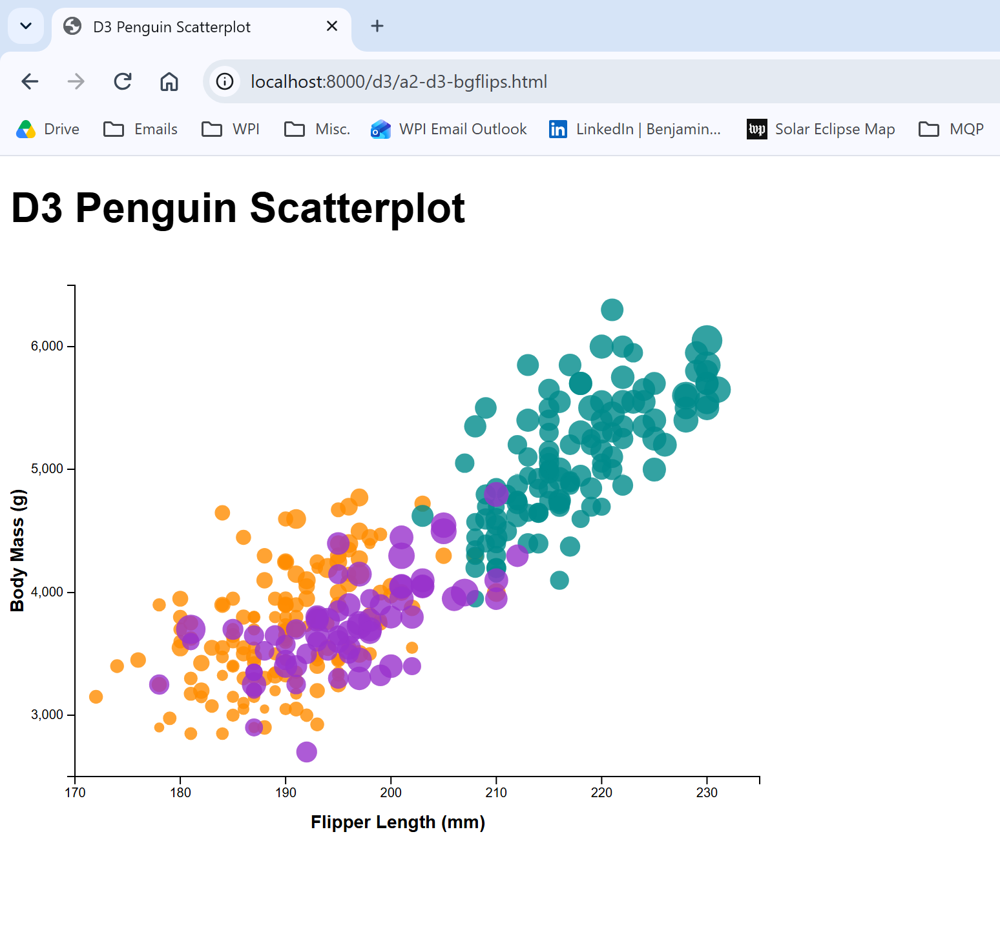
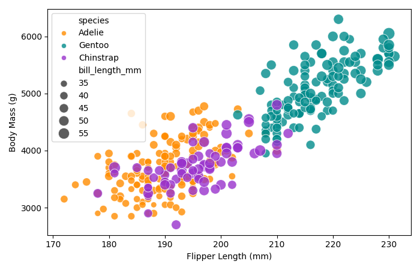
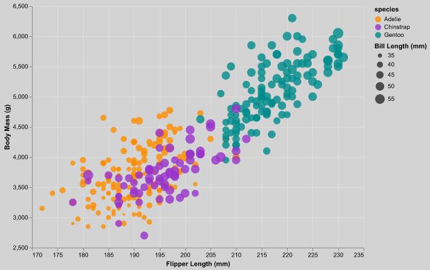
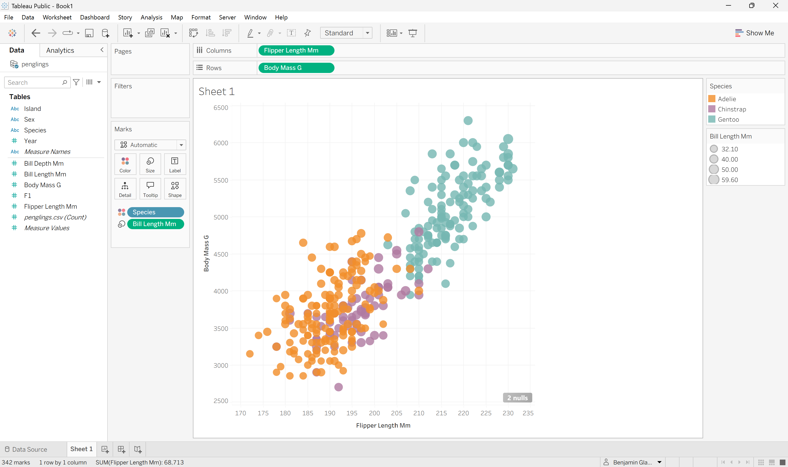

Assignment 2 - Data Visualization, 5 Ways  
===

Benjamin Glaser - bgflips
---

# Prof Harrison's Chart

# R ggplot2

I mapped flipper length to x, body mass to y, species to color, and bill length to size. Them I added geom_point(alpha=0.8) to make the opacity 0.8. I had to pick the colors manually with scale_colour_manual(). At first I said !is.na() for all the columns but then realized I had plotted less pengiuns than Prof Harrison, so I had to fix that statement to include only the columns that we were actually examining.

Deviations: I do not believe there are any deviations from Prof Harrison's example.

# d3

This was kind of hard because I had to build the scatterplot manually since there's no scatterplot function like with the other ones. I used svg to make four scales for the x axis, y axis, radius, and color. The csv had some NA so I had to filter them out by saying "!== 'NA'" for the relevant columns so they didn't break the code. I had to use "python -m http.server" to create a local web server to display my chart.

Deviations: no legend, no grid

# Python Seaborn

I mapped flipper length to x, body mass to y, species to hue, and bill length to size. I made a palette to map each species to their correct color. I had to filter out the NA's using dropna() and putting a subset of the relevant columns. sns.scatterplot() made the code script pretty short and simple. I had to export my figure using plt.savefig() and then view it in my file explorer.

Deviations: no grid; legend is in the wrong spot and partially covers a couple points, although you can still see them through it

# Python Altair

I had to filter out the NA's using dropna() and putting a subset of the relevant columns. I used zero=False for teh axes and the size so that I could have the broken axes. I had to export my figure using chart.save() and then view it in my file explorer.

Deviations: the grid is different, although I tried to at least make it close by making it light gray

# Tableau Public

I connected the dataset, dragged flipper length to columns, dragged body mass to rows, dragged species to color, and dragged bill length to size. I had to create my own color palette because Tableau didn't have one that was exactly the same as Prof Harrison's. I picked the colors that seemed the closest out of the list of options Tableau gave me and mapped them to their appropriate species to match the example. I also had to change the shape and opacity because the default were nonopaque donut shapes. This was the easiest way to make a good chart quickly and easily but it offered the least control.

For technical achievements, you can click on each point to see more details. It is hard to see exact measurements of each point just using the scale, so clicking on a point allows you to see that information accurately.

Deviations: the grid is different; the legends are on the side in a different panel than the graph; the colors are a bit more muted than the other graphs

