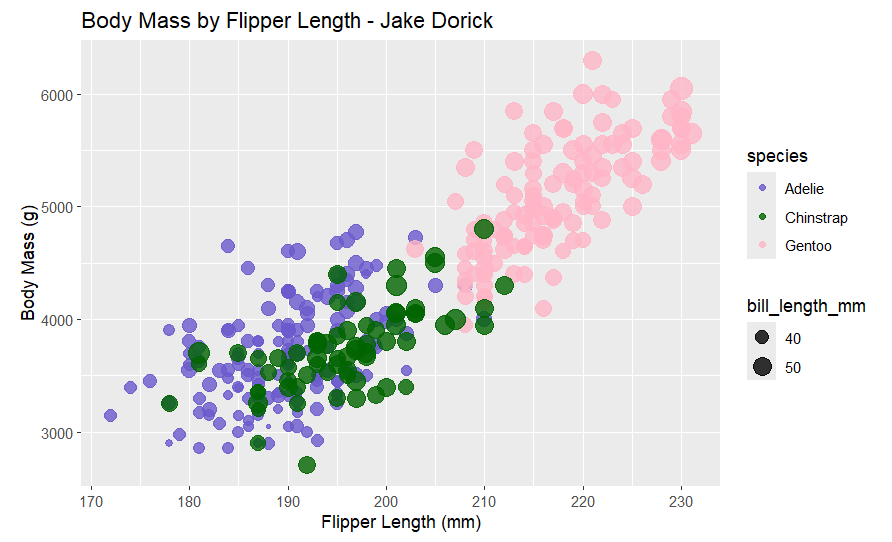
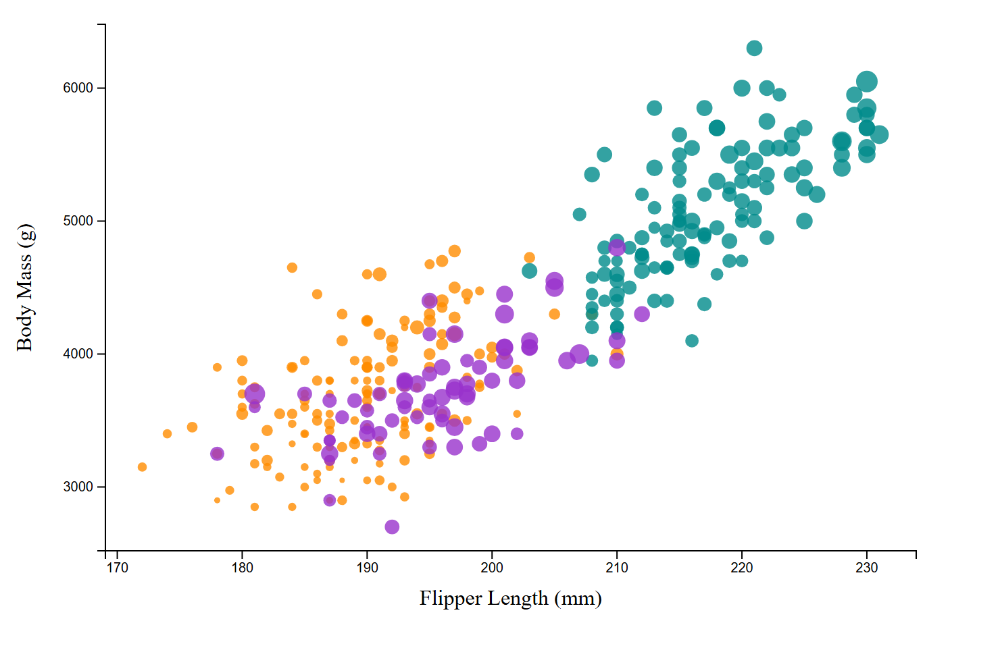
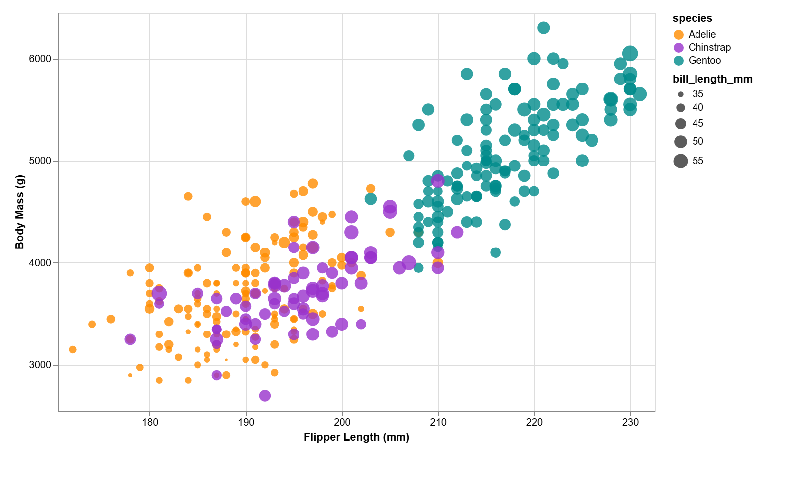
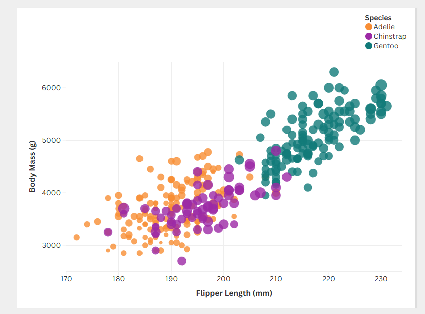
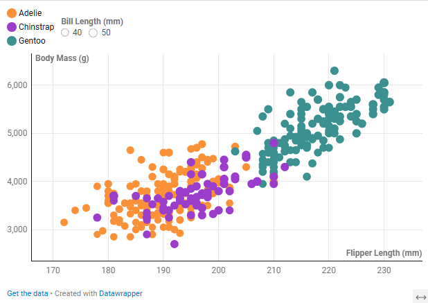

# R + ggplot2

R is a language primarily focused on statistical computing.
ggplot2 is a popular library for charting in R.
R Markdown is a document format that compiles HTML or PDF and allows you to include the output or R code directly in the document.

To visualize the penguins dataset, I made use of ggplot2's geom_point layer, with aesthetics functions for the color and size.

# d3
d3 is a javascript library that binds data to SVG elements on a web page.

For this chart, I started with sample code "Basic scatterplot in d3.js" found on the D3 Graph Gallery (https://d3-graph-gallery.com/graph/scatter_basic.html)

From this, I ended up changing a significant amount to make it match our chart such as the penguin data with filtering applied, d3 version 7 which uses .then instead of callback,
and axes to fit data, axis labels, color by species, size by bill length, and the 0.8 opacity.

This was by far the most difficult but the code example in combination of d3 docs made it possible.\

# Vega-Lite
Similar to d3, I used a web server for Vega-Lite.

A big difference is that Vega-Lite is written in JSON, so you describe the chart in JSON formatting, and then the chart gets drawn based off that.

This was very simple compared to d3, and usually fields existed directly for what I needed and probably my favorite library out of the three that I used.

# Flourish
Flourish is a web application (no code or library) for making interactive charts based on templates.\

To accomplish my goal, I started with the scatter template and manually bounded the columns in the data tab and styled in the preview tab.

Some unique workarounds I did was the circle area wasn't being reflective of the bil length, so I ran a formula in excel on the .csv to make the differences in lengths more significant
to be reflected accurately on the graph to match the original chart.

# Datawrapper
Last but not least, I used another web based application for making interactive charts that are simple and not as customizable.

I didn't really like the size mapping, and even using a modified .csv I made for Flourish, there was still not visible differnece on the chart.

Similar to other ones, I made a clean CSV with those few NA rows removed.

This was my least favorite tool out of the bunch- the customizable ability was very low compared to the others and made it hard to match the original chart.

## Technical Achievements
- **CSV Handling**: Filtering Data (d3) + making a clean CSV for web app tools + using excel formulas to scale the difference of bill length for dot sizing on Flourish.
- **Tooltips on hover**: Availiable in the Flourish visualization and Datawrapper.
- **HTTP Server**: HTTP Server to be able to display the d3 chart in real time on refresh when building the chart.

### Design Achievements
- **Color Palette**: Used online photoshop editor (photopea) to pull the exact colors from the example chart to be able to accurately use across my five charts.
- **Legend**: Added legends for datawrapper, flourish, R + ggplot2, and vega-lite to match original chart.
- **Custom Labels**: Labels didn't match the raw column names so where possible, I updated and even made a modified .csv for that specific tool (Datawrapper, Flourish).
- **Custom Ticks**: Applied custom ticks to match the spacing and increment of the original chart.
- **Circle Size**: Enforced circle size based on bill length across charts (even making custom csv to show the difference if it was not clear with the base dataset).