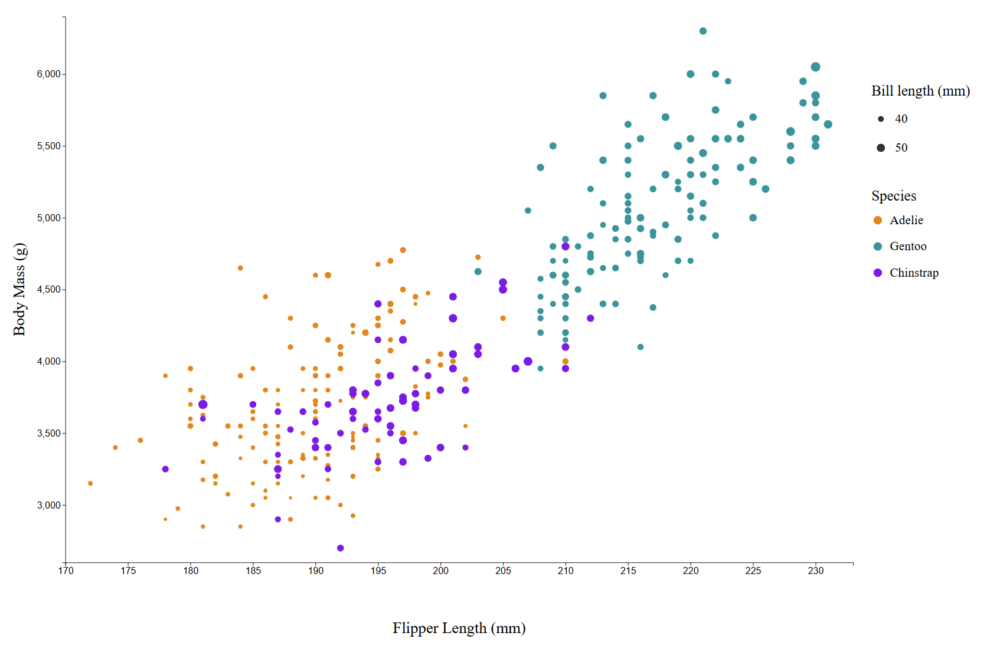
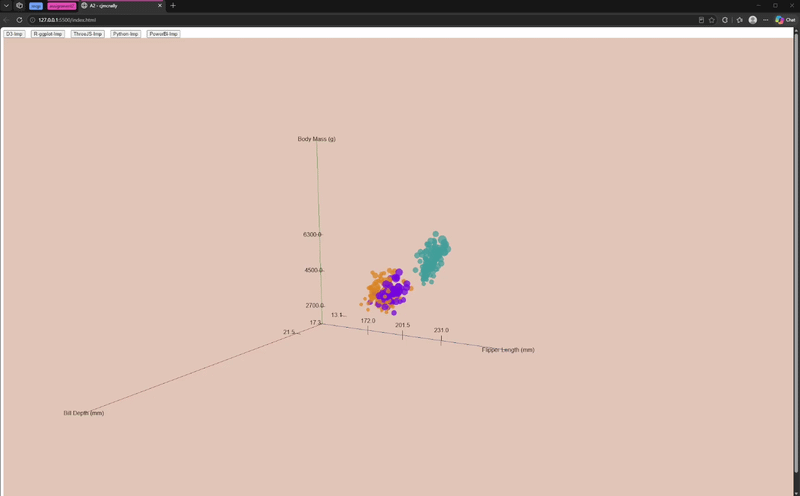
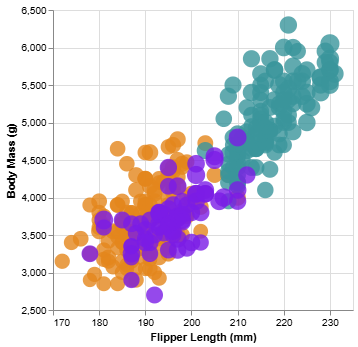
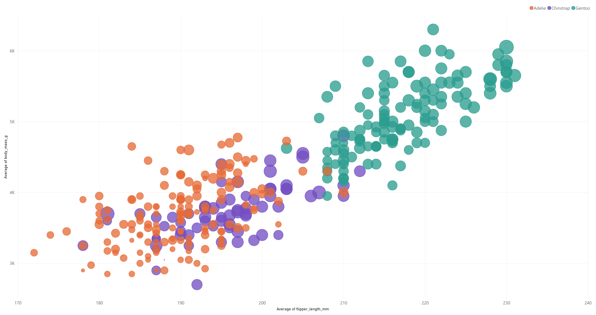

# Plan: Libraries, Tools, Languages:
1. D3 JavaScript
2. R + ggplot 
3. ThreeJS + D3
4. Altair + Python + Vega-lite
5. PowerBi + CSV

# Github Pages Link
- I made it into a webpage because I have a 2 interactive visuals, the D3 implementation has tooltips and the THREE.js implementation is fully interactive.

**Link:** https://cjmcnally.github.io/a2-cjmcnally/

# D3:

For this implementation (D3) I captured domain of values then lined up both axis using range before plotting. Mapped species to a color and defined size to bill_length_mm. I wanted the chart to be interactive so I researched hoverable tooltips I could add and styled based on my preference for sizes and font. 

The main challenge I had was adding the tooltips. Adding the axes and axes labels was time consuming and a little challenging as well.

## Technical Achievements
- Interaction: Tooltips on hover, shows details on the point hovered on
- Included all charts onto one webpage, user can navigate using navbar at the top of the page

## Design Achievements
- Was able to include legends (Bill Length & Species)
- Matched color groups to the image that was provided
- Used a smaller scale for the points to show all of them clearly 
- Added descriptive axis and encoding titles

## Usefulness
- I would say this tool is fairly useful in displaying data, it did take a lot more time and code to produce a output compared to other tools such as Altair, R + ggplot2, and PowerBi. 

### References
- https://d3-graph-gallery.com/graph/custom_legend.html
- https://stackoverflow.com/questions/49599691/how-to-load-data-from-a-csv-file-in-d3-v5
- https://www.tutorialsteacher.com/d3js/loading-data-from-file-in-d3js#d3.csv
- https://d3js.org/d3-axis
- https://d3js.org/d3-color

### AI Usage
- For this implementation (D3) GitHub Copilot was used for help on debugging the tooltip feature, and for formatting the legends.

---

# R + ggplot2:

For this implementation (R + ggplot2) I used the readr package because the base read.csv function wasn't extracting the data I wanted correctly. I used complete.cases() to filter out any data thats missing and plotted using ggplot + geom_point(). I was able to include the legends and exported the chart as a png because I didn't want to use RMarkdown.

There wasn't much that was challenging, the only thing that caused issues was the initial loading of the csv and I fixed it with using the readr library.

## Technical Achievements
- Exported the chart as a png and loading it into the webpage as that
- Included all charts onto one webpage, user can navigate using navbar at the top of the page

## Design Achievements
- Included the legends
- Matched color groups to the image that was provided
- Used semi-transparent points to make overlapping data easier to see
- Looked pretty similar to the example chart that was provided; the spacing between points were different
- Added descriptive axis and encoding titles

## Usefulness
- I would say this tool is definitely useful in displaying data, it didn't take a lot of time to code and it accurately represents the data.

### References
- https://learn-r.org/r-tutorial/read-csv.php
- https://www.datanovia.com/learn/programming/importing-exporting-data/read-csv-txt-in-r
- https://www.geeksforgeeks.org/r-language/return-a-logical-vector-with-missing-values-removed-in-r-programming-complete-cases-function/

### AI Usage
- For this implementation (R + ggplot) GitHub Copilot was barely used, it helped with position the legends.

---

# ThreeJS + D3:

This implementation (THREE.js + D3) was the hardest of all my chart implementations. I have worked with THREE.js in the past but never to create 3D Charts. 
Basically everything was a challenge besides the OrbitControls and Scene setup. The most challenging being the Axes, Ticks, and Labels, the second most challenging would be the mesh creation and positioning of the spheres. And a lot of thought was put into the 3D aspect and what the Z-Axis should portray. 

In the end, it's all on the webpage and it's pretty quick. I made it into a GIF on this MD file but I recommend playing with it on the GitHub pages link I provided. The only thing I couldn't figure out / didn't have enough time, was to adding the legends. I think I could just do something similar to in the axes function where I created the addLabel const but I thought it was fine to leave it as is.

## Technical Achievements
- Adding the camera, scene, and 3D renderer 
- Added Orbit Controls --> Interactive with mouse click down to pan around and scrolls to zoom in and out.
- Loading and parsing data with D3
- Included the billDepth for the Z-Axis, while still using bill_length_mm for the size of the spheres
- Async animation call once loading and parsing is complete

## Design Achievements
- There is the 3D layer so there's a Z-Axis which I set to be the Bill Depth
- Adding the 3 axes and labels to be visible on camera movements
- Used semi-transparent points to make overlapping data easier to see
- Adding vectors to be the ticks on the axes, there are no functions for creating graphs or charts so vectors were used for the ticks
- Added descriptive axis and encoding titles

## Usefulness
- THREE.js is probably the least useful in relation to time, this implementation took the most time out of all of them and while it does display the data accurately and is **very cool** with the 3D aspect and interactivity. There are simply better tools for quicker chart creations.

### References
- https://www.youtube.com/watch?v=ub2u2VIbiyE&t=1s
- https://stackoverflow.com/questions/19564051/labelling-the-vertices-in-axishelper-of-three-js
- https://threejs.org/docs/#AxesHelper
- https://threejs.org/docs/#CSS2DRenderer
- https://stackoverflow.com/questions/71632837/using-the-three-js-css2drenderer-to-position-html-elements-from-the-top-left
- https://threejs.org/docs/#LineSegments
- https://threejs.org/docs/#LineBasicMaterial

### AI Usage
- For this implementation (THREE.js + D3) GitHub Copilot was used for help on debugging the axes positioning, tick positioning, and labels.

---

# Altair + Vega-Lite:

This implementation (Altair + Python + Vega-Lite) I used pathlib and pandas for the csv loading. In pandas I used dropna for filtering out missing values.

The challenging part I had was figuring out what to use for loading and filtering out the missing values in the data. I also had a tough time figuring out Vega-Lite and how to display my chart on the webpage. I found documentation for embedding Vega charts in HTML, which included creating a spec file. I tried adding interaction, but pan and zoom do not work in the embedded chart, so this visualization is currently static.

## Technical Achievements
- Embedded the Vega-Lite chart in the webpage using Vega-Embed
- Loaded the CSV with pandas and removed rows missing values used in the chart

## Design Achievements
- Matched color groups to the image that was provided
- Encoded flipper length and body mass on the x and y-axes, species with color, and bill length with point size
- Used semi-transparent points to make overlapping data easier to see
- Added descriptive axis and encoding titles

## Usefulness
- I would say this tool is definitely useful in displaying data, it didn't take a lot of time to code and it accurately represents the data.

### References
- https://pypi.org/project/altair/
- https://altair-viz.github.io/getting_started/overview.html#overview
- https://altair-viz.github.io/user_guide/data.html
- https://altair-viz.github.io/user_guide/encodings/index.html
- https://altair-viz.github.io/user_guide/interactions/bindings_widgets.html
- https://pandas.pydata.org/pandas-docs/stable/reference/api/pandas.DataFrame.dropna.html
- https://github.com/vega/vega-embed
- https://stackoverflow.com/questions/72465478/how-to-use-vegaembed-to-embed-an-altair-visualization-into-html-document
- https://altair-viz.github.io/gallery/deviation_ellipses.html

### AI Usage
- For this implementation (Altair + Vega-Lite) GitHub Copilot was used for creation of the spec variable in my index.html.

---

# PowerBI:

I've never used PowerBi before so basically everything was a bit of a struggle, mainly transforming the data to be usable. I wasn't able to figure out how to add multiple legends so I ended up with just the species as one.  

## Technical Achievements
- Imported the penguin data and used Power Query to transform it into a usable format for the chart
- Built a scatter chart mapping flipper length to the x-axis and body mass to the y-axis
- Encoded species with color and bill length with bubble size

## Design Achievements
- Matched color groups to the image that was provided
- Kept axis labels and gridlines visible to make values easier to compare
- Used semi-transparent bubbles to help show overlapping observations

## Usefulness
- I would say this tool is definitely useful in displaying data, it didn't take a lot of time to create and it accurately represents the data.

### References
- https://learn.microsoft.com/en-us/power-query/applied-steps
- https://learn.microsoft.com/en-us/power-query/dealing-with-errors
- https://learn.microsoft.com/en-us/power-bi/visuals/power-bi-visualization-scatter
- https://learn.microsoft.com/en-us/power-query/replace-values

### AI Usage
- AI was not used for this implementation, but helped with creating bullet points for achievements