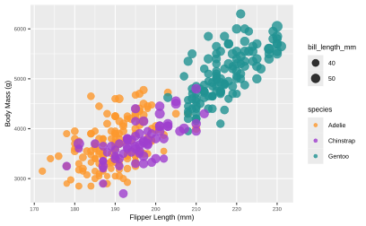
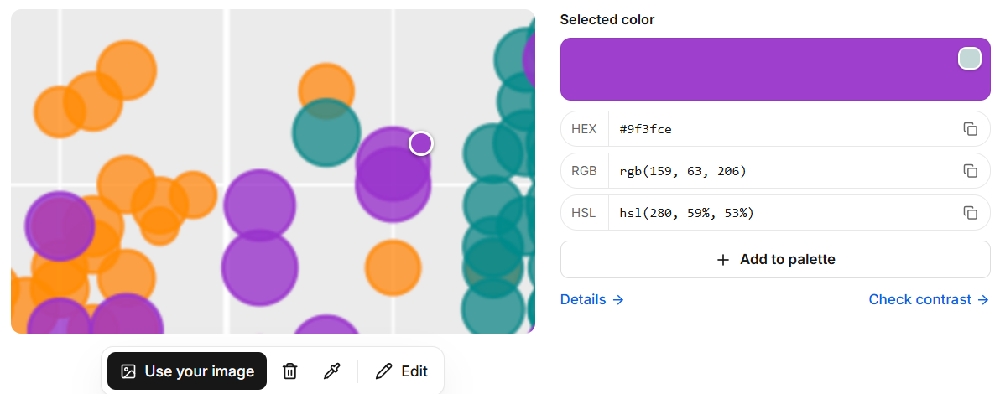
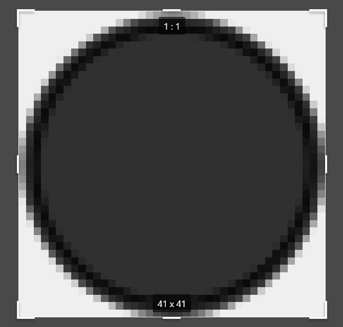
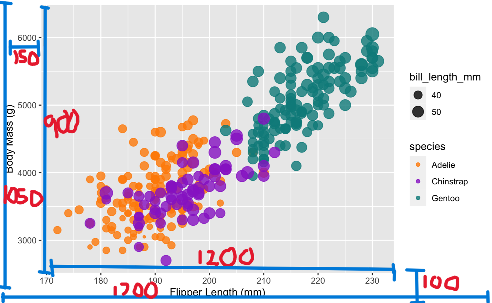

Assignment 2 - Data Visualization, 5 Ways  
===
# d3

Description of d3

I think the easiest part of this was just modifying to get the right properties after adding all of the elements. Once the data points were on the screen, it was pretty easy to change their sizes & opacity. I'd say the most difficult part was just learning how to add axes + gridlines. Also, I forgot about that d3 needs to wait for data to load, so I got confused for a while about why there weren't data points on my screen. I didn't really add the legend through any sort of legend tool, just added shapes to make up the legend - same with the background color. I could see using this tool in the future, potentially for my MQP as I will be making a data visualization tool.

# R + ggplot2

Description of R + ggplot2

This tool was by far the easiest, although the syntax was quite confusing as I'd never used R before. However, once I made the plot, it was pretty much the same as the original example image since that was made in R + ggplot2. The main difficulty came from adding linear scaling to the plot by diameter instead of the default of scaling by area, as I had to figure out how to create custom scaling. It would've been easiest if I had kept the original scaling, but that would make it much harder to apply to other tools.

There's a good chance I'll use R in the future as it's common in computational biology, but I can't say I liked the format. It felt weird just building from a base plot and adding things to it. I didn't really have to use any hacks to get the right chart since the original chart was already made using R + ggplot2.

# Python (Matplotlib???)

Description of Python + Matplotlib

What was easy? Difficult? Where could you see the tool being useful in the future? Did you have to use any hacks or data manipulation to get the right chart?

# Tool/Library 4

Description of Tool/Library 4

What was easy? Difficult? Where could you see the tool being useful in the future? Did you have to use any hacks or data manipulation to get the right chart?

# Tool/Library 5

Description of Tool/Library 5

What was easy? Difficult? Where could you see the tool being useful in the future? Did you have to use any hacks or data manipulation to get the right chart?

## Technical Achievements
List of potential tech achievement I could do:
- **Interactivity**: Might only do that in d3 or if it's easy elsewhere
- **Extra tools/libraries**: Could go above the 5 requested, also could maybe do something like three.js which would be really weird
- **API Usage???**: idk how i would do this but it'd be an achievement!
- **Fun Stuff in each tool**: some tools might have additional functionality that I could mess with

### Design Achievements
- **Consistent color choice**: Consistently used the same colors (purple #9f3fce = Chinstrap, orange #fc992f = Adelie, cyan #219292 = Gentoo), as picked from the original image in the assignment:

- **Consistent element size, font choice**: Element size also measured directly from the original image - 50mm is a 41px diameter circle, 40mm is a 32px diameter circle, so the ratio is about 0.8px/mm. There seems to be some sort of non-linear scaling, because the point at (188, 3050) in the example is far smaller than it should be, but I chose to do linear scaling for each point by diameter. Font identified as Arial, 26px tall for axes & 21px tall for axis labels. Other important measurements are annotated in the pictures below, although there are other measurements such as legend placement which were kept as consistent as possible. 
50mm circle:

Overall measurements:

- **Background Grid + Legends**: Might be difficult, but would be a good design achievement!
- **Second Chart Type**: could also try to make histograms as a second comparison method