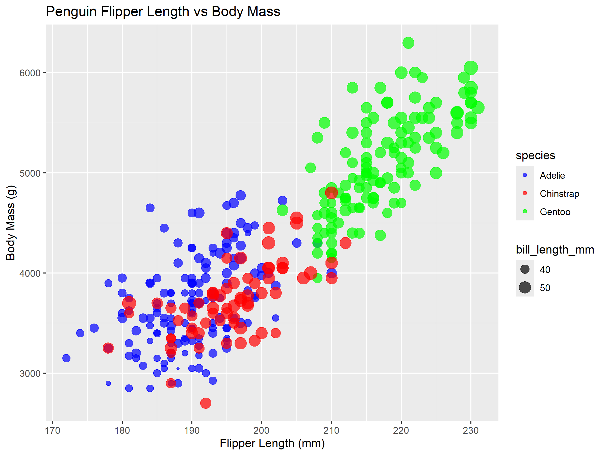
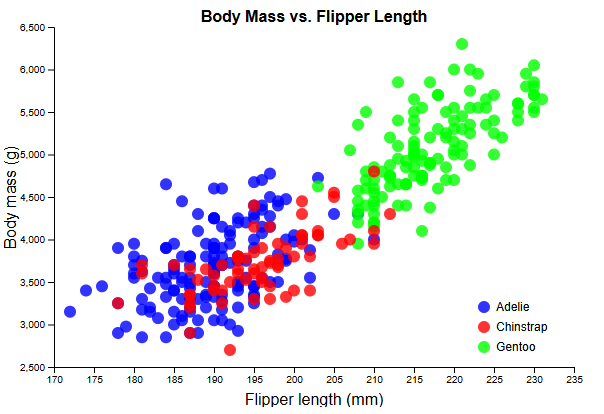
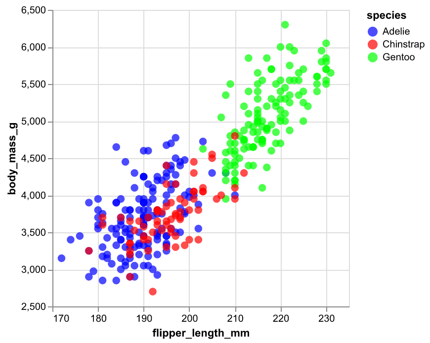
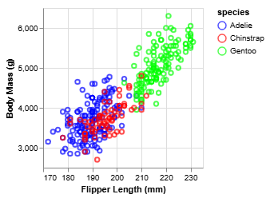
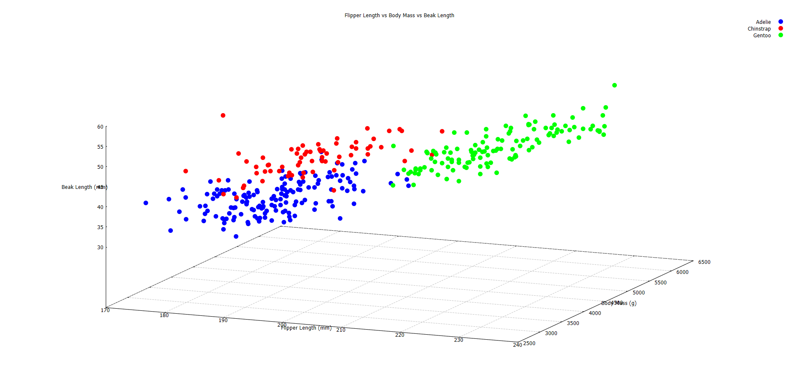

# a2 5 Ways
For this project, I was required to make 5 scatterplots using 5 different libraries/languages.
The scatterplots would use the 'penglings.csv' dataset, which contains some data about penguin species including:
- Bill length (mm)
- Flipper length (mm)
- Body mass (g)
- Species (Adelie, Chinstrap, or Gentoo)

There are others, but these are the primary fields that will be used in these plots.

# R + ggplot2

This plot was created in R using the ggplot2 library. This one took a me a little bit, as R is a somewhat unique language. However, ggplot2 made creating this plot _very_ easy. As I'll describe later, a language like d3 offers a ton of customizability and unique functions, but it is super bulky and takes time to write properly. ggplot2 on the other hand was very short, only requiring 21 lines of code. Since R is so popular in statistics and math fields, I will probably use this one in the future.

To generate this plot, type `Rscript --vanilla rPlot.r` into your terminal and the plot will appear in the ./Plots directory as `ggplot2_Penguin_Plot.png`.

# Javascript + d3

This plot took up a bulk of my time working on this project. d3 is a wonderful language that offers a ton of customizability, but javascript is not a fun language to write in and d3 certainly does not make the writing process fast. Setting the plot, axis labels, even getting the color legend for the penguin species was tedious since it was added manually, not automatically like most of the other libraries on this list. That being said, if I ever encountered any issues with the other libraries, I would be wishing I was writing in d3!

To view this plot, start a server on localhost:8000 with `python3 -m http.server` and visit `http://localhost:8000` in your browser.

# Python + Altair

I don't have much to say about this one, I had the same experience with Altair that I had with ggplot2. The only difference was I was writing in python this time! ggplot2 made it easier to change styles like colors, but overall Altair was very similar to ggplot2.

To generate this plot, type `python altairPlot.py` into your terminal and the plot will appear in the `./Plots` directory as `Altair_Penguin_Plot.png`.

# JSON + Vega-lite

Vega-lite is a very interesting visualization library. Based on what I've seen online you can make very pretty and very unique plots with this. Rather than using a typical programming language like python or javascript, Vega-lite is written in the JSON format. I don't use JSON very often as package managers oftentimes do all the work for me, but JSON and Vega-lite make plotting very easy. However, accessing the plot is a different story.

To view this plot, I installed a Visual Studio Code extension called "Vega Viewer". The normal way would be to go on the online Vega Editor, but with private github repositories this won't work. Instead, in VSCode with the Vega Viewer extension installed, open vega-litePlot.json. In the top left of VSCode, under view, click Command Palate and search for Vega: Preview Vega Graph and click it. This will open a new tab with the plot visible.

Alternatively, just look at the image above.

# GNUPlot

GNUPlot is probably my favorite one on this list, saved for last as always. It uses it's own scripting language to make plots, and it is very specialized to do so. If I didn't color code the penguins I could have written it in only 9 lines. Additionally, it was super easy to make a 3d rotatable plot, so I totally recommend booting this one up yourself. Super simple, super straightforward, super great result.

To view this plot, type `gnuplot -persist gnuplotPlot.gp` into the terminal. A window will open with the 3d plot, which you can drag inside to rotate.