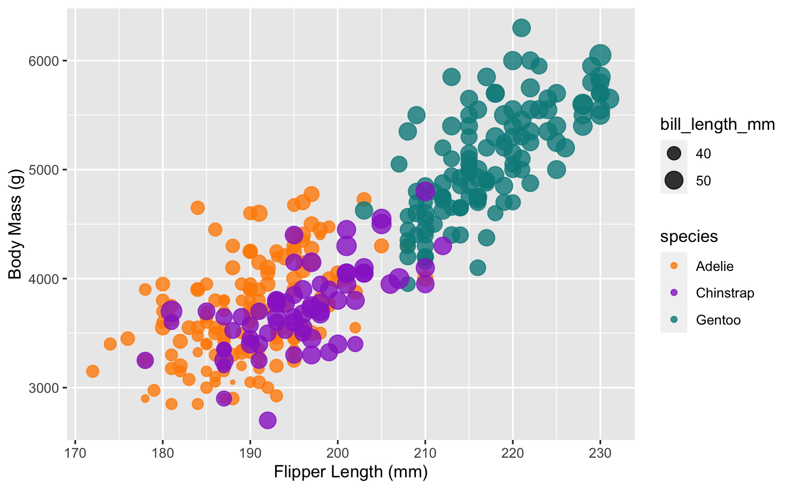
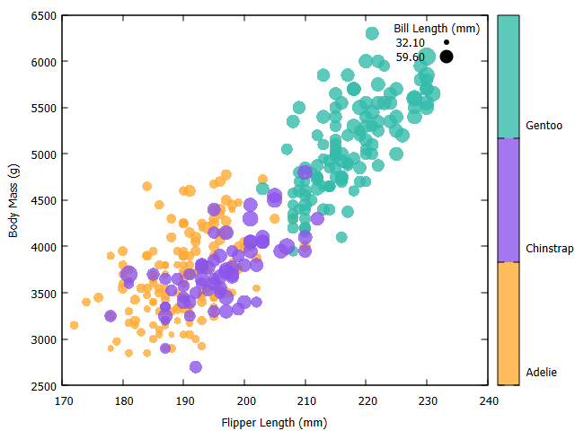
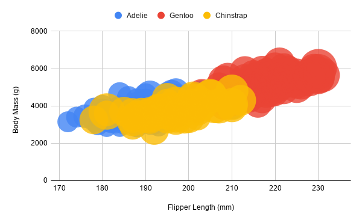

These features should be preserved as much as possible in your replication:

- Data positioning: it should be an upward-trending scatterplot as shown.
  Flipper Length should be on the x-axis and Body Mass on the y-axis.
- Scales: Note the scales do not start at 0.
- Axis ticks and labels: both axes are labeled and there are tick marks at a
  reasonable interval, e.g 10, 20, 30, etc.
- Color mapping to species.
- Size mapping to Bill Length.
- Opacity of circles set to 0.8 or similar for a semi-transparent effect.

Other features are not required. This includes:

- The background grid.
- The legends.

Note that some software packages will make it **impossible** to perfectly
preserve the above requirements. Be sure to note where these deviate as you
reflect on what a tool is good for.

## Other Requirements

- Description of the Technical achievements you attempted with this
  visualization.
    - Some ideas include interaction, such as mousing over to see more detail
      about the point selected.
- Description of the Design achievements you attempted with this visualization.
    - Some ideas include consistent color choice, font choice, element size
      (e.g. the size of the circles).

## GitHub Details

- Fork the GitHub Repository. You now have a copy associated with your username.
- Make changes to fulfill the project requirements. 
- To submit, make a [Pull
  Request](https://docs.github.com/en/pull-requests/how-tos/create-pull-requests/creating-a-pull-request-from-a-fork)
  on the original repository, and put the link to your pull request in the A2
  assignment on Canvas.
- Note: name your pull request using the following scheme: ``` a2-your Gh
  username-your first name-your lastname ```

## Grading

Grades on a 120 point scale. 24 points will be based on your Technical and
Design achievements, as explained in your readme. 

Make sure you include the files necessary to reproduce your plots. You should
structure these in folders if helpful. We will choose some at random to run and
test.

**NOTE: THE BELOW IS A SAMPLE ENTRY TO GET YOU STARTED ON YOUR README. YOU MAY
DELETE THE ABOVE.**

# d3 (library)


I basically already did all of this while doing assingment 1, so it was very
easy for me. I probably had to write a lot moroe code to get the chart to work,
but I didn't actually have to think very hard about it because I knew what I was
doing. The one thing I messed up when I was creating the chart was filtering out
entries with `NaN` because I wasn't properly mapping species data to numbers,
and `"Gentoo"` is actually `NaN` in JS :(

(I mean this literally, `isNaN("Gentoo")` returns `true`)

# matplotlib (library)


It took way longer than it should have to get the legend to work than it should
have for a library which supposedly supports legends. I could not figure out how
to make the folor legend function with custom colors, so instead I just set it
up to use to built-in `cool` gradient which looks better than the others I
tried. Other than that, it was pretty easy for me to work with because like d3,
I already know how matplotlib and python work.

# altair (library)


It looks prettier than basically all of the others, so that's a huge bonus.
Really weird that it can render to HTML, I imagine that's for interactivity but
I still think it's a bit strange. It's a little weird that their scales default
to 0 as the minimum in the domain, rather than as the actual minimum of the
data. Altogether, this was way easier than matplotlib or d3 and took way less
time. Declarative code is wonderful.

# gnuplot (language?)



I basically had to hack together a really weird script in an esoteric language
that I've never used before and will likely never use again. It's probably
wonderful if you get used to using it, but it just didn't really feel right to
me. I'd much prefer to use an actual programming language. Also, making a legend
was awful as usual. This is also super weird but PNG output isn't antialiased so
it looks terrible, but SVG output exists and doesn't look terrible (because it's
vectorized).

# Google Sheets (tool)



I tried to use a spreadsheet, I really did. I was excited when I saw that google
sheets had a bubble chart. I made one. It looks horrific. In google sheets, you
can't change the maximum and minimum bubble size for some reason, which means if
you have a lot of bubbles you can't actually tell what's going on. This seems
kind of dumb because the point of charts is to make lots of data make sense...

I also tried to use excel, but I don't have it on my computer and the web
version refused to function properly. It somehow crashed on like 300 rows of
data, then refused to insert a bubble chart four times in a row. IDK man.

# Technical Achievements

- Mouse-over effect in the d3 implementation which shows penguin information

# Design Achievements

- something something reinvented the wheel
