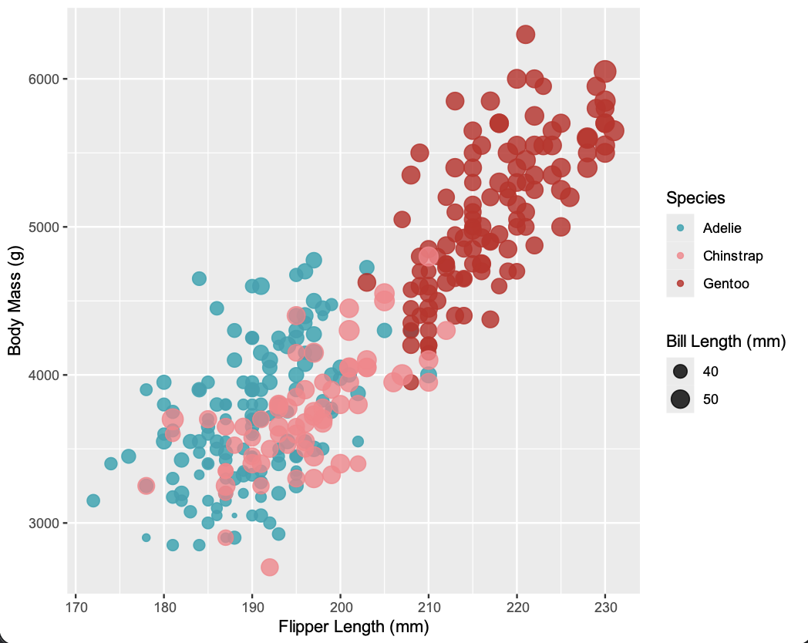
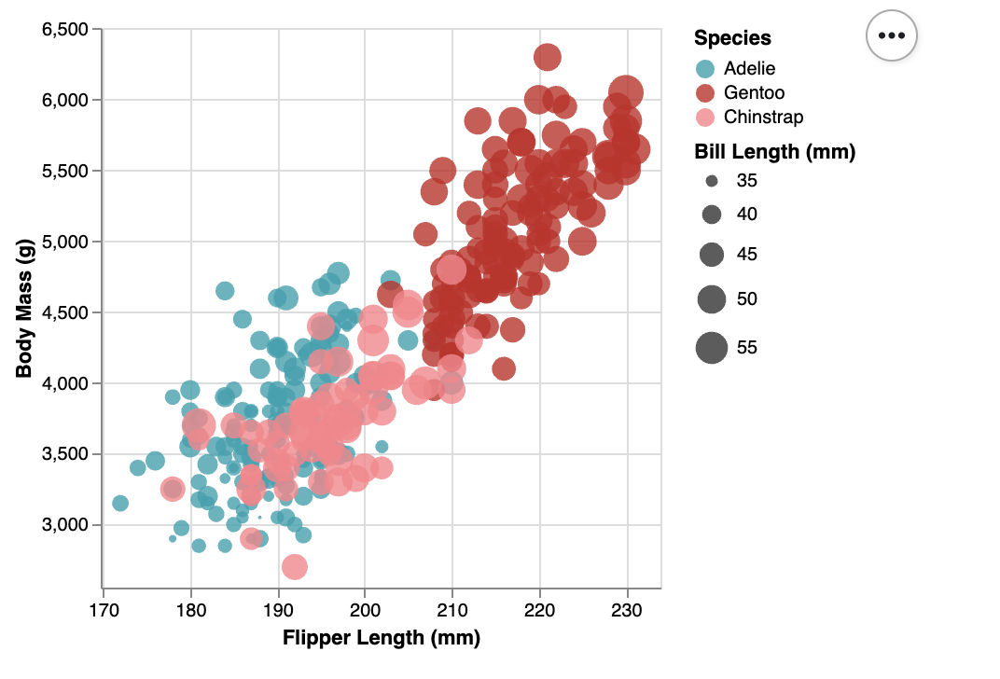
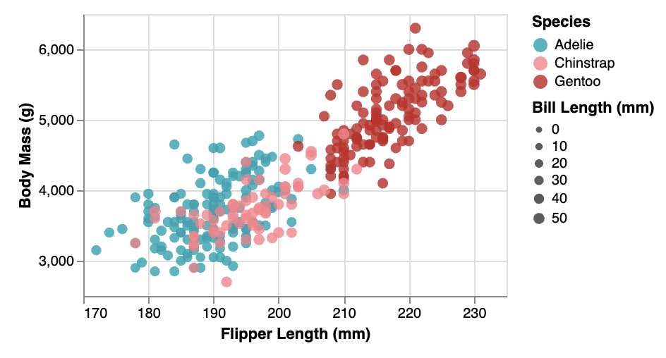
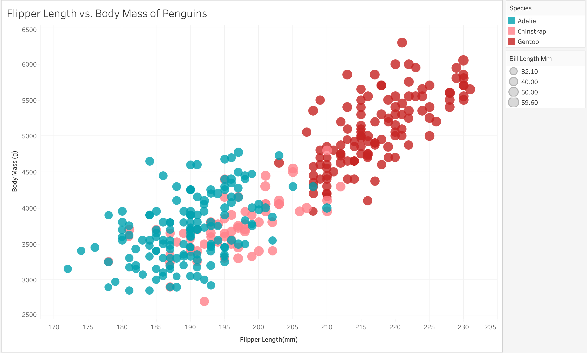
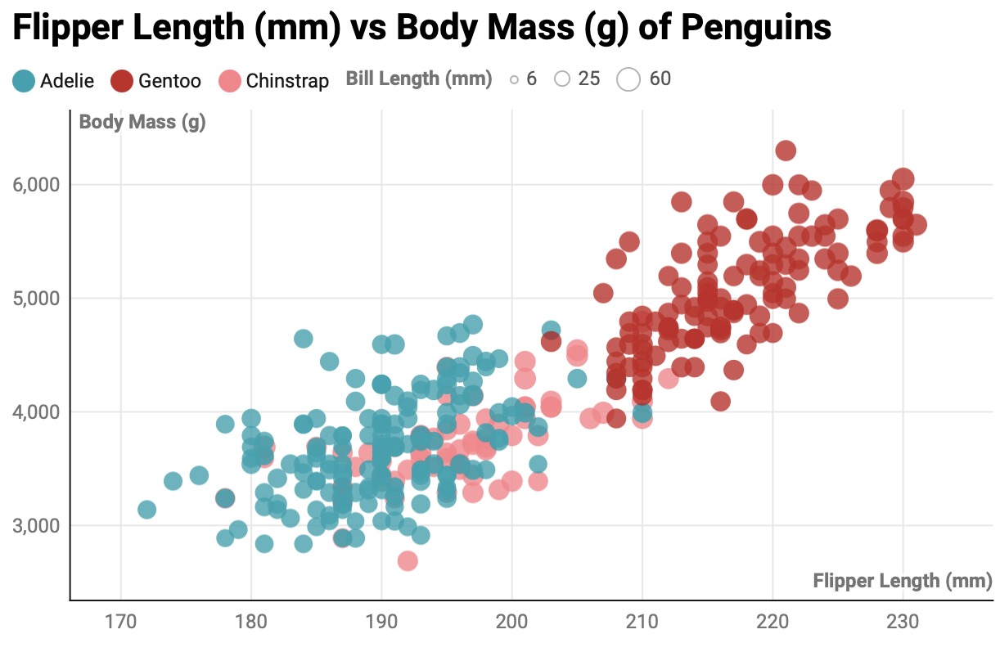

Assignment 2 - Data Visualization, 5 Ways  (+1)
===
## 1. R + ggplot2 

R is a language primarily focused on statistical computing, while ggplot2 is a popular library for charting in R . 
To visualize the penguins dataset, I made use of ggplot2's `geom_point()` layer, with aesthetics functions for the color and size (both lines kept from original README, since they are accurate to me as well).
Truthfully, it took longer to actually download R than to make the graph. I referenced [this](https://r-graph-gallery.com/274-map-a-variable-to-ggplot2-scatterplot.html)
to make the graph, and it was fairly easy! The additional work that had to be done was learn how to read the csv, which ended up being one line.
I learned online that R/ggplot automatically does not map nulls, but regardless, I used a function `na.omit` to remove those values anyways.
R is the most popular choice for statistical analysis.

## 2. d3 (JavaScript)

D3 definitely took the longest, and honestly, did not really feel like it was worth it. The graph I had done was D3, and after doing the rest, 
I was stunned at how much longer it took me to do D3 than all the others. It definitely had more to play with: I found that everything
was more malleable to edit (at least since everything was created basically separately, as opposed to other libraries/tools where it takes is a function).
Even with following [this article](https://d3-graph-gallery.com/graph/custom_theme.html), I still felt like there was a lot to change.
Getting the CSV and parsing it took more time because it was the only tool/library where the graph would not appear *unless* I removed the nullable values.
D3 was also one of the few libraries where I had to manually create and move around the legend, which I found tedius.
It does mean there's more that can be edited and for more complex or unique visualizations it's definitely a top choice, 
but when creating something simple like this scatterplot, I don't think it is worth the time or effort.

## 3. Altair (Python)

Altair also did not take that much time from me. I did have some complications with getting python to work
on my computer, but I would say that took longer that actually creating the visualization (similar to R).
Altair also does not need for me to manually remove the null values, but truthfully I did it anyways.
Following [this](https://altair-viz.github.io/getting_started/starting.html) documentation, I was able to 
quickly create the base graph. Honestly (and this goes for altair, vega-lite, and ggplot), I felt like
I spent most of the time figuring out the different aspects of customization than actually creating the base visualization.
D3 was the opposite, where I spent more time figuring out how to visualize it, while customizing came easier. 
This tool would definitely excel if on a Python-sort of environment, like Jupyter Notebook.
It felt weird working on it in Webstorm (but it still worked, I just never really associated 
Webstorm with Python in general). Altair/Python was also the only environment where I had to make it
create its own html to actaully show the visualization, rather than just displaying it on its own (or have R
create it when I make the run button, and having it show up on the side of my screen).

## 4. Vega-Lite (JavaScript)

Vega-Lite definitely felt interesting, it was really just JSON syntax. I used 
[this](https://vega.github.io/vega-lite/tutorials/explore.html) as my guide as I created the graph. This one required more work
than the tools + altair + ggplot, naming parsing the csv and making sure the columns that I needed for x and y axis
as well as the size where numbers. Additionally, I found it interesting how I had to code to differeniate whether a column
was nominal or quantitative. However, unlike D3, there was no need to manually parse for 
null values here either. It was fairly simple to create, I will note I did get confused along
the way of why some things (like legend or scale) needed to be in quotation marks while others didn't.
Vega-Lite would definitely be useful for more lightweight apps (since that's what it is designed for).

## 5. Tableau (Tool)

This was my first time using to Tableau, so truthfully I struggled a bit. While it was simple once I knew where
everything was, a big part of my confusion was when I'd go to drag an attribute of the CSV file to put in row/column, and 
it would put the sum of it. Of course, it was an easy fix, but I didn't particularly enjoy that it was the default setting.
Additionally, choosing custom colors on Tableau was by far the most tedious in comparison to the rest of the visualization tools/libraries.
Perhaps I wasn't looking in the correct spot, but making a whole custom palette just for this one instance feels like a lot.
Tableau didn't really like their customizations were easy to come by, but at least the tooltip is already built in.
Tableau is most useful for business intelligence or more non-technical dashboards. Since it requires no coding,
the barrier to learn it is lower than any of the libraries.

## 6. Data Wrapper (Tool)

I was shocked at how fast it was to create the graph, customized, in DataWrapper. It definitely falls short
on customization, only giving a few settings to change, but for the task at hand, it handled everything pretty well.
The tooltip was already built in here either, and it was interesting looking at how the type of colorblindness
could affect how the graph looks like to them. I accidentally misunderstood that setting, and actually ended up making
all my graphs how a person with tritanopia sees a red, orange, and blue chart (regardless, I feel like these colors
are nice). It's definitely the most limiting tool in terms of customization, but it was definitely the fastest to create.

## Technical Achievements
Except R+ggplot, all graphs feature a tooltip. This allows user to be able to hover over a specific point and 
see what the other attributes of that point are (to the exact number). Additionally, all graphs feature a legend and background
grid. Also, not sure if this counts as a technical achievement, but I made an extra graph (so I have 6 total, instead of 5).
Finally, the Altair graph is interactive, and allows zoom in to better see parts of the graph. 

### Design Achievements
As far as design went, it was mostly a matter of keeping the colors consistent across all the charts. I will say I chose the color scheme
because I thought that it was the colors that would show easily for a person with tritanopia, but it turns out it was just how 
a person with that type of colorblindness would see the original colors I had selected. Regardless, I liked the colors and I thought 
it would be nice to show it for all graphs to keep them consistent, having the same species be linked to the same color
regardless of the graph. Additionally, I made sure that the legend titles were all uppercase, and did not include the underscores from the 
original `bill_length_mm`.