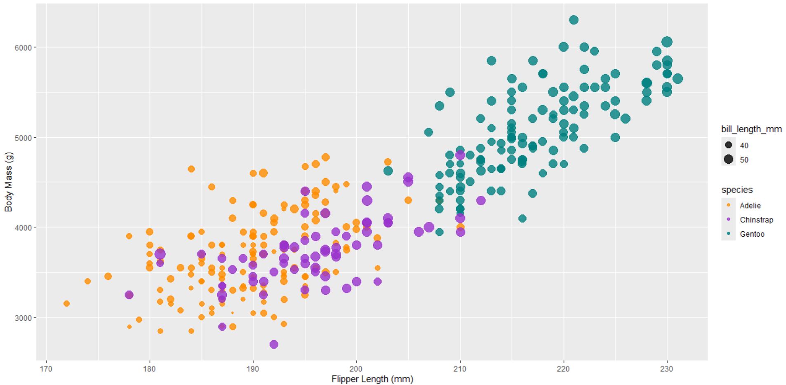
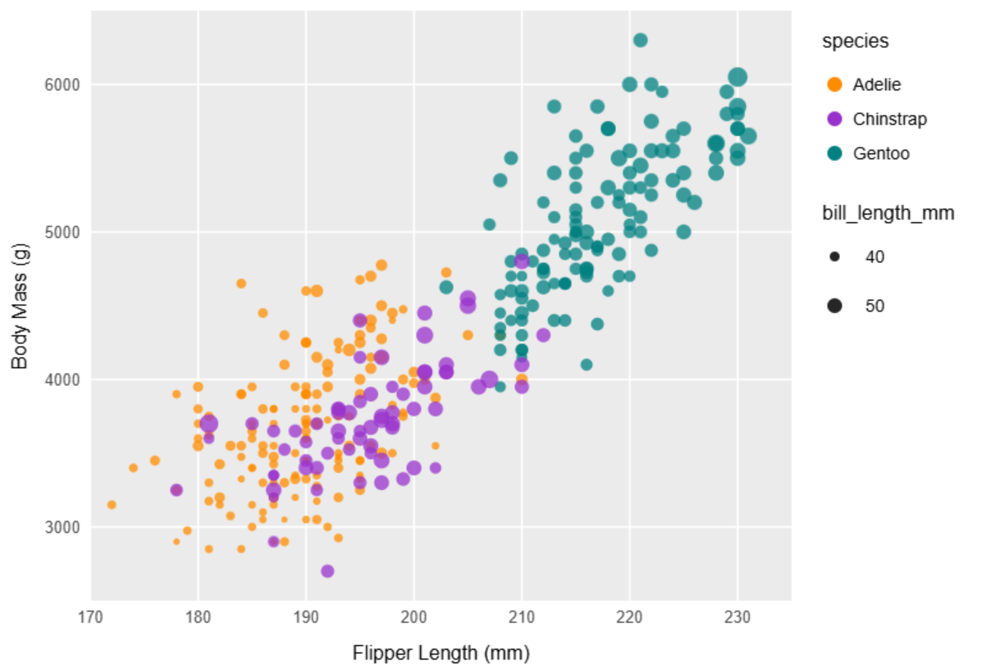
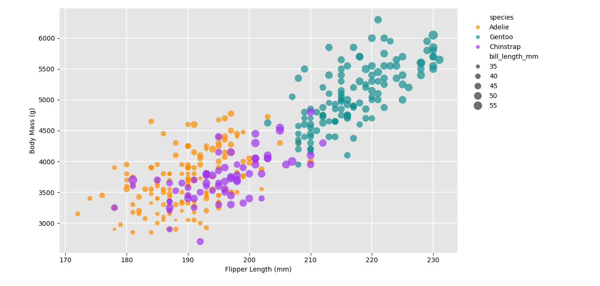
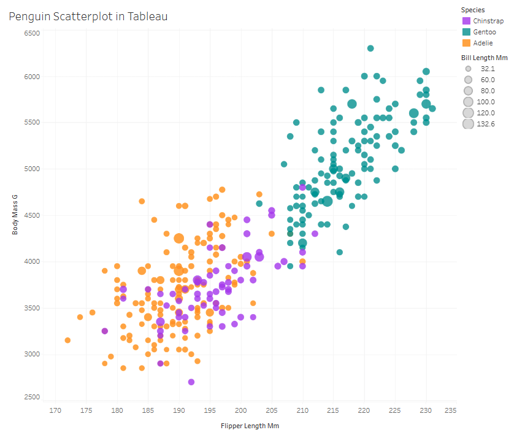
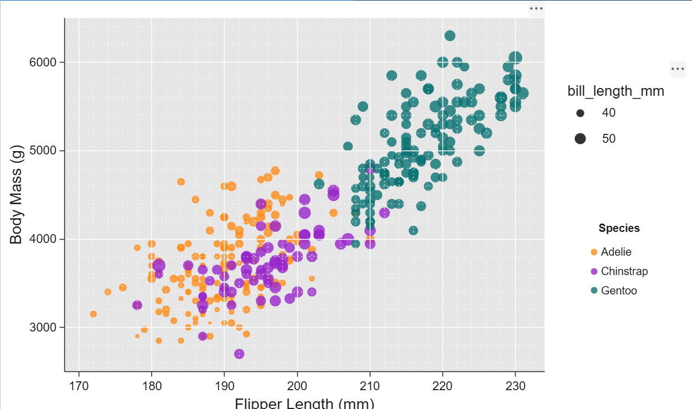

# Penguin Scatterplot: Recreating a Reference Chart in Four Tools

This project recreates a reference scatterplot of the Palmer Penguins data in four tools. The chart plots **flipper length (mm)** on x and **body mass (g)** on y. Color encodes **species** and point size encodes **bill length (mm)**. The reference chart is an R/ggplot2-style plot with a light gray panel, white gridlines, semi-transparent points, and an orange / purple / teal palette. 

Here are the 5 tools/software I used:
1. R (ggplot2)
2. Javascript
3. Python (seaborn)
4. Tableau
5. Matlab

---

# R (ggplot2)

ggplot2 was the easiest tool to match to the reference, because the reference's look (gray panel, white grid, legend layout) is ggplot2's default theme. A single `geom_point()` call with `aes(color = species, size = bill_length_mm)` plus `alpha` covers most of the chart. Some parts were setting the manual color palette, choosing the size range so the legend shows 40 and 50, and fixing the legend order so `bill_length_mm` sits above `species`. It is the tool I would reach for in the future for fast exploratory plots and for static, publication-style figures.

---

# Javascript

Seaborn brings ggplot2's grammar of graphics to Python and by far the most manual work that had to be done, so the code translates almost line for line from R, and the output looks nearly identical to the reference. The main differences were in the details: the legend order puts `species` first, and the point sizes and alpha needed tuning to match the original. This is useful when I want ggplot-style charts inside a Python/pandas workflow without switching languages. Also, Seaborn automatically filters out the null values so that it is not part of the visualization.

---

# Python (seaborn)

Seaborn brings ggplot2's grammar of graphics to Python. The gray background and white grid had to be set by hand (or via the `ggplot` style), and species colors needed one `scatter` call per species or a color mapping. The size legend also needed manual handling: it shows five size entries (35 to 55), where the reference shows only two. The species legend ended up ordered Adelie, Gentoo, Chinstrap rather than matching the reference. Seaborn is the right choice when a chart needs heavy customization or has to embed in larger Python programs.

---

# Tableau

Tableau was the quickest to get a working chart: drag flipper length and body mass onto the axes, species onto color, and bill length onto size. It was the hardest to match the reference exactly. Tableau's default look is white with faint gridlines, it adds a chart title, and it auto-formats axis titles ("Flipper Length Mm"). The size legend (32.1 to 132.6) did not match the reference because the measure was aggregated, which suggests it needed to be set to a dimension or the aggregation turned off. Point sizes also come out less varied than in the reference. Tableau is most useful for interactive dashboards and for sharing exploration with non-programmers.

---

# Matlab

MATLAB gave me a close match to the reference, but it took more manual setup than the other tools. A basic scatter with color by species and size by bill length was quick to produce. Getting the reference look took extra work: a light gray panel, white gridlines (with faint dotted minor gridlines), semi-transparent markers and the orange, purple and teal palette. The size and color encodings also needed separate legends, so the bill length legend (40 and 50) sits apart from a bold-titled species legend. I’d use MATLAB in the future for numerical or scientific work where the data already lives in MATLAB, since the plotting sits next to the analysis and gives fine control over every graphical property. 

---

# Technical Achievements

- Reproduced the same chart across four tools (R, plotnine, matplotlib, Tableau) from the same dataset, mapping three variables to position, one to color and one to size.
- Encoded a fifth variable by combining color (species) with size (bill length) in a single scatterplot.
- Used semi-transparent points (alpha) so overlapping penguins in the dense Adelie/Chinstrap region remain readable.
- Customized legends (order, breaks, labels) and axis titles with units to match the reference.
- The greatest achievement came in Tableau, where you can hover over species, island, and measurements, and you can filter them if you want specifics.

# Design Achievements

- **Consistent color choice:** the same three colors map to the same species in every tool (orange = Adelie, purple = Chinstrap, teal = Gentoo), chosen to be distinguishable and to avoid red/green confusion.
- **Matched visual style:** gray panel, white gridlines and a clear sans-serif font match the reference across the ggplot2, plotnine and matplotlib versions.
- **Marker sizing and transparency:** point sizes were scaled so bill length is noticeable without hiding neighboring points, and alpha reduces overplotting.
- **Clear labeling:** axis titles include units (mm, g) and legend titles name the encoded variables.
- **Observed differences by tool:** Tableau's lighter grid, auto-generated title and different size legend show how each tool's defaults shape the final design.
