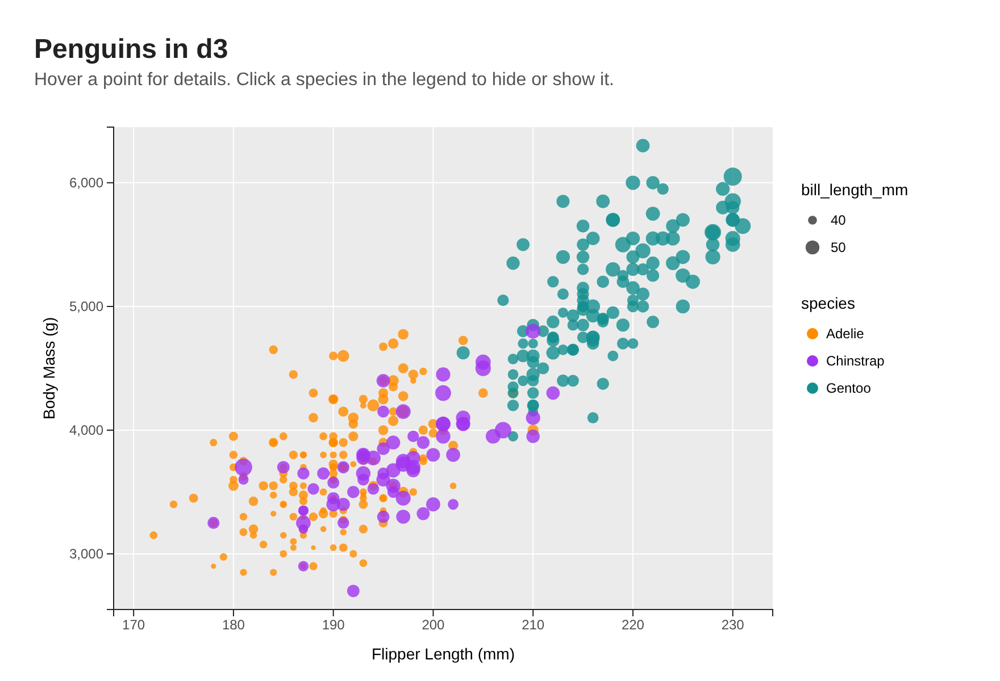
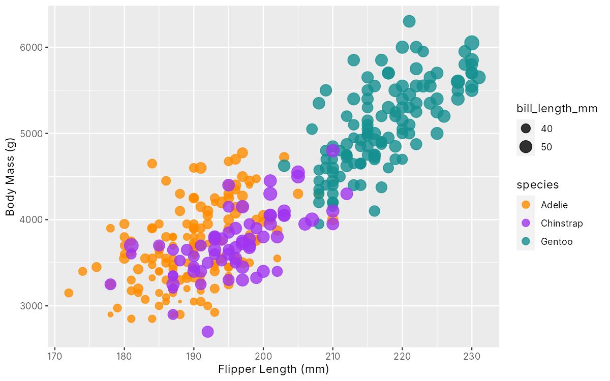
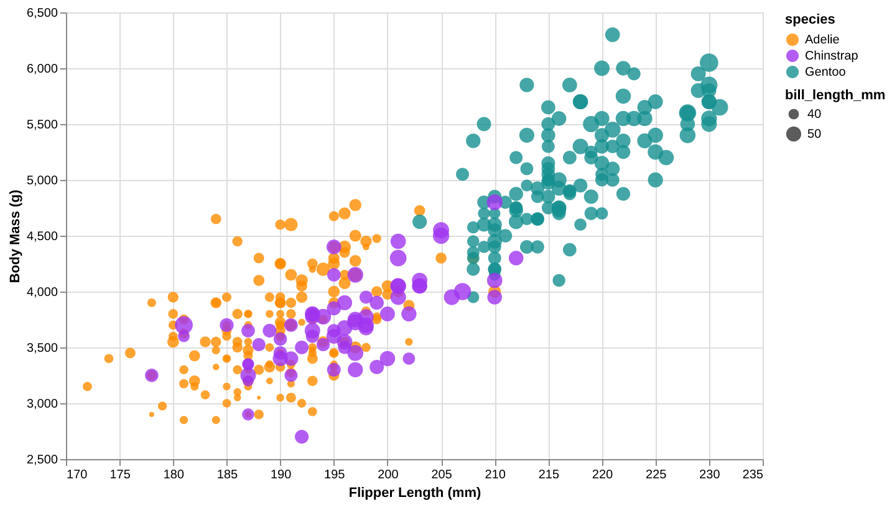
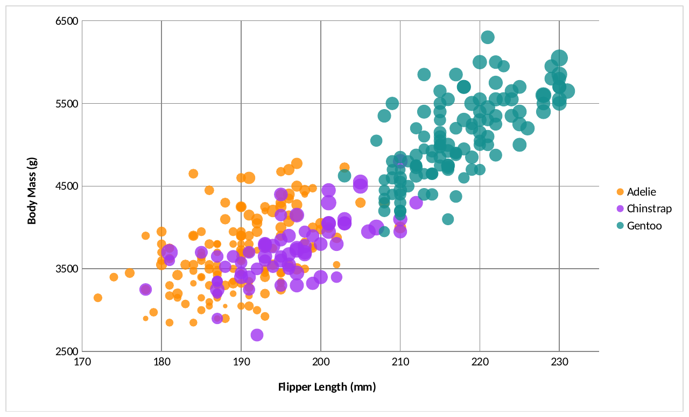
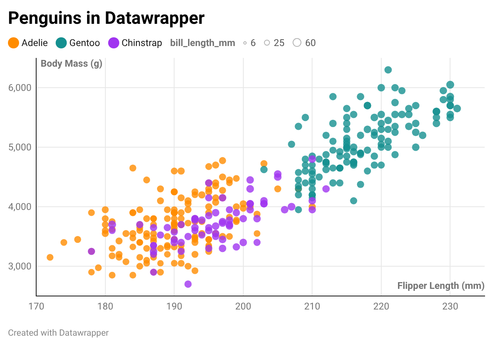

# Assignment 2: Data Visualization, 5 Ways

I made the penguin scatterplot five ways: three code libraries (**d3, ggplot2, Altair**) and two tools (**Excel, Datawrapper**). All five use the same colors and drop the rows with missing data, leaving 342 penguins. Each one has its own folder, and screenshots are in `img/`.

# d3

The most work by far, since I had to build every scale, axis, gridline and legend by hand. The tricky part was loading the data: `d3.csv` is async, so all the drawing has to happen inside `.then()`, and "NA" values turn into `NaN` so I filtered them out first. The payoff is full control, so I added hover tooltips, a clickable legend and an animated load. Best for custom, interactive charts on the web.

Run: `python -m http.server` in the repo root, then open http://localhost:8000/d3/

# R + ggplot2

The easiest one, since the original chart was made in ggplot2. One `geom_point()` call with color and size mapped, and ggplot handles the legends and gray background on its own. I only had to set my colors and filter the NA rows. Great for quick static charts for stats or research.

Run: `Rscript r-ggplot/plot.R`

# Altair

Feels like ggplot for Python. The one hack was that the size scale starts at 0 by default, which made every circle look the same size, so I set `zero=False`. Adding interaction was really easy: zoom, pan, and click a species in the legend to highlight it. Good for exploring data in notebooks.

Run: `python python-altair/chart.py` (needs `pip install altair vl-convert-python pandas`)

# Excel

I used a bubble chart since Excel has no sized scatterplot. It needed the most hacks: each species is its own series to get the colors, a helper column (bill length minus 30) makes the size differences show, and an invisible giant bubble off the chart shrinks the real bubbles down. Excel bubble charts also have no size legend. I built the file with a Python script so it's easy to rebuild, but it's a normal editable Excel chart. Fine for quick charts, but it fights you on anything past the basics.

# Datawrapper

A free no code website: upload a CSV, pick Scatter Plot, and set everything with dropdowns. It was the fastest way to get a good looking chart, and it has hover tooltips built in. I had to remove the NA rows first (`datawrapper/clean.py`) and rename columns to get proper axis titles. The color by column option was hidden behind "Customize colors." Its one weak spot is size: it starts at 0, so the bill length differences are hard to see. Good for fast, clean charts for reports or articles.

# Technical Achievements

* **Interactivity in three tools:** d3 has tooltips, a clickable legend and an animated load. Altair has zoom, pan and legend highlighting. Datawrapper fades out other species when you hover one in the legend.
* **Fixed the size scale** in Altair and Excel so bill length differences actually show.
* **Excel built from a script,** including editing the chart's XML to set 80% opacity, which the library can't do.
* **Clean data everywhere:** all five charts show the same 342 penguins.

# Design Achievements

* **Channels chosen on purpose** (from the Visual Channels lecture): the two main values go on position, the most accurate channel. Species gets color, which pops out at a glance. Bill length gets size, the least precise one.
* **Size scaled by area, not radius,** since people underestimate area (Stevens' power law).
* **Same colors in all five tools:** orange Adelie, purple Chinstrap, teal Gentoo.
* **80% opacity** so the overlapping Adelie and Chinstrap points stay visible.

# Sources

* Written from scratch using the d3, ggplot2, Altair and openpyxl docs.

